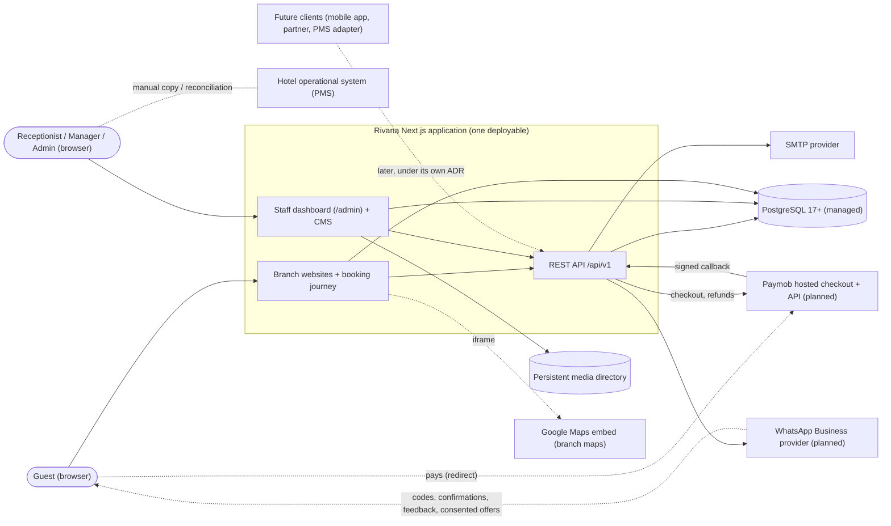
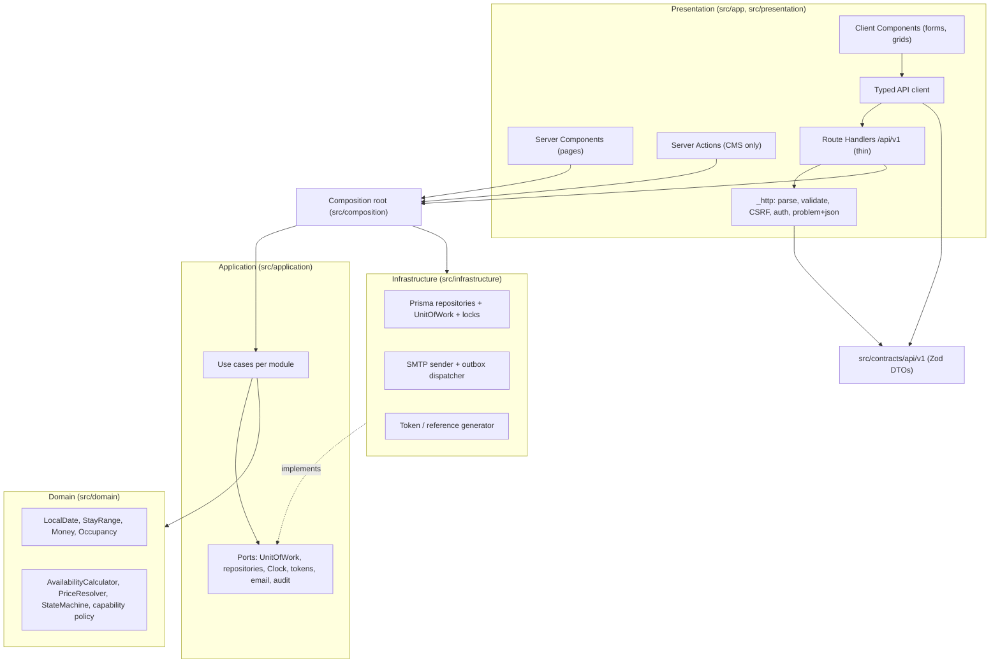
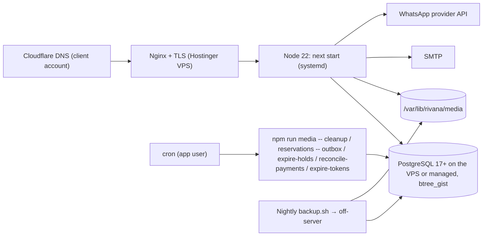

# Architecture overview

Rivana is **one deployable Next.js application**, a modular monolith. The public website, the booking journey, the staff dashboard (content management and reservation operations), and the REST API share one codebase, one database, one authentication system, and one design system. Module boundaries are enforced in source by lint rules and architecture tests, not by separate services. A separate CMS, booking service, or API server would duplicate deployment, authentication, schema, and UI without a business need (ADR 001, ADR 014).

Status: everything described here for content, media, enquiries, promotions, and staff accounts is **implemented** (single site; the promotion popup is retired and removed in M5). Branch websites, inventory, pricing, services, coupons, VAT, reservations, Paymob payments, WhatsApp messaging, the `/api/v1` REST API, and audit are **planned** (milestones M4–M13, replanned 2026-11-06). Diagrams show both, and planned parts are labelled where it matters.

## System context



There is **no data link** between Rivana and the PMS. The dotted line is people.


## Layers and dependency rule

Dependencies point inward:

```text
presentation (src/app, src/presentation) -> application -> domain
infrastructure ----------------------------^ implements application ports
composition: the only place infrastructure is constructed and wired
```

- **Domain:** concepts, value objects, invariants, and pure rules (publication readiness, availability arithmetic, price resolution, the reservation state machine). No Next.js, React, Prisma, storage SDK, or HTTP imports.
- **Application:** use cases, DTOs, authorization (`authorize`, `authorizeBranch`), transaction boundaries, and ports such as `RoomRepository`, `MediaStorage`, `ContactDelivery`, `BookingProvider`, and `ReservationUnitOfWork`.
- **Infrastructure:** Prisma repositories and transactions, inventory locks, local media storage, image processing, SMTP, Better Auth, cache invalidation, token generation.
- **Presentation:** App Router pages and layouts, Server and Client Components, Server Actions, Route Handlers, the typed API client, and view mapping.

Pragmatism rule: a module earns separate domain and application files when it has invariants or replaceable infrastructure. Pure presentational mapping does not need ceremonial classes. The exact, enforced rules are in [dependency-rules.md](./dependency-rules.md); the module list is in [module-boundaries.md](./module-boundaries.md); the source tree is in [project-structure.md](./project-structure.md).

## Application architecture



- Pages (Server Components) call use cases through the composition root. They do not call their own API (ADR 014).
- Client Components mutate reservation data only through the REST API, using the typed client.
- CMS forms keep using Server Actions.


## Request paths

### Public read

1. A Server Component calls an application query through the composition root.
2. The query uses repository ports and returns a view-safe DTO.
3. The Prisma adapter maps rows into the DTO.
4. The route renders on the server and may cache the result under content tags.
5. Client islands add only menu, gallery, lightbox, motion, and form behavior.

Server Components never call the application's own REST API; that would be an extra HTTP round trip that Next.js documents as an anti-pattern.

### Content changes (staff, Server Actions)

1. A form in the dashboard submits to a same-origin Server Action.
2. The action resolves the staff session; the use case checks the capability again, since UI protection is never sufficient.
3. Zod parses `FormData` into a command.
4. The use case enforces invariants and calls a repository transaction.
5. Relevant cache tags are invalidated, and a typed result returns to the form.

### Reservation operations (guests and staff, REST)

1. A Client Component calls `/api/v1/...` through the typed API client (`src/contracts` schemas).
2. The Route Handler's shared `_http` layer checks method, content type, size, CSRF (staff), rate limits (public), and parses the body with Zod.
3. One use case runs, authorizes with capability and branch scope, and performs its unit of work: lock, check, write, audit, outbox.
4. The result maps to JSON or `application/problem+json` ([../api/rest-api-conventions.md](../api/rest-api-conventions.md)).

Route Handlers are used where HTTP is the real boundary: the reservation API, authenticated media upload (`/admin/media/upload`), media delivery (`/media/[...key]`), and future provider callbacks.

## Server and Client Components

Server Components: all page shells and content reads; room and facility lists and details; booking search results (the search form is a plain GET form); metadata and JSON-LD; dashboard data loading; capability-aware navigation.

Client Components only where browser state or events are required: mobile navigation; gallery and lightbox; reduced-motion-aware reveals; React Hook Form admin forms with repeatable fields; upload progress and media pickers; confirmation dialogs and toasts; the booking details and review form; staff reservation actions and the availability grid.

Client Components receive serializable DTOs, never database records or Prisma types.

## Data and provider boundaries

- Content repositories (`Room`, `Facility`, `Page`, `Settings`, `Media`, `Enquiry`, `Branch`) hide Prisma. Page, listing, and facility queries take a branch id the server resolved (M5); the promotion repository was removed in M5.
- `MediaStorage` exposes write, finalize, delete, and open operations without local-path or S3 types. Production writes immutable objects below a persistent directory outside the release tree.
- `ContactDelivery` sends enquiry notifications independently of persistence. Reservation emails reuse its SMTP configuration through an outbox.
- Operations ports (`ReservationUnitOfWork`, `InventoryLock`, `RateRepository`, `RoomTypeCatalog`, and others) are listed in [../domain/domain-model.md](../domain/domain-model.md#application-ports).
- `WhatsAppSender` (planned) sends verification codes, transactional messages, feedback requests, and consented marketing broadcasts through the templates the Admin manages in the dashboard (ADR 028, Q-67); the business number is an Admin setting and the access token a server secret. The provider (Meta Cloud API or a provider such as Twilio, Q-10) stays inside the adapter; secrets are server-only.
- `PaymentGateway` (planned, ADR 025) creates Paymob hosted checkouts, verifies HMAC-signed callbacks, queries transactions, and requests refunds. Paymob SDKs and payloads stay in `src/infrastructure/payments/paymob/`; no card data reaches Rivana.
- `HotelSystemSync` reserves the place for a future PMS integration. It has no adapter; synchronization is manual (ADR 013).
- `Clock`, ids, and tokens are injected where logic needs deterministic tests.

## Book Now entry point

All Book Now controls (header, listing cards, listing detail, mobile bar) use one shared component driven by the `BookingProvider` port. Pages pass only context (placement, branch, listing slug); they never build booking URLs.

- **Today (implemented):** `DisabledBookingProvider` returns "not available". Each control is a real `<button>` with `aria-disabled`, focusable, with an accessible explanation of how to book by phone or contact. There is no fake date picker, price, calendar, or success state.
- **Planned (M10):** the provider gains an internal mode. For a listing whose branch is active, has online booking enabled, and is bookable (IN-4), Book Now opens `/{branchSlug}/book` with the listing preselected. Otherwise the disabled behavior stays, so switching a branch's online booking off needs no deploy.
- Analytics events, if analytics is approved: `booking_cta_view`, `booking_cta_click`, never with guest-entered data.

## Caching and publication

- Published content uses Next.js cache tags, branch-qualified since M5 (spec 0002): `site-settings`, `sitemap`, `branches` (the active branch list and branch view models), and per branch `branch:{slug}:page:{key}`, `branch:{slug}:stay`, `branch:{slug}:stay:{roomSlug}`, `branch:{slug}:facilities`, `branch:{slug}:facility:{slug}`. Every `unstable_cache` key names its branch. Mutations invalidate only their own branch's tags, plus the sitemap when publication or slugs change, plus `branches` when a branch's published listing types or facilities change. An edit to one branch never expires another branch's tags (tested).
- Dashboard views, availability, quotes, payment status, and everything under `/api/v1` are dynamic and never cached.
- Draft and unpublished records never appear in public queries.

## Error handling

- Expected outcomes (validation, conflict, not found, forbidden) return typed `Result` values. Forms show them per field; the API maps them to problem+json ([../api/error-model.md](../api/error-model.md)).
- Unexpected failures are logged server-side with a request id and show a safe generic message.
- Missing public content uses `notFound()`.
- Media uploads cannot be atomic with the database, so they use explicit `PENDING`, `READY`, and `FAILED` states with idempotent finalization and scheduled cleanup. Reservation emails use an outbox for the same reason.

## Inventory transaction (concurrency strategy)

```mermaid
sequenceDiagram
  participant A as Request A (guest)
  participant B as Request B (receptionist, external)
  participant DB as PostgreSQL
  A->>DB: BEGIN; SELECT Room(T) FOR NO KEY UPDATE
  B->>DB: BEGIN; SELECT Room(T) FOR NO KEY UPDATE
  Note over B,DB: B waits for A's lock
  A->>DB: count capacity/sold → free = 1 → INSERT reservation
  A->>DB: COMMIT (lock released)
  DB-->>B: lock granted
  B->>DB: count capacity/sold → free = 0
  B->>DB: ROLLBACK → 409 INVENTORY_UNAVAILABLE (cross-system conflict shown)
```

## Deployment topology




## Technology baseline

- Next.js 16.3 / React 19.2: App Router, Server Components, metadata, image optimization, Route Handlers.
- Node.js 22 LTS (CI and hosting).
- TypeScript 5.9 strict.
- PostgreSQL 18 (17 as the managed-provider minimum; `btree_gist` for reservations).
- Prisma ORM 7.10 with the pg driver adapter, isolated in infrastructure, with a UTC session on every connection.
- Better Auth 1.7.6: closed email and password staff accounts, database sessions.
- Tailwind CSS 4.3 with CSS custom-property tokens; `motion` for animation.
- Zod at every external input and configuration boundary.
- React Hook Form for complex admin forms only.

Exact versions are pinned (`save-exact`). Preview and release-candidate dependencies are not used.

## Decision map

| Concern | Decision | ADR |
| --- | --- | --- |
| Application shape | One Next.js App Router modular monolith | 001 |
| Database and ORM | PostgreSQL; Prisma isolated in infrastructure | 002, 003 |
| Authentication | Better Auth, closed staff accounts, database sessions | 004 |
| Media | Persistent local storage behind `MediaStorage` | 005 |
| Content | Typed, allowlisted page sections plus structured entities | 006 |
| Dashboard | One admin route group for content and operations | 007 |
| Rendering | Server Components by default; narrow client islands | 009 |
| Styling and motion | Tailwind tokens; `motion`; View Transitions | 010, 012 |
| Hosting | Hostinger VPS: Node under systemd, Nginx, local media; portable adapters | 023 (supersedes 011), 022 |
| Reservations | Self-managed; manual PMS sync; integration port without adapter | 013 (supersedes 008) |
| API | REST under `/api/v1`, problem+json, OpenAPI from Zod | 014 |
| Module structure | Layered tree with per-module folders; `src/contracts`; unit of work | 015 |
| Inventory | Room-type counts plus row lock; exclusion constraints | 016 |
| Branches | Branch-owned rows; composite foreign keys; branch websites at `/{branch}/…` | 017, 026 |
| Authorization | Capabilities plus branch assignments | 018 |
| Guests | Verified phone profiles by WhatsApp code; blocking; no accounts | 019 |
| Confirmation | Website bookings confirmed immediately when inventory (and payment) is secured; cancellation requests | 024 |
| Payments | Paymob hosted checkout, holds, verified callbacks, refunds | 025 |
| Price composition | Date prices, services, coupons, VAT; popup retired | 027 |
| Guest messaging | WhatsApp confirmations, feedback, consented broadcasts | 028 |
| Dates and money | `DATE`, branch time zone, US dollars as integer cents | 020 |
| Testing | Real-database integration and concurrency tests | 021 |
