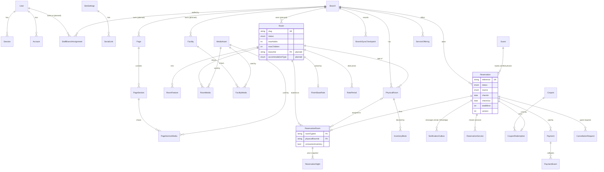

# Data model

PostgreSQL is the system of record for content, staff identity, enquiries, promotions (retired), media metadata, and (planned) branches, inventory, prices, services, coupons, VAT, reservations, payments, and marketing consent. Card data is never stored (Paymob hosted checkout, ADR 025). Binary images live in the configured media store (a persistent server directory). Prisma is the migration and persistence adapter, not the domain model; it is imported only under `src/infrastructure/db`.

The implemented schema is `prisma/schema.prisma` (3 migrations). Tables marked *planned* are specified here and added by milestone migrations ([migrations-and-seeding.md](./migrations-and-seeding.md)).

## Conventions

- IDs are application-generated CUID2 strings (`VARCHAR(32)`); do not mix strategies. The `SiteSettings` singleton uses the fixed key `default`.
- Instants are `timestamptz(3)` in UTC, formatted in the presentation layer. Every Prisma connection sets `-c TimeZone=UTC`, because the pg adapter exchanges instants as zone-less UTC wall time (see `src/infrastructure/db/prisma/client.ts`).
- Stay dates are `DATE`, never instants (ADR 020). Money is `INTEGER` minor units (cents) with a `currency` column; the currency is USD.
- Strings are bounded `VARCHAR`s. Room size is `NUMERIC(6,2)` square metres, mapped to `number` at the repository boundary.
- Rich text is a strict structured JSON document, not raw HTML.
- Slugs are lower-case ASCII and immutable by default after publication; changing one requires an explicit redirect decision.
- `CHECK`, exclusion, and partial-index constraints that Prisma cannot express live in SQL migrations, with a comment.
- Deletes are `RESTRICT` unless a child is owned outright.

## Tables at a glance

| Area | Tables | Status |
| --- | --- | --- |
| Staff identity | `User`, `Session`, `Account`, `Verification`, `LoginThrottle` | Implemented; `User.role` gains values and `StaffBranchAssignment` is planned (M4) |
| Site and pages | `SiteSettings`, `SocialLink`, `Page`, `PageSection`, `PageSectionMedia` | Implemented; `Page.branchId` planned (M4) |
| Rooms and facilities | `Room`, `RoomFeature`, `RoomMedia`, `Facility`, `FacilityMedia` | Implemented; `Room.branchId`, `Room.accommodationType`, `Facility.branchId` planned (M4) |
| Media | `MediaAsset` | Implemented |
| Marketing and enquiries | `Promotion` (retired, Q-47; unused from M5, dropped later), `ContactEnquiry` | Implemented; `ContactEnquiry.branchId` planned (M4) |
| Branches | `Branch`, `StaffBranchAssignment` | Planned (M4) |
| Inventory | `PhysicalRoom`, `InventoryBlock` | Planned (M6) |
| Pricing | `RoomBaseRate`, `RatePeriod` (M6); `ServiceOffering`, `Coupon`, `CouponBranch`, `CommercialSettings` (M7) | Planned |
| Reservations | `Reservation`, `ReservationRoom`, `ReservationNight`, `ReservationService`, `CouponRedemption`, `BranchSyncCheckpoint` | Planned (M8) |
| Payments | `Payment`, `PaymentEvent`, `CancellationRequest` | Planned (M9) |
| Guests | `Guest` (verified phone profiles, blocking, marketing consent), `PhoneVerification` | Planned (M8) |
| Messaging settings | `WhatsAppSettings`, `WhatsAppTemplate` (Admin-managed, Q-67) | Planned (M8) |
| Marketing | `Broadcast` | Planned (M13) |
| Cross-cutting | `AuditEvent` (M4), `NotificationOutbox` (M8) | Planned |

## Content and identity tables

### `SiteSettings`

Purpose: one record for global identity and defaults.

Important fields:

- `id` fixed to `default` or protected by a singleton unique key;
- `timeZone` as a required IANA identifier (initially `Africa/Cairo`) for promotion scheduling and editorial date display;
- `siteName`, `tagline`, `phone`, `email`, `addressLine1`, `addressLine2`, `city`, `country`;
- `latitude`, `longitude`, `mapEmbedUrl` (optional, allowlisted/validated);
- `footerText`, `defaultSeoTitle`, `defaultSeoDescription`;
- `logoMediaId`, `stickyLogoMediaId`, `faviconMediaId` nullable until setup;
- `updatedAt`, `updatedById`.

Relationships: optional media references, many `SocialLink` rows, updater `User`.

Constraints/indexes: singleton key unique; email validation in application; foreign keys use `RESTRICT` for media.

### `SocialLink`

Purpose: ordered, editable social profiles.

Fields: `id`, `siteSettingsId`, `platform`, `label`, `url`, `sortOrder`, `isVisible`.

Constraints: unique `(siteSettingsId, platform)` and `(siteSettingsId, sortOrder)`; supported platform allowlist in Zod/domain.

### `Page`

Purpose: metadata/container for required editorial routes.

Fields: `id`, `key` (`HOME|ABOUT|CONTACT`), `title`, `seoTitle`, `seoDescription`, `ogMediaId`, `canonicalPath`, `isPublished`, timestamps, `updatedById`.

Relationships: many `PageSection`; optional OG media.

Constraints/indexes: unique `key`; unique `canonicalPath`; index `isPublished` is not important at this scale but may be combined with key by the unique constraint.

### `PageSection`

Purpose: an ordered instance of an approved section type.

Fields: `id`, `pageId`, `type`, `heading`, `eyebrow`, `payload Json`, `sortOrder`, `isVisible`, timestamps.

Relationships: many `PageSectionMedia`.

Constraints/indexes: unique `(pageId, sortOrder)`; index `(pageId, isVisible, sortOrder)`; type/payload validated on every write. The JSON payload contains only section-specific structured text/config, never arbitrary executable HTML or media URLs.

### `PageSectionMedia`

Purpose: referentially safe section-to-media association.

Fields: `sectionId`, `mediaId`, `role` (`BACKGROUND|PRIMARY|GALLERY|DECORATIVE`), `sortOrder`, optional `altOverride`.

Constraints/indexes: composite primary/unique identity; unique `(sectionId, role, sortOrder)`; indexes on `mediaId` for usage checks.

### `Room`

Purpose: accommodation marketing record.

Fields: `id`, `name`, `slug`, `shortDescription`, `description Json`, `sizeSqm Decimal?`, `maxAdults Int`, `maxChildren Int`, `bedSummary`, `viewSummary`, `featured`, `sortOrder`, `status`, `seoTitle`, `seoDescription`, `ogMediaId`, timestamps, `updatedById`.

Relationships: many `RoomFeature`, many `RoomMedia`, optional OG media.

Constraints/indexes:

- unique `slug`;
- unique `sortOrder` among active display records (enforced transactionally if partial uniqueness is inconvenient in Prisma);
- check constraints via SQL migration: `maxAdults >= 1`, `maxChildren >= 0`, `sizeSqm IS NULL OR sizeSqm > 0`;
- indexes `(status, sortOrder)` and `(featured, status, sortOrder)`.

`Room` holds marketing fields only. Its branch, physical rooms, prices, and reservation lines are separate tables that reference it (planned, below).

### `RoomFeature`

Purpose: manageable ordered feature list for a room.

Fields: `id`, `roomId`, `label`, `iconKey?`, `sortOrder`.

Constraints/indexes: unique `(roomId, sortOrder)`; index `roomId`; cascade delete with a hard-deleted room.

### `RoomMedia`

Purpose: ordered room gallery and hero selection.

Fields: `roomId`, `mediaId`, `role` (`HERO|GALLERY`), `sortOrder`, optional `altOverride`.

Constraints/indexes: unique `(roomId, role, sortOrder)`; index `mediaId`; application transaction guarantees exactly one hero for a published room.

### `Facility`

Purpose: facility/amenity marketing record.

Fields: `id`, `name`, `slug`, `shortDescription`, `description Json`, `openingHoursText?`, `featured`, `sortOrder`, `status`, SEO fields, `ogMediaId`, timestamps, `updatedById`.

Relationships: many `FacilityMedia`; optional OG media.

Constraints/indexes: unique `slug`; indexes `(status, sortOrder)` and `(featured, status, sortOrder)`.

### `FacilityMedia`

Purpose: facility hero/gallery association.

Fields and constraints mirror `RoomMedia`; publication requires one hero.

### `MediaAsset`

Purpose: metadata and lifecycle for a stored object.

Fields:

- `id`, `storageProvider`, `storageContainer`, `storageKey`, optional `publicUrl` cache;
- `originalFilename`, `mimeType`, `bytes`, `width`, `height`, `checksum`;
- `altText`, `caption?`, `credit?`, `focalX?`, `focalY?`;
- `status` (`PENDING|READY|FAILED|DELETED`);
- timestamps, `createdById`.

`storageKey` is a relative, server-generated key such as `2026/09/<uuid>.webp`; never store an absolute operating-system path or a user-supplied filename as the key. `storageContainer` is a stable logical name such as `local-media`; it does not expose the absolute root and can later hold an object-storage bucket/container name.

Constraints/indexes: unique `(storageProvider, storageContainer, storageKey)`; optional unique checksum for deduplication; indexes `(status, createdAt)` and normalized filename/search support if later needed. `bytes > 0`, dimensions positive for ready images, focal points within 0–1.

### `Promotion`

Status: **implemented; retired by Q-47.** From M5 nothing reads or writes it; it is dropped by a later expand-and-contract migration after launch. Coupons (`Coupon`, below) replace it.

Purpose: scheduled public promotion-code campaign managed by staff.

Fields: `id`, `internalName`, `headline`, `body`, `code`, `terms?`, `status` (`DRAFT|PUBLISHED|ARCHIVED`), `startsAt?`, `endsAt?`, `priority Int`, `showAsPopup Boolean`, `version Int`, `publishedAt?`, timestamps, `createdById`, `updatedById`.

Constraints/indexes:

- check `length(trim(code)) > 0`, bounded field lengths, and `endsAt IS NULL OR startsAt IS NULL OR endsAt > startsAt`;
- index `(status, showAsPopup, startsAt, endsAt, priority)` for the public active-campaign query;
- index `(status, updatedAt desc)` for the admin list;
- use server-side time and a deterministic `priority desc, publishedAt desc, id` order when selecting one public popup.
- start `version` at 1 and increment it when public popup content/code/terms materially change so an updated campaign may display after an earlier version was dismissed.

A promotion never carries a discount amount, eligibility, or redemption data.

### `ContactEnquiry`

Purpose: reliable record of contact-form submissions and delivery outcome.

Fields: `id`, `name`, `email`, `phone?`, `subject?`, `message`, `status` (`NEW|READ|ARCHIVED|DELIVERY_FAILED`), `deliveryMessageId?`, `createdAt`, `readAt?`, `archivedAt?`.

Constraints/indexes: indexes `(status, createdAt desc)` and `createdAt`; field lengths enforced with Zod plus database column limits. Do not store raw IP; store a short-lived rate-limit key outside this table if needed.

### Better Auth tables

Better Auth owns `User`, `Session`, `Account`, and `Verification` schema for its pinned version (1.7.6, migration `20260925141030_auth`). Rivana extends `User` with `role`, `active`, and audit timestamps. Important indexes include unique normalized email (with a lower-case CHECK), unique session token, session expiry, and user foreign keys (cascade). Sessions store no IP address. `LoginThrottle` holds HMAC-keyed failed sign-in counters. Public sign-up is disabled; staff are provisioned with `npm run staff`.

## Operations tables (planned)

### Changes to existing tables

| Table | Change | Why |
| --- | --- | --- |
| `Room` | `+ branchId VARCHAR(32) NOT NULL` → `Branch.id` (`RESTRICT`); `@@unique([id, branchId])`; `@@index([branchId, status, sortOrder])`; `+ accommodationType AccommodationType @default(ROOM)`; `+ bedroomCount Int?`, `+ bathroomCount Int?` (CHECK ≥ 0) | Branch ownership (ADR 017, 026); composite-FK target; rooms and apartments (Q-43) |
| `Facility` | `+ branchId NOT NULL` → `Branch.id`; `@@index([branchId, status, sortOrder])` | Branch-owned facilities (ADR 026) |
| `Page` | `+ branchId NOT NULL` → `Branch.id`; unique `key` becomes unique `(branchId, key)`; unique `canonicalPath` becomes `(branchId, canonicalPath)` | Branch-owned pages (ADR 026) |
| `ContactEnquiry` | `+ branchId` nullable → `Branch.id` | Enquiries per branch contact page |
| `SiteSettings` | contact, address, coordinates, and `mapEmbedUrl` move to `Branch` (columns kept, unused, until a later contract migration) | Brand vs branch split (Q-42) |
| `User` | role enum gains `RECEPTIONIST`, `MANAGER` (`ALTER TYPE "AdminRole" ADD VALUE`) | ADR 018 |
| `LoginThrottle` | no schema change; reused with namespaced HMAC keys (`rsv-create:`, `rsv-lookup:`) for public rate limits | Reuse of an atomic counter store |

No existing column is renamed or dropped in these milestones.

### New tables (sketch)

```prisma
enum BranchStatus       { ACTIVE INACTIVE }
enum AccommodationType  { ROOM APARTMENT }
enum ReservationStatus  { AWAITING_PAYMENT CONFIRMED PAYMENT_FAILED CANCELLED CHECKED_IN CHECKED_OUT NO_SHOW }   // PENDING and DECLINED removed (ADR 024)
enum ReservationSource  { WEBSITE STAFF EXTERNAL }
enum PaymentMethod      { PAY_AT_HOTEL PAYMOB }
enum ReservationPaymentStatus { NOT_REQUIRED AWAITING PAID REFUND_PENDING REFUNDED }
enum NightRateSource    { BASE PERIOD MANUAL }
enum ServiceKind        { BREAKFAST AIRPORT_TRANSFER }
enum CouponKind         { PERCENT FIXED }
enum PaymentStatus      { INITIATED SUCCEEDED FAILED REFUND_PENDING REFUNDED REFUND_FAILED }
enum CancellationRequestStatus { OPEN APPROVED REJECTED REFUND_PENDING REFUND_FAILED COMPLETED }
enum BroadcastStatus    { DRAFT SENDING SENT FAILED }
enum BlockReason        { MAINTENANCE OWNER_USE OTHER }
enum OutboxStatus       { PENDING SENT FAILED }
enum OutboxChannel      { EMAIL WHATSAPP }
enum VerificationPurpose { BOOKING GUEST_SESSION }
enum SyncCheckpointKind { STARTED COMPLETED }

model Branch {
  id                   String       @id @db.VarChar(32)
  slug                 String       @unique @db.VarChar(80)
  name                 String       @db.VarChar(120)
  summary              String?      @db.VarChar(300)
  status               BranchStatus @default(ACTIVE)
  onlineBookingEnabled Boolean      @default(false)
  timeZone             String       @default("Africa/Cairo") @db.VarChar(100)
  currency             String       @default("USD") @db.Char(3)
  phone / email / addressLine1 / addressLine2 / city / country / latitude / longitude   (as SiteSettings)
  checkInTime          String?      @db.VarChar(5)    // HH:MM, branch time zone; required to enable online booking (CX-1)
  checkOutTime         String?      @db.VarChar(5)
  mapEmbedUrl          String?      @db.VarChar(1000) // https://www.google.com/maps/embed… only (Q-52)
  heroMediaId          String?      @db.VarChar(32)   // → MediaAsset RESTRICT
  syncReminderIntervalMinutes Int  @default(30)       // CHECK 10–240 (Q-20)
  syncFollowUpMinutes         Int  @default(10)       // CHECK 5–60 and < interval
  sortOrder            Int
  createdAt / updatedAt / updatedById
}

model StaffBranchAssignment {
  userId      String   @db.VarChar(32)   // → User CASCADE
  branchId    String   @db.VarChar(32)   // → Branch RESTRICT
  createdAt   DateTime @default(now()) @db.Timestamptz(3)
  createdById String?  @db.VarChar(32)
  @@id([userId, branchId])
  @@index([branchId])
}

model PhysicalRoom {
  id         String  @id @db.VarChar(32)
  branchId   String  @db.VarChar(32)
  roomTypeId String  @db.VarChar(32)   // (roomTypeId, branchId) → Room(id, branchId)
  label      String  @db.VarChar(40)   // "204"
  active     Boolean @default(true)
  notes      String? @db.VarChar(500)
  createdAt / updatedAt / updatedById
  @@unique([branchId, label])
  @@unique([id, roomTypeId])            // composite-FK target for assignments
  @@index([roomTypeId, active])
}

model InventoryBlock {
  id             String      @id @db.VarChar(32)
  branchId       String      @db.VarChar(32)
  physicalRoomId String      @db.VarChar(32)
  startDate      DateTime    @db.Date
  endDate        DateTime    @db.Date          // exclusive
  reason         BlockReason
  note           String?     @db.VarChar(500)
  cancelledAt    DateTime?   @db.Timestamptz(3)
  cancelledById  String?     @db.VarChar(32)
  createdAt / createdById
  @@index([physicalRoomId, startDate])
  @@index([branchId, startDate])
}

model RoomBaseRate {
  roomTypeId  String   @id @db.VarChar(32)   // → Room RESTRICT
  amountMinor Int
  updatedAt / updatedById
}

model RatePeriod {                     // one kind (Q-44)
  id          String         @id @db.VarChar(32)
  roomTypeId  String         @db.VarChar(32)
  startDate   DateTime       @db.Date
  endDate     DateTime       @db.Date        // exclusive
  amountMinor Int
  label       String?        @db.VarChar(80)
  active      Boolean        @default(true)
  createdAt / updatedAt / updatedById
  @@index([roomTypeId, startDate])
}

model Reservation {
  id                   String            @id @db.VarChar(32)
  reference            String            @unique @db.VarChar(16)
  branchId             String            @db.VarChar(32)
  source               ReservationSource
  status               ReservationStatus
  version              Int               @default(1)
  checkIn              DateTime          @db.Date
  checkOut             DateTime          @db.Date
  guestId              String?           @db.VarChar(32)   // → Guest RESTRICT; required for WEBSITE (CHECK)
  guestName            String            @db.VarChar(120)
  guestEmail           String?           @db.VarChar(320)   // required for WEBSITE (app rule)
  guestPhone           String?           @db.VarChar(32)
  guestCountry         String?           @db.VarChar(2)
  specialRequests      String?           @db.VarChar(1000)
  internalNotes        String?           @db.VarChar(2000)
  externalReference    String?           @db.VarChar(80)
  currency             String            @default("USD") @db.Char(3)
  accommodationMinor   Int?              // price snapshot (ADR 027); null only for unpriced EXTERNAL
  servicesMinor        Int               @default(0)
  subtotalMinor        Int?
  discountMinor        Int               @default(0)
  taxableMinor         Int?
  vatRateBasisPoints   Int?              // stored rate used (TX-5)
  vatMinor             Int?
  totalMinor           Int?              // taxable + vat
  couponId             String?           @db.VarChar(32)   // → Coupon RESTRICT
  couponCode           String?           @db.VarChar(32)   // as entered, normalized
  couponKind           CouponKind?
  couponValue          Int?              // basis points or cents
  paymentMethod        PaymentMethod     @default(PAY_AT_HOTEL)
  paymentStatus        ReservationPaymentStatus @default(NOT_REQUIRED)
  holdExpiresAt        DateTime?         @db.Timestamptz(3) // AWAITING_PAYMENT only
  pmsEnteredAt         DateTime?         @db.Timestamptz(3) // WEBSITE only (Q-40)
  pmsEnteredById       String?           @db.VarChar(32)
  privacyNoticeVersion String?           @db.VarChar(40)
  manageTokenHash      String?           @unique @db.VarChar(64)
  manageTokenExpiresAt DateTime?         @db.Timestamptz(3)
  idempotencyKeyHash   String?           @db.VarChar(64)
  requestFingerprint   String?           @db.VarChar(64)
  statusChangedAt      DateTime          @db.Timestamptz(3)
  createdAt / updatedAt
  createdById          String?           @db.VarChar(32)   // staff; null for WEBSITE
  @@unique([id, branchId])              // composite-FK target for ReservationRoom
  @@unique([branchId, externalReference])
  @@unique([source, createdById, idempotencyKeyHash])  // see note
  @@index([branchId, status, checkIn])
  @@index([branchId, checkIn, checkOut])
  @@index([guestEmail])
  @@index([guestId, checkIn])
  @@index([status, holdExpiresAt])      // hold expiry job
  @@index([branchId, source, pmsEnteredAt])
}

model ReservationRoom {
  id                String  @id @db.VarChar(32)
  reservationId     String  @db.VarChar(32)   // → Reservation CASCADE
  branchId          String  @db.VarChar(32)   // (roomTypeId, branchId) → Room(id, branchId)
  roomTypeId        String  @db.VarChar(32)
  physicalRoomId    String? @db.VarChar(32)   // (physicalRoomId, roomTypeId) → PhysicalRoom(id, roomTypeId)
  checkIn           DateTime @db.Date         // = reservation stay (v1), kept for constraints/queries
  checkOut          DateTime @db.Date
  adults            Int
  children          Int     @default(0)
  consumesInventory Boolean
  subtotalMinor     Int?
  @@index([branchId, roomTypeId, consumesInventory, checkIn, checkOut])
}

model ReservationNight {
  reservationRoomId String          @db.VarChar(32)   // → ReservationRoom CASCADE
  night             DateTime        @db.Date
  amountMinor       Int?
  rateSource        NightRateSource?
  ratePeriodId      String?         @db.VarChar(32)   // historical pointer, SET NULL
  label             String?         @db.VarChar(80)
  @@id([reservationRoomId, night])
}

model AuditEvent {
  id         String   @id @db.VarChar(32)
  occurredAt DateTime @default(now()) @db.Timestamptz(3)
  actorType  String   @db.VarChar(16)    // STAFF | GUEST | SYSTEM
  actorId    String?  @db.VarChar(32)
  action     String   @db.VarChar(80)
  entityType String   @db.VarChar(40)
  entityId   String   @db.VarChar(32)
  branchId   String?  @db.VarChar(32)
  reason     String?  @db.VarChar(500)
  changes    Json?
  @@index([entityType, entityId, occurredAt])
  @@index([branchId, occurredAt])
}

model Guest {
  id              String    @id @db.VarChar(32)
  phone           String    @unique @db.VarChar(20)   // normalized E.164
  name            String    @db.VarChar(120)          // latest used
  email           String?   @db.VarChar(320)          // latest used
  phoneVerifiedAt DateTime? @db.Timestamptz(3)        // null for staff-entered profiles
  marketingOptInAt        DateTime? @db.Timestamptz(3)   // Q-58
  marketingConsentVersion String?   @db.VarChar(40)
  marketingOptOutAt       DateTime? @db.Timestamptz(3)
  blockedAt       DateTime? @db.Timestamptz(3)
  blockedById     String?   @db.VarChar(32)
  blockReason     String?   @db.VarChar(500)
  createdAt / updatedAt
  @@index([blockedAt])
  @@index([name])
}

model PhoneVerification {
  id          String              @id @db.VarChar(32)
  phone       String              @db.VarChar(20)
  purpose     VerificationPurpose
  codeHash    String              @db.VarChar(64)
  attempts    Int                 @default(0)
  expiresAt   DateTime            @db.Timestamptz(3)    // created + 10 minutes
  verifiedAt  DateTime?           @db.Timestamptz(3)
  tokenHash   String?             @unique @db.VarChar(64) // verification token / guest session (30 minutes)
  tokenExpiresAt DateTime?        @db.Timestamptz(3)
  consumedAt  DateTime?           @db.Timestamptz(3)    // BOOKING token used by a reservation
  clientKey   String              @db.VarChar(80)       // HMAC of the client address, for limits
  createdAt   DateTime            @default(now()) @db.Timestamptz(3)
  @@index([phone, createdAt])
  @@index([clientKey, createdAt])
}

model ReservationService {             // flat price per booking (SV-1…4)
  reservationId String      @db.VarChar(32)   // → Reservation CASCADE
  kind          ServiceKind
  priceMinor    Int
  details       String?     @db.VarChar(300) // e.g. flight number (Q-56), plain text
  @@id([reservationId, kind])
}

model ServiceOffering {
  id          String      @id @db.VarChar(32)
  branchId    String      @db.VarChar(32)
  kind        ServiceKind
  priceMinor  Int                              // CHECK > 0
  active      Boolean     @default(false)
  description String?     @db.VarChar(300)
  updatedAt / updatedById
  @@unique([branchId, kind])
}

model Coupon {
  id                     String     @id @db.VarChar(32)
  code                   String     @db.VarChar(32)    // unique on upper(code) (SQL index)
  kind                   CouponKind
  percentBasisPoints     Int?                          // PERCENT: 1–10000
  amountMinor            Int?                          // FIXED: > 0
  startsAt               DateTime?  @db.Timestamptz(3)
  endsAt                 DateTime?  @db.Timestamptz(3)
  maxRedemptions         Int?
  maxRedemptionsPerPhone Int?
  allBranches            Boolean    @default(false)
  active                 Boolean    @default(true)
  description            String?    @db.VarChar(300)
  createdAt / updatedAt / createdById / updatedById
}

model CouponBranch {
  couponId String @db.VarChar(32)   // → Coupon CASCADE
  branchId String @db.VarChar(32)   // → Branch RESTRICT
  @@id([couponId, branchId])
}

model CouponRedemption {
  couponId      String    @db.VarChar(32)   // → Coupon RESTRICT
  reservationId String    @id @db.VarChar(32) // one coupon per reservation
  phone         String?   @db.VarChar(20)
  releasedAt    DateTime? @db.Timestamptz(3) // payment failed / cancelled (CP-2)
  createdAt     DateTime  @default(now()) @db.Timestamptz(3)
  @@index([couponId, releasedAt])
  @@index([couponId, phone, releasedAt])
}

model CommercialSettings {              // singleton id "default"
  id                 String  @id @db.VarChar(32)
  vatRateBasisPoints Int?                // 0–10000; entered by the Admin in the dashboard (Q-05); null until then
  updatedAt / updatedById
}

model WhatsAppSettings {               // singleton id "default" (Q-67, ADR 028)
  id                    String    @id @db.VarChar(32)
  businessPhoneNumber   String?   @db.VarChar(20)   // E.164; empty placeholder until the client supplies it
  providerPhoneNumberId String?   @db.VarChar(64)   // e.g. Meta Cloud API phone-number id; the access token is a server secret, not stored here
  lastTestAt            DateTime? @db.Timestamptz(3)
  lastTestOk            Boolean?
  lastTestError         String?   @db.VarChar(200)
  updatedAt / updatedById
}

model WhatsAppTemplate {               // Admin-managed (Q-67)
  id           String  @id @db.VarChar(32)
  purpose      String  @db.VarChar(40)    // VERIFICATION_CODE, BOOKING_CONFIRMED, PAYMENT_NOT_COMPLETED, CANCELLATION_RECEIVED, CANCELLATION_APPROVED, CANCELLATION_REJECTED, REFUND_COMPLETED, CANCELLED_BY_HOTEL, MANAGE_LINK, FEEDBACK_REQUEST, MARKETING, TEST
  language     String  @db.VarChar(10)    // e.g. en, ar
  providerName String  @db.VarChar(120)   // template name exactly as approved in Meta
  category     String  @db.VarChar(20)    // AUTHENTICATION, UTILITY, MARKETING
  variables    Json                       // ordered list of allowlisted field keys, e.g. ["guestFirstName","reference","checkIn"]
  previewText  String  @db.VarChar(1024)  // staff-facing preview, not sent
  active       Boolean @default(true)
  createdAt / updatedAt / updatedById
  // unique active template per (purpose, language) except MARKETING (several allowed): partial unique index in SQL
}

model Payment {
  id                    String        @id @db.VarChar(32)   // also the merchant reference sent to Paymob
  reservationId         String        @db.VarChar(32)
  provider              String        @default("PAYMOB") @db.VarChar(16)
  providerOrderId       String?       @db.VarChar(80)
  providerIntentionId   String?       @db.VarChar(120)
  providerTransactionId String?       @unique @db.VarChar(80)
  amountMinor           Int
  currency              String        @db.Char(3)
  status                PaymentStatus @default(INITIATED)
  expiresAt             DateTime      @db.Timestamptz(3)
  refundProviderId      String?       @db.VarChar(80)
  refundedAt            DateTime?     @db.Timestamptz(3)
  lastError             String?       @db.VarChar(200)
  createdAt / updatedAt
  @@index([status, expiresAt])
  @@index([reservationId])
}

model PaymentEvent {
  id              String   @id @db.VarChar(32)
  paymentId       String?  @db.VarChar(32)
  providerEventId String   @unique @db.VarChar(120)  // dedupe (PY-4)
  kind            String   @db.VarChar(40)           // transaction, refund
  success         Boolean
  amountMinor     Int?
  currency        String?  @db.Char(3)
  receivedAt      DateTime @default(now()) @db.Timestamptz(3)
  // no card data, no full payload
}

model CancellationRequest {
  id             String                    @id @db.VarChar(32)
  reservationId  String                    @db.VarChar(32)
  status         CancellationRequestStatus @default(OPEN)
  guestReason    String?                   @db.VarChar(500)
  decidedById    String?                   @db.VarChar(32)
  decidedAt      DateTime?                 @db.Timestamptz(3)
  decisionReason String?                   @db.VarChar(500)
  createdAt / updatedAt
  // partial unique index: one OPEN request per reservation
  @@index([status, createdAt])
}

model Broadcast {                      // M13 (ADR 028)
  id            String          @id @db.VarChar(32)
  authorId      String          @db.VarChar(32)
  allBranches   Boolean         @default(false)
  branchIds     String[]                          // or a join table, decided in the M13 spec
  templateName  String          @db.VarChar(120)
  variables     Json
  couponId      String?         @db.VarChar(32)
  audienceCount Int             @default(0)
  status        BroadcastStatus @default(DRAFT)
  createdAt / sentAt
}

model NotificationOutbox {
  id            String       @id @db.VarChar(32)
  channel       OutboxChannel
  kind          String       @db.VarChar(60)    // reservation.confirmed, payment.failed, cancellation.approved, feedback.request, marketing.broadcast, …
  broadcastId   String?      @db.VarChar(32)
  reservationId String?      @db.VarChar(32)
  recipient     String       @db.VarChar(320)   // email address or E.164 phone
  payload       Json                            // template data, no secrets except manage URL
  status        OutboxStatus @default(PENDING)
  attempts      Int          @default(0)
  lastError     String?      @db.VarChar(200)
  availableAt   DateTime     @db.Timestamptz(3)
  sentAt        DateTime?    @db.Timestamptz(3)
  createdAt     DateTime     @default(now()) @db.Timestamptz(3)
  @@index([status, availableAt])
}

model BranchSyncCheckpoint {           // Q-20
  id           String   @id @db.VarChar(32)
  branchId     String   @db.VarChar(32)
  kind         SyncCheckpointKind
  recordedAt   DateTime @default(now()) @db.Timestamptz(3)
  recordedById String   @db.VarChar(32)
  note         String?  @db.VarChar(500)
  @@index([branchId, recordedAt])
}
```

Notes:

- **Idempotency uniqueness.** Postgres treats `NULL`s as distinct in unique constraints. The migration instead creates `UNIQUE NULLS NOT DISTINCT ("source", "createdById", "idempotencyKeyHash")` (PostgreSQL 15+), so public (`createdById IS NULL`) keys are also unique. Rows without a key (none in v1) are excluded with a partial index.
- **Manage token in outbox payload.** The token appears only inside the queued email payload until the email is sent. The dispatcher then replaces it with `null`. Never log payloads.
- **The manage token is not stored in plaintext anywhere else.**
- **Verification codes** are sent by WhatsApp directly from the verification use case, not through the outbox, because they must arrive within seconds and no other write depends on them. Only the code's hash is stored.
- **Retention:** guest and reservation rows are kept indefinitely (Q-13). Verification rows are also kept, as evidence for abuse investigations; their code and token hashes are useless after expiry.

### SQL-only constraints (migration)

```sql
CREATE EXTENSION IF NOT EXISTS btree_gist;

ALTER TABLE "Reservation"     ADD CHECK ("checkOut" > "checkIn");
ALTER TABLE "ReservationRoom" ADD CHECK ("checkOut" > "checkIn" AND "adults" >= 1 AND "children" >= 0);
ALTER TABLE "InventoryBlock"  ADD CHECK ("endDate" > "startDate");
ALTER TABLE "RatePeriod"      ADD CHECK ("endDate" > "startDate" AND "amountMinor" > 0);
ALTER TABLE "ServiceOffering" ADD CHECK ("priceMinor" > 0);
ALTER TABLE "Coupon"          ADD CHECK (("kind" = 'PERCENT' AND "percentBasisPoints" BETWEEN 1 AND 10000 AND "amountMinor" IS NULL) OR ("kind" = 'FIXED' AND "amountMinor" > 0 AND "percentBasisPoints" IS NULL));
ALTER TABLE "Coupon"          ADD CHECK ("endsAt" IS NULL OR "startsAt" IS NULL OR "endsAt" > "startsAt");
CREATE UNIQUE INDEX "Coupon_code_upper_key" ON "Coupon" (upper("code"));
ALTER TABLE "CommercialSettings" ADD CHECK ("vatRateBasisPoints" IS NULL OR "vatRateBasisPoints" BETWEEN 0 AND 10000);
ALTER TABLE "Reservation"     ADD CHECK ("status" <> 'AWAITING_PAYMENT' OR ("paymentMethod" = 'PAYMOB' AND "holdExpiresAt" IS NOT NULL));
ALTER TABLE "Reservation"     ADD CHECK ("totalMinor" IS NULL OR ("totalMinor" = "taxableMinor" + "vatMinor" AND "taxableMinor" = "subtotalMinor" - "discountMinor" AND "discountMinor" >= 0 AND "taxableMinor" >= 0));
CREATE UNIQUE INDEX "CancellationRequest_one_open" ON "CancellationRequest" ("reservationId") WHERE "status" = 'OPEN';
ALTER TABLE "Branch"          ADD CHECK ("slug" NOT IN ('admin','api','media','reservations','book'));
ALTER TABLE "RoomBaseRate"    ADD CHECK ("amountMinor" > 0);
ALTER TABLE "ReservationNight" ADD CHECK ("amountMinor" IS NULL OR "amountMinor" >= 0);
ALTER TABLE "Reservation"     ADD CHECK ("source" <> 'EXTERNAL' OR "externalReference" IS NOT NULL);
ALTER TABLE "Reservation"     ADD CHECK ("source" <> 'WEBSITE'  OR ("guestEmail" IS NOT NULL AND "guestId" IS NOT NULL));
ALTER TABLE "Branch"          ADD CHECK ("syncReminderIntervalMinutes" BETWEEN 10 AND 240 AND "syncFollowUpMinutes" BETWEEN 5 AND 60 AND "syncFollowUpMinutes" < "syncReminderIntervalMinutes");

-- Same-branch guarantees (composite FKs)
ALTER TABLE "ReservationRoom" ADD FOREIGN KEY ("roomTypeId","branchId") REFERENCES "Room"("id","branchId");
ALTER TABLE "ReservationRoom" ADD FOREIGN KEY ("physicalRoomId","roomTypeId") REFERENCES "PhysicalRoom"("id","roomTypeId");
ALTER TABLE "PhysicalRoom"    ADD FOREIGN KEY ("roomTypeId","branchId") REFERENCES "Room"("id","branchId");
-- ReservationRoom.branchId must equal Reservation.branchId: FK (reservationId, branchId) → Reservation(id, branchId)

-- No double assignment of a physical room; no overlapping blocks; no overlapping same-kind rate periods
ALTER TABLE "ReservationRoom" ADD CONSTRAINT "ReservationRoom_no_double_assignment"
  EXCLUDE USING gist ("physicalRoomId" WITH =, daterange("checkIn","checkOut",'[)') WITH &&)
  WHERE ("physicalRoomId" IS NOT NULL AND "consumesInventory");
ALTER TABLE "InventoryBlock" ADD CONSTRAINT "InventoryBlock_no_overlap"
  EXCLUDE USING gist ("physicalRoomId" WITH =, daterange("startDate","endDate",'[)') WITH &&)
  WHERE ("cancelledAt" IS NULL);
ALTER TABLE "RatePeriod" ADD CONSTRAINT "RatePeriod_no_overlap"
  EXCLUDE USING gist ("roomTypeId" WITH =, daterange("startDate","endDate",'[)') WITH &&)
  WHERE ("active");
```

Prisma does not model exclusion constraints. The project already keeps `CHECK` constraints in SQL migrations, and `prisma migrate diff` reported no drift with them in Phase 11. In M4/M6 we must verify that `migrate diff` stays clean with exclusion constraints and with expression-based composite FKs. If Prisma insists on modelling the composite FKs, they move into `schema.prisma` as `@relation(fields: [roomTypeId, branchId], references: [id, branchId])`.

## Entity-relationship diagram



`Promotion` (retired), `ContactEnquiry`, `CommercialSettings`, `WhatsAppSettings`, `WhatsAppTemplate`, `Broadcast`, `AuditEvent`, `Verification`, and `LoginThrottle` are standalone. Records also reference their creating or updating `User` (`updatedById`, `createdById`); `AuditEvent.actorId` is deliberately not a foreign key, so history survives user removal.

## Transactions

- Content: reorder operations, publication validation plus status change, promotion publication, media reference swaps, and destructive reference checks run in transactions. Filesystem writes cannot join a database transaction, so media uses the pending/finalize lifecycle ([../architecture/overview.md](../architecture/overview.md#error-handling)).
- Operations: every multi-step write runs in one unit-of-work transaction, and availability-reducing writes take the room-type lock first ([integrity-and-concurrency.md](./integrity-and-concurrency.md)).

## Deletion behavior

| Relationship | On delete | Reason |
| --- | --- | --- |
| Branch → anything | `RESTRICT` | Branches are deactivated, never deleted |
| Room → PhysicalRoom/rates/reservation lines | `RESTRICT` | A room type with inventory or history cannot be hard-deleted; the existing CMS archive flow still works |
| Reservation → lines → nights | `CASCADE` | Defined for integrity only. Reservations are never deleted; data is kept indefinitely (Q-13) |
| Guest → Reservation | `RESTRICT` | Guest profiles are never deleted; blocking is a status, not a deletion |
| PhysicalRoom → blocks/assignments | `RESTRICT` | Units are deactivated, not deleted, once used |
| User → StaffBranchAssignment | `CASCADE` | Removing a user removes assignments; audit rows keep `actorId` as text (no FK) so history survives |
| RatePeriod → ReservationNight.ratePeriodId | `SET NULL` | The snapshot keeps the amount and label |
| Coupon → Reservation / CouponRedemption | `RESTRICT` | Used coupons are deactivated, not deleted; the snapshot keeps code and value |
| Reservation → Payment, CancellationRequest | `RESTRICT` | Payment and refund history is kept with the reservation |

## Invariants checklist

| Id | Invariant | Enforced by |
| --- | --- | --- |
| DB-1 | Reservation lines and physical rooms belong to the reservation's branch and room type | Composite FKs |
| DB-2 | `checkOut > checkIn` everywhere | CHECK |
| DB-3 | One physical room is never assigned to overlapping active stays | Exclusion constraint |
| DB-4 | Blocks on one room do not overlap | Exclusion constraint |
| DB-5 | Active date periods of one listing do not overlap | Exclusion constraint |
| DB-6 | References are unique | Unique index |
| DB-7 | Idempotency keys are unique per source and actor | Unique (NULLS NOT DISTINCT) |
| DB-8 | External references are unique per branch | Unique index |
| DB-9 | Room-type capacity is never oversold | Room-type lock plus count in one transaction (ADR 016); proven by concurrency tests |
| DB-10 | Audit is append-only | Runtime role lacks `UPDATE`/`DELETE` on `AuditEvent` (Phase 12 grants) |
| DB-11 | One guest profile per phone number | Unique `Guest.phone` (normalized E.164) |
| DB-12 | A website reservation always has a guest profile | CHECK `source <> 'WEBSITE' OR "guestId" IS NOT NULL` |
| DB-13 | Stored totals are internally consistent (`total = taxable + vat`, `taxable = subtotal − discount ≥ 0`) | CHECK |
| DB-14 | Coupon codes are unique case-insensitively; values match their kind | Unique index on `upper(code)`; CHECK |
| DB-15 | A provider transaction is processed once; at most one open cancellation request per reservation | Unique `providerEventId`, `providerTransactionId`; partial unique index |
| DB-16 | `AWAITING_PAYMENT` always has a Paymob method and a hold expiry | CHECK |
