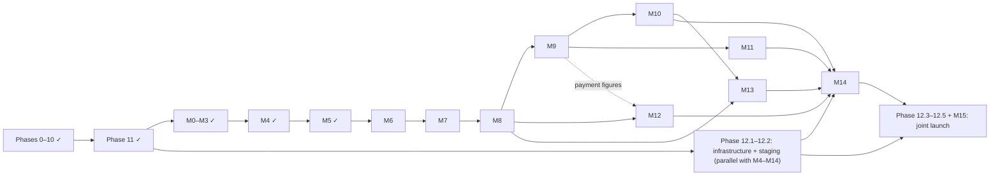

# Roadmap

The single delivery plan for Rivana Residence. Work is delivered as a sequence of reviewable contracts, not a loose backlog: one step at a time, evidence at the end, explicit approval before the next. The website and content management were built as **Phases 0–11**. The reservation system and the branch websites are built as **milestones M0–M14**, under the same governance (replanned on 2026-11-06 after the client decisions Q-36…Q-53). **Phase 12 and M15 are one joint launch** of the whole product (decision Q-16, 2026-10-24).

## Delivery overview

| Step | Scope | Status | Evidence |
| --- | --- | --- | --- |
| Phase 0 | Documentation and architecture | Accepted 2026-09-25 | this roadmap, ADRs 001–012 |
| Phase 1 | Project foundation | Accepted 2026-09-25 | [reports/phase-1-foundation.md](./reports/phase-1-foundation.md) |
| Phase 2 | Domain, database, persistence | Accepted 2026-09-25 | [reports/phase-2-persistence.md](./reports/phase-2-persistence.md) |
| Phase 3 | Authentication and authorization | Accepted 2026-09-25 | [reports/phase-3-auth.md](./reports/phase-3-auth.md) |
| Phase 4 | Admin shell and shared workflows | Accepted 2026-09-25 | [reports/phase-4-admin-shell.md](./reports/phase-4-admin-shell.md) |
| Phase 5 | Content management | Accepted 2026-09-25 | [reports/phase-5-content-management.md](./reports/phase-5-content-management.md) |
| Phase 6 | Media management | Accepted 2026-09-25 | [reports/phase-6-media.md](./reports/phase-6-media.md) |
| Phase 7 | Public website | Accepted 2026-09-26 | [reports/phase-7-public-site.md](./reports/phase-7-public-site.md) |
| Phase 8 | Visual system | Accepted 2026-09-26 | [reports/phase-8-visual-system.md](./reports/phase-8-visual-system.md) |
| Phase 9 | Interaction and motion | Accepted 2026-09-26 | [reports/phase-9-motion.md](./reports/phase-9-motion.md) |
| Phase 10 | SEO, performance, content readiness | Accepted 2026-09-26 | [reports/phase-10-seo-performance.md](./reports/phase-10-seo-performance.md) |
| Phase 11 | Test completion and security hardening | Accepted 2026-10-24 | [reports/phase-11-release-candidate.md](./reports/phase-11-release-candidate.md) |
| M0 | Discovery and baseline for reservations | Accepted 2026-10-24 | [reports/m0-repository-assessment.md](./reports/m0-repository-assessment.md) |
| M1 | Requirements and business rules | Accepted 2026-10-24; client answers pending (scope v2.0) | [../requirements/](../requirements/business-requirements.md) |
| M2 | Domain, architecture, database, API design | Accepted 2026-10-24; ADRs 014–022 accepted | [../domain/](../domain/domain-model.md), [../architecture/](../architecture/overview.md), [../database/](../database/data-model.md), [../api/](../api/api-contracts.md), [../security/](../security/threat-model.md) |
| M3 | Agent setup and engineering foundation | Accepted 2026-10-24 | [../engineering/](../engineering/engineering-standards.md), `AGENTS.md`, `CLAUDE.md` |
| M4 | Backend foundations and branch data ownership | Accepted 2026-11-07 | [reports/m4-backend-foundations.md](./reports/m4-backend-foundations.md) |
| M5 | Branch websites and the rooms-and-apartments catalog | Accepted 2026-11-07 | [reports/m5-branch-websites.md](./reports/m5-branch-websites.md) |
| M6 | Inventory, date prices, and availability ([brief](./milestones/m6-inventory-and-availability.md)) | Accepted 2026-11-10 (10/10 tasks; closeout gates and live verification passed) | [reports/m6-inventory-and-availability.md](./reports/m6-inventory-and-availability.md) |
| M7–M14 | Quote, reservations, payments, booking journey, staff tools, messaging, hardening (replanned 2026-11-06; [briefs](./milestones/README.md); task-based workflow from 2026-11-07) | In progress (M7: 3/6 tasks accepted); plan approved by the project owner 2026-11-06 | — |
| Phase 12 + M15 | Joint deployment and launch | Not started | — |

The external reservation module integration once planned as Phase 13 never started. The provider supplied no module or API, and the reservation system replaces it (ADR 013).

## Phase governance

From M6 onward, milestones run as small tasks with their own approval gates; the workflow is in [engineering/agent-workflow.md](../engineering/agent-workflow.md) and the steps in [milestones/README.md](./milestones/README.md#the-loop-every-milestone-follows). The status values and definition of done below apply to milestones; task status lives in each brief's **Task breakdown**, and the milestone handoff is the evidence report template in the milestones README.

### Status values

- `Not started`
- `In progress`
- `Ready for review`
- `Changes requested`
- `Accepted`
- `Blocked`

### Required phase handoff

At the end of every phase, the agent must provide:

1. a concise outcome summary;
2. files added, changed, and removed;
3. architecture decisions or assumptions made;
4. commands/tests run and their results;
5. screenshots or recordings where visual behavior changed;
6. migrations/configuration/environment changes;
7. known limitations, risks, and deferred work;
8. a checklist mapping each acceptance criterion to evidence;
9. an explicit statement that the next phase has **not** started.

### Definition of done for every phase

- Work is limited to the approved phase scope.
- No unrelated refactor or dependency is introduced.
- TypeScript remains strict; lint, typecheck, relevant tests, and production build pass.
- New external input is validated at the server boundary.
- New protected behavior performs server-side authorization.
- Accessibility and reduced-motion requirements are considered for UI work.
- Documentation and environment examples are updated with the implementation.
- No fake rates, availability, reservations, or booking workflow are introduced.
- Reviewer can reproduce the result from documented commands.

---

## Phase 0 — Documentation and architecture

Status: **Approved on 2026-09-25**

### Objective

Agree on the product boundary and technical design before application implementation.

### 0.1 Reference audit

- Inventory all supplied HTML, CSS, JavaScript, fonts, images, and design notes.
- Map reference routes, page sections, shared components, breakpoints, and interactions.
- Identify content inaccuracies, duplicate galleries, placeholders, licensing questions, and accessibility risks.
- Treat the legacy WordPress tree as content/asset provenance only.

### 0.2 Scope and product model

- Define visitors, editors, administrators, operators, and the future reservation provider.
- Define public pages and CMS capabilities.
- Record exclusions, especially reservation-system ownership.
- Define content migration and client-verification requirements.

### 0.3 Architecture and data design

- Define modular-monolith boundaries and dependency direction.
- Define domain concepts, use cases, repository/provider ports, and DTO boundaries.
- Define database entities, constraints, indexes, transactions, and publication behavior.
- Define the controlled content-section strategy.
- Define Server Component, Client Component, Server Action, and Route Handler responsibilities.

### 0.4 Experience and operations design

- Define design tokens and modernization rules from the reference identity.
- Define public/admin component architecture.
- Define authentication, authorization, upload, privacy, and validation requirements.
- Define SEO, performance, testing, deployment, and recovery strategies.
- Record ADRs for all major decisions.

### Phase 0 testing and validation

- Verify every required documentation file exists and is non-empty.
- Check internal links and terminology consistency.
- Confirm every ADR contains Context, Decision, Reasoning, Alternatives, and Consequences.
- Search the data/domain documents to confirm no local price, availability, inventory, reservation, or payment model exists.
- Cross-check all required public/admin routes against the architecture and test plan.

### Phase 0 acceptance criteria

- All requested documents are present under `docs/` and describe Rivana specifically.
- The supplied reference implementation and assets are reflected in the design/content findings.
- Proposed architecture, project tree, data model, content model, components, admin, booking boundary, security, SEO, performance, tests, deployment, and phases are explicit.
- The booking boundary uses a disabled adapter and inert controls.
- Technology choices and alternatives are recorded in ADRs.
- No production application code has been created.

### Required review evidence

- Complete documentation file inventory.
- Reference audit summary and identified content/design risks.
- ADR index and decision summary.
- Validation output for required files, links, terminology, and booking-boundary searches.
- Git status/diff proving only reference material and documentation exist.

### Reviewer decision

Approved by the client on 2026-09-25 after the local-media, Hosting.com/cPanel deployment, and promotion-code additions. Phase 1 may begin; its implementation status remains `Not started` until foundation work is actually commenced.

---

## Phase 1 — Project foundation

Status: **Accepted on 2026-09-25**

### Objective

Create a reproducible, production-oriented Next.js foundation without implementing business features.

### Prerequisites

- Phase 0 accepted.
- Package manager and deployment account constraints confirmed.
- Repository root and supported Node version confirmed.

### 1.1 Framework scaffold

- Create Next.js App Router project with TypeScript and `src/` layout.
- Pin current compatible stable versions identified in the architecture docs.
- Lock Node and package-manager versions.
- Add root scripts for development, lint, typecheck, unit tests, E2E tests, build, and formatting.

### 1.2 Code-quality baseline

- Enable strict TypeScript options and safe path aliases.
- Configure ESLint and formatting without conflicting rules.
- Establish import/dependency boundaries for presentation, application, domain, and infrastructure.
- Add `server-only` guards to server modules.
- Add environment validation with safe server/public separation.

### 1.3 Styling and component baseline

- Configure Tailwind CSS and semantic CSS custom-property tokens.
- Install only approved shadcn/ui primitives needed for the shell.
- Configure local font placeholders/approved files through `next/font/local`.
- Add public and admin root layouts with minimal accessible landmarks.

### 1.4 Test and CI foundation

- Configure Vitest and React Testing Library.
- Configure Playwright with desktop/mobile projects.
- Add one meaningful smoke test for each runner.
- Add CI jobs for install, lint, typecheck, test, and production build.

### Phase 1 testing

- Clean install from lockfile.
- `lint`, `typecheck`, unit smoke test, Playwright smoke test, and production build.
- Verify a client component cannot import a marked server-only module.
- Verify invalid/missing environment configuration fails clearly.
- Run a basic accessibility scan on the empty public/admin shells.

### Phase 1 acceptance criteria

- A clean clone can install and run using documented versions/commands.
- Public and admin shells render without business data or fake content.
- Design tokens are centralized; no second ad hoc theme exists.
- CI reproduces local quality checks.
- No database schema, authentication flow, CMS feature, or public page implementation has leaked into this phase.

### Required review evidence

- Dependency/version table and lockfile summary.
- Proposed source tree as implemented.
- CI run output and local command results.
- Screenshots of the minimal public/admin shells at desktop and mobile.

### Reviewer decision

Approved by the client on 2026-09-25 with authorization to begin Phase 2.

---

## Phase 2 — Domain, database, and persistence

Status: **Accepted on 2026-09-25**

### Objective

Implement the content domain and PostgreSQL persistence boundary without building CMS screens.

### Prerequisites

- Phase 1 accepted.
- Development/CI PostgreSQL strategy available.
- ID strategy confirmed.

### 2.1 Domain and application contracts

- Implement publication state, roles, media lifecycle, promotion scheduling/priority, section types, and value rules.
- Define repository ports and provider-neutral DTOs.
- Implement use-case inputs/results and typed application errors.
- Add the disabled `BookingProvider` contract and adapter.

### 2.2 Prisma and PostgreSQL schema

- Add Prisma 7 configuration and generated-client output path.
- Model SiteSettings, SocialLink, Page, PageSection, page media, Room, RoomFeature, room media, Facility, facility media, MediaAsset, Promotion, ContactEnquiry, and auth-compatible user extension points.
- Add foreign keys, uniqueness, checks, ordering indexes, publication indexes, and timestamps.
- Keep binaries, promotion redemption, and booking data out of PostgreSQL.

### 2.3 Repository implementations

- Implement Prisma adapters and explicit mappers.
- Implement public published-only queries and admin queries.
- Implement transaction-safe create/update/reorder/publish/archive operations.
- Translate expected Prisma errors into application outcomes.

### 2.4 Seed and migration tooling

- Create the initial reviewed migration.
- Seed singleton settings and required page records.
- Seed only clearly marked draft reference content; omit prices, calendars, availability, and unverified publication.
- Make the seed idempotent.

### Phase 2 testing

- Unit tests for every domain invariant and publish-readiness rule.
- Repository contract tests against an isolated PostgreSQL database.
- Migration test from an empty database.
- Idempotent seed test.
- Constraint tests for duplicate slugs/order, invalid occupancy/size, and referenced media.
- Query tests proving drafts/archived content and inactive promotions never appear publicly.
- Architecture test proving Prisma types/imports do not leak outside infrastructure/composition code.

### Phase 2 acceptance criteria

- Empty database can be migrated and seeded reproducibly.
- Domain/application layers compile without Prisma imports.
- All public repositories filter publication correctly.
- Reorder/publish/media-swap operations are transactional.
- Schema contains no reservation, availability, rate, guest, stay, payment, discount-calculation, or redemption entity/field.
- Disabled booking adapter returns only an unavailable launch descriptor.

### Required review evidence

- Entity/relationship summary and generated migration review notes.
- Schema diff and index/constraint list.
- Unit/integration test results.
- Example public/admin repository outputs with sensitive/infrastructure details removed.

### Reviewer decision

Approved by the client on 2026-09-25 with authorization to begin Phase 3. Evidence: [phase-2-persistence.md](./reports/phase-2-persistence.md).

---

## Phase 3 — Authentication and authorization

Status: **Accepted on 2026-09-25**

### Objective

Secure all current and future admin surfaces using closed, revocable staff access.

### Prerequisites

- Phase 2 accepted.
- Better Auth pinned-version schema reviewed.
- Transactional email approach decided for reset flow, or reset explicitly deferred with an operator recovery procedure.

### 3.1 Better Auth integration

- Configure Better Auth and Prisma adapter.
- Generate/review auth tables and migration.
- Enable email/password and database sessions.
- Disable public registration.
- Add secure cookie, trusted-origin, secret, session expiry, and revocation settings.

### 3.2 Identity lifecycle

- Add secure bootstrap/provisioning for the first administrator.
- Implement active/inactive user behavior and role mapping.
- Add sign-out and session revocation.
- Add password reset only with verified email delivery; otherwise document controlled manual recovery.

### 3.3 Protected access layer

- Implement `/admin/login` and protected admin layout.
- Add optimistic route redirection where useful.
- Enforce authoritative session/role checks in each protected query/action.
- Sanitize internal return URLs to prevent open redirects.
- Add login rate limiting and generic failure messages.

### Phase 3 testing

- Unit tests for authorization matrix and safe return URLs.
- Integration tests for session creation, expiry, revocation, inactive users, and role checks.
- E2E: successful login/logout, failed login, protected-route redirect, direct protected action denial.
- Security checks for user enumeration, open redirect, cookie flags, brute-force/rate-limit behavior, and session invalidation after password/reset/security change.
- Accessibility test for login errors, labels, focus, and keyboard flow.

### Phase 3 acceptance criteria

- No public sign-up path exists.
- Every admin page and mutation rejects unauthenticated access server-side.
- Editors and administrators receive only their allowed capabilities.
- Login errors do not reveal whether an account exists.
- Sessions can be revoked and inactive users lose access.
- No credentials, auth secret, token, or session value appears in logs/client bundles.

### Required review evidence

- Auth configuration summary with secrets redacted.
- Role/capability matrix mapped to tests.
- E2E recording/screenshots of login, denial, and logout.
- Cookie/header inspection and auth test report.

### Reviewer decision

Approved by the client on 2026-09-25 with authorization to begin Phase 4. The approval accepts the security boundary, the password-reset deferral (operator recovery via `npm run staff -- set-password`), and the 12-hour session lifetime. Evidence: [phase-3-auth.md](./reports/phase-3-auth.md).

---

## Phase 4 — Admin shell and shared workflows

Status: **Accepted on 2026-09-25**

### Objective

Build a coherent, accessible CMS foundation before entity-specific CRUD.

### Prerequisites

- Phase 3 accepted.
- Admin navigation and role visibility confirmed.

### 4.1 Admin information architecture

- Implement dashboard shell, sidebar/mobile sheet, header, breadcrumb, and account menu.
- Add Overview, Pages, Rooms, Facilities, Media, Promotions, Enquiries, and Settings destinations.
- Add noindex behavior and authenticated data loading.

### 4.2 Shared admin primitives

- Implement accessible tables, filters, pagination pattern, empty/error/loading states, badges, breadcrumbs, and responsive layout.
- Implement form field, error summary, pending submit, toast/status, alert dialog, and destructive confirmation patterns.
- Implement consistent save/publish/archive action placement.

### 4.3 Settings workflow

- Implement general identity/contact/footer/default SEO editing.
- Implement ordered social-link editing.
- Validate and authorize through application commands.
- Invalidate only relevant public settings caches.

### 4.4 Dashboard overview

- Add useful content/status counts, active/upcoming promotion state, and recent activity placeholders backed by real queries.
- Add shortcuts to approved destinations.
- Do not add booking, occupancy, revenue, or vanity charts.

### Phase 4 testing

- Component tests for responsive navigation, dialog focus/return, form errors, pending/duplicate-submit protection, and toasts.
- Integration tests for settings/social writes and cache invalidation intent.
- E2E editor/admin navigation and settings update.
- Keyboard, 200% zoom, mobile reflow, and axe tests.
- Authorization tests for administrator-only settings.

### Phase 4 acceptance criteria

- Non-technical user can navigate the CMS on desktop and mobile.
- Settings changes validate, save, report status, and appear through the public settings query.
- Destructive/pending/error states are consistent and accessible.
- Booking settings show “Not configured” and expose no fake integration field.
- Admin UI does not inherit inappropriate public-page decorative patterns.

### Required review evidence

- Desktop/mobile screenshots of every shell state.
- Keyboard navigation notes and accessibility report.
- Settings update demonstration and invalid-input demonstration.
- Test results and cache invalidation evidence.

### Reviewer decision

Approved by the client on 2026-09-25 with authorization to begin Phase 5. The approval accepts the shared CMS patterns, the settings field list, and the Google Maps embed-link restriction. Evidence: [phase-4-admin-shell.md](./reports/phase-4-admin-shell.md).

---

## Phase 5 — Content-management features

Status: **Accepted on 2026-09-25**

### Objective

Let staff safely manage structured pages, rooms, facilities, promotions, and publication state without media upload yet.

### Prerequisites

- Phase 4 accepted.
- Final field labels/help text reviewed.

### 5.1 Room management

- Implement list/search/filter and create/edit/archive flows.
- Add basics, description, verified marketing facts, ordered features, discovery order/featured state, SEO, and publication readiness.
- Accept existing ready media selection only if fixtures exist; upload comes in Phase 6.
- Exclude price and availability fields completely.

### 5.2 Facility management

- Implement list/search/filter and create/edit/archive flows.
- Add description, optional opening-hours text, ordering/featured state, SEO, and publication readiness.
- Keep Cafe/Spa drafts unpublished until approved.

### 5.3 Page-section management

- Implement Home, About, and Contact editors.
- Render type-specific forms through the allowlisted section registry.
- Support allowed visibility/reordering only.
- Validate required core sections and schema versions.

### 5.4 Preview and publication

- Add authenticated noindex preview or a safe equivalent.
- Add publish/unpublish/archive confirmations and readiness issue lists.
- Add “View public page” links.
- Invalidate entity/list/sitemap tags only as required.

### 5.5 Promotion management

- Implement promotion list/search/filter and create/edit/preview/publish/unpublish/archive flows.
- Add internal name, public headline/body, code, optional terms, optional active window, popup flag, and priority.
- Show explicit property timezone and deterministic active-campaign priority feedback.
- Invalidate `promotion:active` after every relevant mutation.
- Exclude discount amount, eligibility, redemption, guest, reservation, and payment fields.

### Phase 5 testing

- Unit tests for form schemas, section registry, readiness, slug rules, promotion windows/priority, and role permissions.
- Integration tests for room/facility/page/promotion CRUD, ordering conflicts, transactions, publication, and cache invalidation.
- E2E room CRUD, facility CRUD, promotion schedule/preview/publish, page update, publish/unpublish, archive, validation failure, and unauthorized destructive action.
- Regression assertion that no form/DTO/database mutation accepts price, rate, availability, or reservation input.
- Accessibility tests for long forms, repeatable fields, error summary, and confirmations.

### Phase 5 acceptance criteria

- Editor can manage all required text/structured content without source edits.
- Published records appear publicly through queries; drafts do not.
- Required page sections cannot be accidentally removed.
- Slug/order conflicts produce useful errors rather than data corruption.
- Archive is the normal destructive path; administrator-only hard deletion is guarded.
- No generic raw JSON/HTML editor is exposed.

### Required review evidence

- Screen recording of one complete room and facility lifecycle.
- Screenshots of each page editor and readiness errors.
- CRUD/publication test matrix.
- List of final fields and explicit proof booking fields are absent.

### Reviewer decision

Approved by the client on 2026-09-25 with authorization to begin Phase 6. The approval accepts the content workflows and terminology, the plain-text formatting rules, the fixed page structure, and the administrator-only permanent delete. Evidence: [phase-5-content-management.md](./reports/phase-5-content-management.md).

---

## Phase 6 — Media management

Status: **Accepted on 2026-09-25**

### Objective

Provide safe, provider-neutral image management and migrate approved source assets.

### Prerequisites

- Phase 5 accepted.
- Hosting.com/cPanel media root, quota, serving method, and off-server backup approach verified over the existing SSH access.
- Upload format, byte, dimension, and rights policy approved.

### 6.1 Storage adapters

- Implement `MediaStorage` contract.
- Implement the local filesystem adapter for development/test and Hosting.com production roots.
- Keep the contract ready for a future S3-compatible adapter.
- Configure environment-specific roots/public prefixes, permissions, quarantine, and immutable object naming outside every release directory.

### 6.2 Upload lifecycle

- Implement authenticated same-origin streaming upload with progress and server finalization.
- Verify magic bytes, decoded format, size, dimensions, checksum, and allowed type.
- Implement `PENDING`, `READY`, `FAILED`, cleanup, and idempotent finalization.

### 6.3 Media library

- Implement library search/filter, details panel, alt text, focal point, caption, credit, dimensions, byte size, and usage list.
- Implement media picker for pages/rooms/facilities.
- Implement reorder and contextual alt override.

### 6.4 Replace and delete

- Replacement uploads/finalizes a new object before changing references.
- Block deletion of referenced assets.
- Require administrator confirmation for unreferenced hard deletion.
- Clean database/object state safely when one side fails.

### 6.5 Reference asset migration

- Produce an asset manifest with source, dimensions, checksum, intended usage, rights/approval state, and alt draft.
- Import approved assets idempotently.
- Keep duplicate/unlicensed/placeholder assets unpublished.
- Require distinct room galleries or mark content gap visibly in admin readiness.

### Phase 6 testing

- Local adapter contract tests covering root containment, write/finalize/open/delete, retries, and failure cleanup; reuse the contract for any future S3 adapter.
- Upload tests: valid formats; extension/MIME/magic mismatch; oversized bytes/pixels; corrupt image; duplicate; traversal/symlink escape; wrong-user/CSRF; retry/idempotency.
- Integration tests for reference counts, replace transaction, failed finalization, orphan cleanup, and deletion failure recovery.
- E2E upload, edit alt/focal point, attach, reorder, replace, blocked delete, successful unreferenced delete.
- Accessibility tests for drag/drop alternative, progress announcements, picker keyboard flow, and crop/focal controls.

### Phase 6 acceptance criteria

- Editors can manage images without changing source paths.
- PostgreSQL stores metadata only; no binary content.
- Database stores a provider-neutral relative key, never an absolute server path.
- Provider SDK/types do not escape the infrastructure adapter.
- Invalid/malicious uploads never become public ready assets.
- Referenced media cannot be deleted.
- Every migrated production candidate has known provenance/approval status and alt-text state.

### Required review evidence

- Storage configuration/permission/backup diagram with account paths and secrets redacted.
- Upload threat-test results.
- Media lifecycle demonstration and failure-path screenshots.
- Asset migration/rights manifest summary.

### Reviewer decision

Approved by the client on 2026-09-25 with authorization to begin Phase 7. The approval accepts the media behavior and the migrated asset manifest; reference-image usage rights still need confirmation per image before content using them is published. The off-server backup, production media root, and free-space alert remain launch tasks. Evidence: [phase-6-media.md](./reports/phase-6-media.md).

---

## Phase 7 — Public website functionality

Status: **Accepted on 2026-09-26**

### Objective

Implement every required public route with server-rendered real CMS content and a disabled booking boundary.

### Prerequisites

- Phase 6 accepted.
- Minimum approved content and hero/gallery media available.

### 7.1 Shared marketing shell

- Implement semantic root/marketing layouts, skip link, header/navigation, mobile menu, footer, social/contact links, and not-found/error states.
- Render site settings server-side.
- Add shared disabled `BookNowButton` placements without destination.
- Query and render at most one active `PromotionPopup` without blocking primary server-rendered content.

### 7.2 Home

- Implement hero, brand introduction, featured rooms, featured facilities, lifestyle/story section, and contact CTA.
- Ensure room/facility sections query canonical entities.
- Define LCP image and responsive crop behavior.

### 7.3 About

- Implement controlled page sections, property imagery, story, optional stats/gallery, featured rooms, and contact CTA.
- Preserve reference identity without copying its markup.

### 7.4 Rooms

- Implement room listing with verified facts and responsive cards.
- Implement `/rooms/[slug]` details, features, facts, ordered gallery, facility discovery, and disabled booking CTA.
- Exclude prices, availability search, date fields, guests, and calendar.

### 7.5 Facilities

- Implement facilities index.
- Implement shared `/facilities/[slug]` template.
- Verify Gym and Swimming Pool canonical routes/content; provide redirects/aliases only if approved.
- Render opening hours only when populated and verified.

### 7.6 Contact and enquiries

- Implement contact/location content, accessible map fallback/link, and contact form.
- Persist and deliver enquiries through application ports.
- Add rate limiting, honeypot/time heuristic, pending/error/success states, and plain-text rendering.

### Phase 7 testing

- Server-render/public query integration tests for all route templates.
- E2E navigation across every required route at desktop/mobile widths.
- E2E contact validation, one successful submission/delivery, and delivery-failure handling.
- E2E active promotion display, copy success/fallback, dismissal persistence, priority, schedule expiry, and draft exclusion.
- E2E proof every Book Now control is inert, non-navigating, has no fake data, and announces status.
- 404/unpublished slug tests.
- Baseline axe, keyboard, no-JavaScript content, and reduced-motion checks.
- Assert primary content exists in server HTML.

### Phase 7 acceptance criteria

- All required routes render from managed content and work from 320px upward.
- Visitors can discover rooms/facilities and submit a contact message.
- No public page queries Prisma directly.
- No room price, availability, fake search, reservation, or booking destination exists.
- Header/menu/footer/contact/gallery basics are semantic and keyboard accessible.
- Promotion popup is dismissible, keyboard/screen-reader usable, non-blocking, and honest about provider validation.
- Unpublished content is inaccessible and absent from lists.

### Required review evidence

- Route inventory with HTTP status and source entity.
- Desktop/mobile screenshots of every page template.
- Contact delivery test with private data redacted.
- Booking-boundary test report and DOM/link audit.

### Reviewer decision

Accepted on 2026-09-26 when the client asked for the Phase 7 review and Phase 8 work. The review's defects (missing wordmark styles, text-only logo) were fixed at the start of Phase 8. Evidence: [phase-7-public-site.md](./reports/phase-7-public-site.md).

---

## Phase 8 — Modern luxury visual system

Status: **Accepted on 2026-09-26**

### Objective

Apply the approved Rivana design system and achieve a polished, coherent hospitality experience.

### Prerequisites

- Phase 7 accepted.
- Brand assets, image rights, and production copy approved or explicitly marked pending.

### 8.1 Token implementation

- Finalize color contrast pairs, fluid type scale, spacing, container, border, radius, shadow, and surface tokens.
- Map Tailwind/shadcn tokens to one semantic source.
- Finalize font weights/subsets and fallbacks.

### 8.2 Shared composition polish

- Implement transparent/scrolled header visual states.
- Refine hero proportions, brush divider asset, section headings, cards, galleries, CTA, footer, and form presentation.
- Keep public imagery predominantly square-edged and surfaces restrained.

### 8.3 Page-specific composition

- Tune Home editorial hierarchy and image crops.
- Tune About story/stat rhythm.
- Tune room listing/detail facts and galleries.
- Tune facility detail hero/gallery/hours.
- Tune Contact map/info/form composition.

### 8.4 Content-fit and responsive polish

- Test realistic longest titles, descriptions, address/email, and missing optional content.
- Verify 320, 390, 768, 1024, 1280, and 1440px widths.
- Verify landscape mobile, coarse pointer, 200% zoom, and browser text scaling.
- Replace all visible placeholder/duplicate/unapproved content before acceptance.

### Phase 8 testing

- Visual regression baselines for all templates and target widths.
- Contrast audits for every semantic color/state.
- Responsive overflow and touch-target tests.
- Image focal/crop QA and resolution/upscaling review.
- 200% zoom/reflow and long-content testing.
- Client review against reference identity: plum/gold, editorial typography, whitespace, photography, restrained surfaces.

### Phase 8 acceptance criteria

- Experience reads as modern Rivana luxury, not a generic template or Apple copy.
- Plum/gold identity and editorial typography remain recognizable.
- No essential text depends on low contrast or hover.
- No unintended horizontal overflow, clipped copy, or obscured controls at test widths.
- Images remain credible at rendered size and use approved focal points.
- No unlicensed stock, placeholder copy, or duplicate room gallery is presented as final.

### Required review evidence

- Before/after comparison board for each template.
- Full-page desktop/mobile screenshots.
- Token table and contrast report.
- Responsive/content stress-test results.

### Reviewer decision

Accepted on 2026-09-26 when the client asked for Phase 8 to be committed, merged, and pushed and for Phase 9 to begin. Evidence: [phase-8-visual-system.md](./reports/phase-8-visual-system.md).

---

## Phase 9 — Interaction and motion

Status: `Accepted on 2026-09-26`

### Objective

Add refined interaction feedback and motion without reducing accessibility or performance.

### Prerequisites

- Phase 8 accepted.
- Static layouts stable enough for regression baselines.

### 9.1 Navigation interactions

- Implement smooth fixed-header state transition.
- Complete keyboard/pointer desktop submenu behavior.
- Complete mobile sheet focus trap, Escape, outside close, focus return, and background inertness.

### 9.2 Gallery interactions

- Implement labelled previous/next, keyboard navigation, swipe enhancement, thumbnail/lightbox behavior, and current-position announcements.
- Disable impossible controls and preserve image dimensions.
- No autoplay.

### 9.3 Reveal and micro-interactions

- Add restrained section reveals and at most one justified hero character reveal.
- Add button/card/form pending/hover/focus/active feedback.
- Keep animation to transform/opacity and disconnect observers.

### 9.4 Reduced motion and failure behavior

- Remove stagger/transforms/smooth scroll when reduced motion is requested.
- Ensure content is immediately readable without JavaScript or observer support.
- Ensure interrupted navigation/gallery actions leave valid state.

### Phase 9 testing

- Component and E2E keyboard tests for menus, submenu, gallery, lightbox, and dialogs.
- Pointer/touch tests and coarse-pointer hover-content check.
- Automated and manual reduced-motion verification.
- Performance trace for layout/repaint issues and event-listener cleanup.
- Screen-reader announcement checks for menu/gallery/form state.

### Phase 9 acceptance criteria

- Every interaction works by keyboard and touch where applicable.
- Focus never becomes lost/trapped incorrectly.
- Reduced-motion users receive an equivalent, immediate experience.
- No autoplay, scroll-jacking, bounce, or decorative perpetual motion.
- Motion does not cause layout shift or materially delay reading/input.

### Required review evidence

- Short recordings of normal and reduced-motion behavior.
- Keyboard/focus test notes.
- Interaction test results and performance trace summary.

### Reviewer decision

Accepted on 2026-09-26 when the client directed Phase 10 to proceed. The transform-only, reduced-motion-safe hero parallax remains the approved exception. Evidence: [phase-9-motion.md](./reports/phase-9-motion.md).

---

## Phase 10 — SEO, performance, and production content readiness

Status: `Accepted on 2026-09-26`

### Objective

Make the site discoverable, fast, stable, and ready for real domain/content launch.

### Prerequisites

- Phase 9 accepted.
- Production canonical host and final contact/location data available.

### 10.1 Metadata and crawlability

- Implement metadata fallbacks, title template, descriptions, canonicals, OG/Twitter data, and social-image alt.
- Implement dynamic sitemap and robots.
- Add redirects for approved migrated URLs/slugs.
- Mark admin/preview routes noindex.

### 10.2 Structured data

- Add validated Hotel/LodgingBusiness identity and breadcrumbs.
- Add room/facility schema only when semantically correct and visible.
- Exclude fake Offer, price, availability, ratings, and reviews.

### 10.3 Rendering and cache tuning

- Add precise cache tags and mutation invalidation.
- Verify no authenticated/draft content enters shared cache.
- Review database projections, query count, indexes, and pooling.
- Test publication freshness.

### 10.4 Asset and bundle tuning

- Finalize image `sizes`, priority, quality, formats, and lazy loading.
- Finalize font subsets/preloads and remove unused fonts/weights.
- Analyze client/server bundles and remove unjustified dependencies.
- Lazy-load map and any optional third party.

### 10.5 Production content audit

- Verify names, address, phone, email, map, social links, opening hours, room facts, promotion copy/terms/windows, legal/privacy text, alt text, credits, and image rights.
- Verify every public record has suitable title, summary, hero, and metadata fallback.
- Confirm booking messaging accurately states its disabled status.

### Phase 10 testing

- Metadata/canonical/sitemap/robots integration tests.
- Structured-data validation and negative assertions for fake commercial markup.
- Lighthouse CI for Home, listing, detail, and Contact templates.
- Web Vitals lab runs at mobile/desktop profiles.
- Bundle-size and route client-JS budget checks.
- Cache isolation/invalidation tests and database query review.
- Broken-link/image audit and production-content checklist.

### Phase 10 acceptance criteria

- Published routes have unique, correct metadata and canonical URLs.
- Sitemap contains only indexable published routes.
- Structured data validates and contains no invented offer/price/rating data.
- Target routes meet agreed performance budgets or have documented approved exceptions.
- No unnecessary third-party script runs in the critical path.
- Final content/contact/media/legal facts are approved or explicitly block launch.

### Required review evidence

- Per-route SEO matrix.
- Structured-data validator output.
- Lighthouse/Web Vitals and bundle reports.
- Cache invalidation demonstration.
- Signed-off content readiness checklist.

### Reviewer decision

Accepted on 2026-09-26 when Phase 11 was commissioned. The Phase 11 review found no Phase 10 defect that blocks acceptance; it corrected the room JSON-LD capacity property (`occupancy` instead of `maximumAttendeeCapacity`) and documented running Lighthouse with Playwright's Chromium. Production launch remains explicitly blocked by the final HTTPS host, official contact data, default social/search settings, approved privacy/media-rights wording, SMTP delivery verification, and one unresolved legacy room redirect. Evidence: [phase-10-seo-performance.md](./reports/phase-10-seo-performance.md).

---

## Phase 11 — Test completion and security hardening

Status: `Accepted`

### Objective

Close coverage gaps, test hostile/failure conditions, and produce a release candidate.

### Prerequisites

- Phase 10 accepted.
- Feature scope frozen except release-blocking fixes.

### 11.1 Automated suite completion

- Complete unit tests for domain/application logic.
- Complete repository/provider integration tests.
- Complete component behavior/accessibility tests.
- Complete critical Playwright public/admin journeys.
- Remove flaky tests or fix their underlying nondeterminism.

### 11.2 Security testing

- Test authorization/IDOR across every command and protected query.
- Test stored/reflected XSS, unsafe rich text, open redirect, CSRF/origin behavior, login/contact limits, and upload bypasses.
- Verify CSP, headers, cookies, secret isolation, dependency advisories, and logging redaction.
- Review database/storage privileges.

### 11.3 Reliability and failure testing

- Simulate database, email, local media filesystem/quota, and storage failures.
- Test duplicate submits, retries, interrupted uploads, cleanup, cache failure, and transaction rollback.
- Verify useful safe errors and no false success states.
- Verify backup/restore tooling in a non-production environment.

### 11.4 Cross-browser and accessibility acceptance

- Test current Chrome, Safari, Firefox, and Edge at representative phone/tablet/desktop sizes.
- Keyboard-only and screen-reader smoke passes.
- 200% zoom, reflow, high contrast where available, and reduced motion.
- Fix all critical/serious axe issues and manually assessed blockers.

### Phase 11 testing

This phase is itself the full test execution. The release report must include:

- unit/component/integration/E2E totals and pass results;
- accessibility findings and disposition;
- security checklist/findings and disposition;
- browser/device matrix;
- performance regression comparison;
- dependency audit;
- backup restore result;
- list of accepted residual risks.

### Phase 11 acceptance criteria

- Critical flows pass reliably in CI and a production-like environment.
- No known critical/high security defect remains.
- No critical/serious accessibility blocker remains.
- Failure paths do not lose data or claim false success.
- Release build is reproducible and migrations are reviewed.
- Residual risks have owner, severity, and explicit acceptance/defer decision.

### Required review evidence

- Consolidated release-candidate test report.
- Security and accessibility findings table.
- Cross-browser matrix.
- Restore drill record.
- Release-candidate commit/deployment identifier.

### Reviewer decision

Approve or reject the release candidate. Deployment preparation must not hide unresolved blockers.

Ready for review on 2026-09-26; accepted by the project owner on 2026-10-24 after the manual browser and screen-reader passes. Evidence, residual risks, and the items that still need a person (Firefox run, real-Safari/Edge and screen-reader passes) are in [phase-11-release-candidate.md](./reports/phase-11-release-candidate.md).

---

## Reservation milestones

Milestones M0–M3 produced the reservation design (accepted 2026-10-24). The client decisions of 2026-11-06 (immediate confirmation, Paymob payment and refunds, branch websites, rooms and apartments, optional services, coupons, VAT, WhatsApp messaging; [Q-36…Q-53](../requirements/assumptions-and-open-questions.md#decided-2026-11-06-client-decisions)) changed that design. They are recorded in ADRs 024–028 and in the current requirements, domain, database, API, security, frontend, testing, and operations documents. The M0–M3 evidence stays as it was. **This plan replaces the earlier M4–M12 plan**: M4–M14 build the product, and **M15 is the joint launch**, together with Phase 12.

Each milestone has a detailed brief in [milestones/](./milestones/README.md) with its tasks by layer, files, database and API impact, numbered acceptance criteria, tests, evidence, risks, and the agent skills to run at each step (`/architect` → `/develop` → `/test` → `/debug` → `/check verify` → `/check review` → `/sync` → `/document`). The brief is the contract; this section is the summary.

Ordering rule: foundations and data or API contracts come before the screens that use them. Every milestone is a tested slice, delivered as the small tasks in its brief's **Task breakdown**; each task is planned, independently reviewed, and accepted by the owner before the next begins ([agent workflow](../engineering/agent-workflow.md), 2026-11-07), and the milestone stops for acceptance before the next milestone begins. The plan was approved by the project owner on 2026-11-06; M4 and M5 are accepted.

### Completion rules (every milestone)

Definition of done is [the brief's §23](../source/prompt.md), the roadmap's per-phase definition of done, and the [milestone loop](./milestones/README.md#the-loop-every-milestone-follows):

- format, lint, typecheck, unit, integration, build, and Chromium E2E pass on the final tree, with counts recorded;
- docs updated, including the delivery overview above;
- every task accepted by the owner, each after its own `/check review` on a different model;
- an evidence doc `docs/delivery/reports/m<N>-<name>.md`;
- the next milestone has **not** started.

### Milestone summary

| Milestone | Objective | Main requirements | Database | API | Depends on |
| --- | --- | --- | --- | --- | --- |
| [M4](./milestones/m4-backend-foundations.md) Backend foundations and branch data ownership | REST plumbing, contracts, OpenAPI, roles and branch scope, audit; every room, facility, and page gets a branch; no visible change | FR-IAM-1/3, FR-AUD-1, FR-CAT-1/2, FR-SITE-1, NFR-3/10 | `branches_and_staff_roles` | health | M3; approval of this plan |
| [M5](./milestones/m5-branch-websites.md) Branch websites and the rooms-and-apartments catalog | `/{branch}/…` sites on shared templates, chooser, switcher, redirects, per-branch content and maps, Room or Apartment listings; promotion popup removed | FR-SITE-1…8, FR-CAT-1…5, FR-BR-1…4 | none new | P1–P4, A1–A3 | M4 |
| [M6](./milestones/m6-inventory-and-availability.md) Inventory, date prices, availability | Units, blocks, base rates and one kind of date period, availability, all under the room-type lock | FR-INV-1…3, FR-AV-1…4, FR-PR-1/2/6, NFR-1/2 | `inventory_and_rates` | P5, S20–S27, S30–S34 | M5 |
| [M7](./milestones/m7-booking-quote.md) Booking quote: services, coupons, VAT | Server-side quote composing units, services, coupon, and VAT exactly; staff APIs for services, coupons, VAT | FR-PR-3, FR-SVC, FR-CPN, FR-TAX | `commercial_rules` | P6, S35–S39, A5 | M6 |
| [M8](./milestones/m8-reservations.md) Reservations, immediate confirmation, verification, messages | Pay-at-hotel website bookings `CONFIRMED` in the reserving transaction; staff and external bookings; lifecycle; PMS-entry marker; WhatsApp verification; confirmations after commit; Admin WhatsApp settings, templates, and test message | FR-RES, FR-GST, FR-LKP, FR-NTF, FR-AUD, FR-OPS-7 | `reservations` | P7, P9, P10, G1, G3, G4, S1–S6, S9–S16, S28, S29, S50–S53, A6–A8 | M7 |
| [M9](./milestones/m9-payments-and-cancellations.md) Paymob payments, holds, cancellation requests, refunds | Paymob hosted checkout with 15-minute holds, verified callbacks, late-success handling; guest cancellation requests; Manager or Admin decisions; refunds through Paymob | FR-PAY, FR-CXL | `payments_and_cancellations` | P7 (online), P8, G2, G4, S9, S17–S19, S44, S45 | M8; Paymob sandbox keys from the client (Q-55) |
| [M10](./milestones/m10-guest-booking-journey.md) Guest booking journey | End-to-end booking UI with several units, services, coupon, payment choice, VAT review; manage page and cancellation requests | US-G1…G7, FR-SITE-5, FR-WEB-10 | none | consumes M5–M9 | M9 |
| [M11](./milestones/m11-front-desk.md) Front-desk operations | Desk overview, reservations, PMS-entry marking, cancellation queue, staff and external forms, grid, blocks, sync reminder, guests | FR-OPS-1…8, US-R*, US-M4, US-M6 | none | consumes M8–M9 | M9 |
| [M12](./milestones/m12-manager-admin.md) Manager and admin tools | Pricing, services, coupons, VAT, reports, branches, staff assignment, audit viewer | FR-PR/SVC/CPN/TAX (UI), FR-RPT, FR-BR, FR-IAM-2, FR-AUD-2 | none | S40–S43, A4 | M8 (M9 for payment figures) |
| [M13](./milestones/m13-whatsapp-marketing.md) WhatsApp broadcasts and feedback | Consented marketing broadcasts with coupon codes; feedback request after recorded check-out | FR-MKT-1…6 | `marketing` | S60–S62 | M8, M10; Q-58, Q-59; templates entered by the Admin (Q-67) |
| [M14](./milestones/m14-hardening.md) Security, regression, E2E hardening | Release candidate for the whole product | all NFRs | — | OpenAPI review | M10, M11, M12, M13 |
| [M15](./milestones/m15-joint-launch.md) Joint launch and handover | Go-live with Phase 12.3–12.5; training; online booking per branch | Phase 12 | production migration | — | M14; Phase 12.1–12.2 |

### What changed from the earlier plan

| Earlier (2026-10-24) | Now |
| --- | --- |
| M5 Branches and room catalog (booking-only branch paths, global pages) | M5 branch websites with branch-owned content, chooser, switcher, apartments, maps, popup removal |
| M6 pricing with `SEASONAL` and `OFFER` precedence | M6 one kind of date period; discounts move to M7 coupons |
| — | M7 quote composition (services, coupons, VAT) before reservations store it |
| M7 lifecycle with request to book, confirm and decline | M8 immediate confirmation; `PENDING` and `DECLINED` removed; PMS-entry marker |
| No online payment | M9 Paymob, holds, cancellation requests, refunds |
| M8 customer journey, M9 receptionist, M10 manager and admin | M10, M11, M12 (same split, new content) |
| — | M13 WhatsApp broadcasts and feedback |
| M11 hardening, M12 launch | M14 hardening, M15 launch |

---

## Phase 12 — Deployment and launch

Status: `Not started`

> Phase 12 is the joint launch of the website and reservations (Q-16). Sections 12.1 (production infrastructure) and 12.2 (content migration rehearsal) run in parallel with milestones M4–M14, so staging exercises the real topology. Sections 12.3–12.5 (go-live, smoke tests, handover) run together with M15.

### Objective

Provision production safely, migrate approved content, launch, and prove recovery/operations.

### Prerequisites

- Phase 11 accepted.
- Client launch approval, domain access, production accounts, and support contacts available.

### 12.1 Production infrastructure

- Preflight and provision the Hostinger VPS (ADR 023): Node service, Nginx, PostgreSQL 17+, persistent media root/URL, transactional email, WhatsApp sender, Paymob callback URL, DNS/TLS, secrets, backups, and monitoring.
- Separate production and preview credentials/resources.
- Configure pooled runtime and direct migration database connections.

### 12.2 Data/content migration

- Apply production migrations through controlled job.
- Run idempotent settings/page/content/media migration.
- Provision named administrator accounts and revoke bootstrap credentials.
- Validate record counts, references, file availability, relative storage keys, and content checksums.

### 12.3 Domain and policy configuration

- Configure canonical host and redirects.
- Verify TLS, HSTS timing, CSP enforcement, robots, sitemap, Search Console, and analytics/consent if approved.
- Verify email domain authentication and contact/reset delivery.

### 12.4 Launch and smoke tests

- Run public/admin/contact/media smoke suite against production.
- Verify logs/alerts/Web Vitals and no secret/sensitive logging.
- Verify online booking works end to end for each enabled branch (pay at hotel, and a live low-value Paymob payment and refund), that every branch site and the chooser render with their own content, and that branches with booking off show the disabled Book Now.
- Observe initial traffic/errors and establish incident escalation.

### 12.5 Handover

- Train administrators on branch pages, listings (rooms and apartments), facilities, media, enquiries, publication, and recovery contacts, and staff on the reservation procedures (M15).
- Deliver operations runbook, environment inventory, backup/restore instructions, update process, and known limitations.
- Record ownership for content, infrastructure, and security updates.

### Phase 12 testing

- Production migration and smoke test.
- Backup creation and restore into isolated environment.
- Domain/TLS/header/CSP scan.
- Production email/contact test with controlled test data.
- Media upload/delivery/replace/delete test using disposable asset.
- Admin login/session revocation test.
- Public link/image/metadata/sitemap test.
- Monitoring/alert test.

### Phase 12 acceptance criteria

- Production is reachable on the canonical HTTPS domain and redirects correctly.
- Database/local media/email/backups/monitoring operate with production credentials and restricted filesystem permissions.
- Preview cannot access production data/resources.
- Approved content and media are complete and consistent.
- Critical smoke tests pass and rollback path is understood.
- Admins are trained and bootstrap access is removed.
- Online booking is enabled only for branches that passed M14, with the manual-sync procedures in force.

### Required review evidence

- Redacted production topology/environment inventory.
- Migration and smoke-test report.
- DNS/TLS/header/CSP report.
- Backup/restore evidence.
- Training/runbook handoff acknowledgement.

### Reviewer decision

Provide production acceptance or initiate rollback/fix plan.

---

## Master review checklist

Use this after every agent handoff:

- Is the reported phase or milestone the only one changed?
- Does the implementation match the accepted docs/ADRs?
- Are all changed files and migrations listed?
- Can the reviewer reproduce every test command?
- Are failures/warnings shown, not omitted?
- Are screenshots current and at the specified viewports?
- Are auth, validation, accessibility, performance, and reduced-motion impacts covered?
- Are secrets and personal data redacted?
- Are reservation consistency (database locks and constraints) and branch scope still protected?
- Are known limitations explicit?
- Has the agent stopped before the next phase or milestone?
