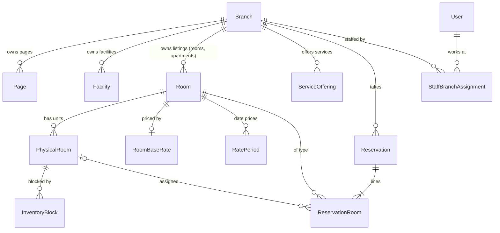

# Branch model

Status: design accepted 2026-10-24 (ADR 017) and extended on 2026-11-06 (ADR 026: branch-owned websites, path-based branch URLs, per-branch maps; Q-41, Q-42, Q-52). **Implemented in M4:**

- The `Branch` table, with every attribute below and its checks.
- The domain schema with the reserved-slug rule (`src/domain/branches`).
- The first branch, `new-cairo`, created from `SiteSettings`.
- Branch ownership of rooms, facilities, and pages.
- `StaffBranchAssignment` and branch-scoped staff access.

**Implemented in M5** (spec [0002](../specs/0002-m5-branch-websites.md)):

- Branch sites at `/{branch}/…`, the chooser, the header switcher, and the single-hop redirects from the old URLs.
- Per-branch content, maps, and contact (the public site reads contact and map from the branch only).
- The minimal branch admin (`/admin/branches`), and the branch API (API-P1…P4, API-A1…A3).
- The longer reserved-slug list, and the guard that keeps the default branch `new-cairo` active.

**Planned:** the sync reminders (M11) and the full branch admin screens (M12).

## Identity and attributes

| Attribute | Notes |
| --- | --- |
| `id` | CUID2, like every other table |
| `slug` | URL-safe, unique, and fixed once the branch is created (M5; stricter than "after first activation"). The default branch is `new-cairo` (`src/domain/branches/default-branch.ts`) |
| `name` | "Rivana Residence New Cairo" |
| `summary` | Short public description |
| `status` | `ACTIVE` or `INACTIVE` |
| `onlineBookingEnabled` | If false, Book Now for this branch keeps today's disabled behavior, while staff can still record reservations. Cannot be turned on while the VAT rate is unset (TX-1), WhatsApp is not configured (Q-67; verification codes need it), or `checkInTime` is missing |
| `timeZone` | IANA zone, default `Africa/Cairo`; defines the branch's "today" |
| `currency` | `USD` (one currency for all branches) |
| Contact | `phone`, `email`, `addressLine1/2`, `city`, `country`, `latitude`, `longitude` |
| Operational times | `checkInTime`, `checkOutTime` as `HH:MM` in the branch time zone. `checkInTime` also defines the online cancellation deadline (CX-1), so it is required before online booking is enabled |
| `mapEmbedUrl` | Optional Google Maps embed URL (`https://www.google.com/maps/embed…` only) shown as an interactive map on the branch site (Q-52) |
| `heroMediaId` | Optional `MediaAsset` used on the chooser card and branch home (PDF "branch images") |
| `syncReminderIntervalMinutes` | Default 30, allowed 10–240. How often receptionists must record a sync checkpoint (Q-20) |
| `syncFollowUpMinutes` | Default 10, allowed 5–60, and less than the interval. Delay before reminding again after "I'm syncing now" |
| `sortOrder` | Display order |
| Audit | `createdAt`, `updatedAt`, `updatedById` |

`SiteSettings` stays the brand-wide identity (logo variants, brand name, social links, footer and legal text, default SEO, chooser content). The first branch is created by migration from the current `SiteSettings` contact, address, coordinates, map, and time zone, so the public site does not change in M4.

Each branch owns its pages (Home, About, Contact), facilities, accommodation listings (rooms and apartments), services, and enquiries received from its contact page (ADR 026).

## Relationships

- A listing (room type or apartment type) belongs to exactly one branch. The same product at two branches is two listings.
- Pages and facilities belong to exactly one branch and render through shared templates.
- A physical room belongs to one room type and therefore one branch.
- Prices belong to a room type, so they are branch-specific automatically.
- A reservation belongs to one branch. Each of its lines references a room type of the same branch, enforced by a composite foreign key.

## Availability scope

Availability is computed per `(branch, room type, night)`. Queries always take an explicit `branchId`. There is no code path that aggregates capacity across branches.

## Branch sites and selection (ADR 026)

- **URLs:** every public page lives under `/{branchSlug}/…`: home, `about`, `stay` (rooms and apartments), `facilities`, `contact`, `book`. The branch travels in the path, so it survives reloads, sharing, and the back button without cookies.
- **First screen:** with two or more `ACTIVE` branches, `/` shows the branch chooser (brand content plus a card per branch). With exactly one, `/` redirects (`307`) to that branch, so adding a branch needs no deploy.
- **Switching:** the header shows the current branch and, with more than one active branch, a switcher. Switching keeps the page type when it exists at the other branch, otherwise it opens that branch's listing or home.
- **Carry-through:** links, Book Now, and the booking journey always use the current branch; a booking never mixes branches.
- **Server validation:** every public request resolves `branchSlug` to an `ACTIVE` branch (and, for booking, one with online booking enabled). Every staff request checks branch assignment. A client-supplied branch identifier is never trusted without that lookup.
- **Reserved slugs:** a branch slug may not equal a top-level route segment (`admin`, `api`, `media`, `reservations`, `book`, `sitemap.xml`, `robots.txt`), an old public path that now redirects (`about`, `contact`, `rooms`, `facilities`; added in M5), or a legacy `*.html` path. The domain list and the database `Branch_slug_check` agree (a unit test compares them).
- **Old URLs:** `/about`, `/contact`, `/rooms…`, `/facilities…`, and legacy `*.html` paths redirect permanently (`308`, one hop) to the default branch `new-cairo`. That branch therefore cannot be deactivated (owner decision, 2026-11-07); changing it needs a code change to the redirect constant.
- **Maps:** the Contact page and home location section show the branch's interactive Google Map from `mapEmbedUrl`, with the address and a directions link as the fallback.
- **Subdomains** were an example in the scope PDF and are not approved (Q-41).

## Sync reminders

- Each branch has its own interval and follow-up delay, edited by Admin on the branch's settings screen. A change applies from the next reminder.
- The reminder is per branch (Q-20). Any receptionist's "I have synced" records one checkpoint and clears the reminder for everyone at that branch.
- Reminders go to signed-in staff with `reservations:record-external` for that branch, on every dashboard page. A Manager sees overdue branches on the overview, but does not get the pop-up unless they hold the front-desk role at that branch.
- A sound plays when the pop-up opens. Browsers only allow sound after the person has interacted with the page, so the pop-up always appears and the tab title flashes even if the sound is blocked.
- Nothing is shown when no one is signed in. Gaps appear in the checkpoint history for the manager review.

## Staff access

| Role | Branch scope |
| --- | --- |
| Admin | All branches, implicitly |
| Manager | Assigned branches only; reports are scoped to them |
| Receptionist | Assigned branches only |
| Editor (if kept) | None; CMS only |

A Receptionist or Manager with no assignment can sign in but sees no reservation data.

## Deactivation

The default branch `new-cairo` cannot be deactivated (the old URLs redirect to it). When an Admin sets any other branch to `INACTIVE`:

- It disappears from the chooser, the switcher, and the sitemap. Its branch site returns 404, and if it was the only other active branch, `/` goes back to redirecting to the remaining one.
- Public availability and reservation creation for it return `404 BRANCH_NOT_FOUND`.
- Staff with access still see and manage its existing reservations: cancel, check out, view history. New staff reservations are refused unless it is reactivated.
- Nothing is deleted. Branch deletion is not offered; a branch with history is retained for reporting and audit.

## Future expansion

Adding a branch means creating the branch (contact, map, check-in time), filling in its pages, facilities, and listings (CMS), entering units, rates, and services, assigning staff, and enabling online booking. No code or schema change is needed; the chooser appears automatically when the second branch becomes active.
