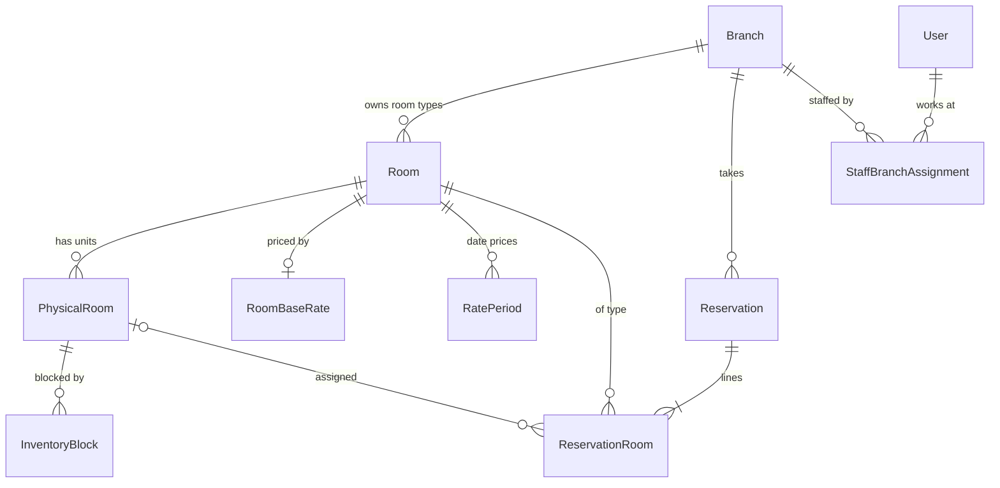

# Branch model

Status: **Planned**, design accepted 2026-10-24 (ADR 017). Nothing in this document is implemented yet.

## Identity and attributes

| Attribute | Notes |
| --- | --- |
| `id` | CUID2, like every other table |
| `slug` | URL-safe, unique, immutable after the branch is first activated (`new-cairo`) |
| `name` | "Rivana Residence New Cairo" |
| `summary` | Short public description |
| `status` | `ACTIVE` or `INACTIVE` |
| `onlineBookingEnabled` | If false, Book Now for this branch keeps today's disabled behavior, while staff can still record reservations |
| `timeZone` | IANA zone, default `Africa/Cairo`; defines the branch's "today" |
| `currency` | `USD` (one currency for all branches) |
| Contact | `phone`, `email`, `addressLine1/2`, `city`, `country`, `latitude`, `longitude` |
| Operational text | `checkInTime`, `checkOutTime` as display strings ("14:00"), and policy text references once approved |
| `heroMediaId` | Optional `MediaAsset` (PDF "branch images") |
| `syncReminderIntervalMinutes` | Default 30, allowed 10–240. How often receptionists must record a sync checkpoint (Q-20) |
| `syncFollowUpMinutes` | Default 10, allowed 5–60, and less than the interval. Delay before reminding again after "I'm syncing now" |
| `sortOrder` | Display order |
| Audit | `createdAt`, `updatedAt`, `updatedById` |

`SiteSettings` stays the brand-wide identity (logo, social links, default SEO). The first branch is created by migration from the current `SiteSettings` contact fields, so the public site does not change.

## Relationships

- A room type belongs to exactly one branch. The same product at two branches is two room types.
- A physical room belongs to one room type and therefore one branch.
- Prices belong to a room type, so they are branch-specific automatically.
- A reservation belongs to one branch. Each of its lines references a room type of the same branch, enforced by a composite foreign key.

## Availability scope

Availability is computed per `(branch, room type, night)`. Queries always take an explicit `branchId`. There is no code path that aggregates capacity across branches.

## Branch selection

- **Public journey:** the customer chooses a branch on `/book` (skipped automatically when only one branch is active and bookable). The choice travels in the URL path (`/book/[branchSlug]/…`), so it survives reloads, sharing, and the back button without cookies.
- **Server validation:** every public request resolves `branchSlug` to an `ACTIVE` branch with online booking enabled. Every staff request checks branch assignment. A client-supplied branch identifier is never trusted without that lookup.
- **Room pages:** `/rooms/[slug]` keeps working. The room's branch is shown, and its Book Now goes to `/book/[branchSlug]/[roomSlug]`.
- **Subdomains** (`newcairo.rivanaresidence.com`, from the PDF example) are deferred (Q-03).

## Sync reminders

- Each branch has its own interval and follow-up delay, edited by Admin on the branch's settings screen. A change applies from the next reminder.
- The reminder is per branch (Q-20). Any receptionist's "I have synced" records one checkpoint and clears the reminder for everyone at that branch.
- Reminders go to signed-in staff with `reservations:record-external` for that branch, on every dashboard page. A Manager sees overdue branches on the overview, but does not get the pop-up unless they hold the front-desk role at that branch.
- A sound plays when the pop-up opens. Browsers only allow sound after the person has interacted with the page, so the pop-up always appears and the tab title flashes even if the sound is blocked.
- Nothing is shown when no one is signed in. Gaps appear in the checkpoint history for the manager review.

## Staff access

| Role | Branch scope |
| --- | --- |
| Admin | All branches, implicitly |
| Manager | Assigned branches only; reports are scoped to them |
| Receptionist | Assigned branches only |
| Editor (if kept) | None; CMS only |

A Receptionist or Manager with no assignment can sign in but sees no reservation data.

## Deactivation

When an Admin sets a branch to `INACTIVE`:

- It disappears from public branch lists, the room listing filters, and the sitemap. Its room pages return 404 unless the client approves another behavior.
- Public availability and reservation creation for it return `404 BRANCH_NOT_FOUND`.
- Staff with access still see and manage its existing reservations: cancel, check out, view history. New staff reservations are refused unless it is reactivated.
- Nothing is deleted. Branch deletion is not offered; a branch with history is retained for reporting and audit.

## Future expansion

Adding a branch means creating the branch, its room types (CMS), physical rooms, and rates, assigning staff, and enabling online booking. No code or schema change is needed. Branch-specific pages, facilities, and promotions are a later candidate (Q-04).
