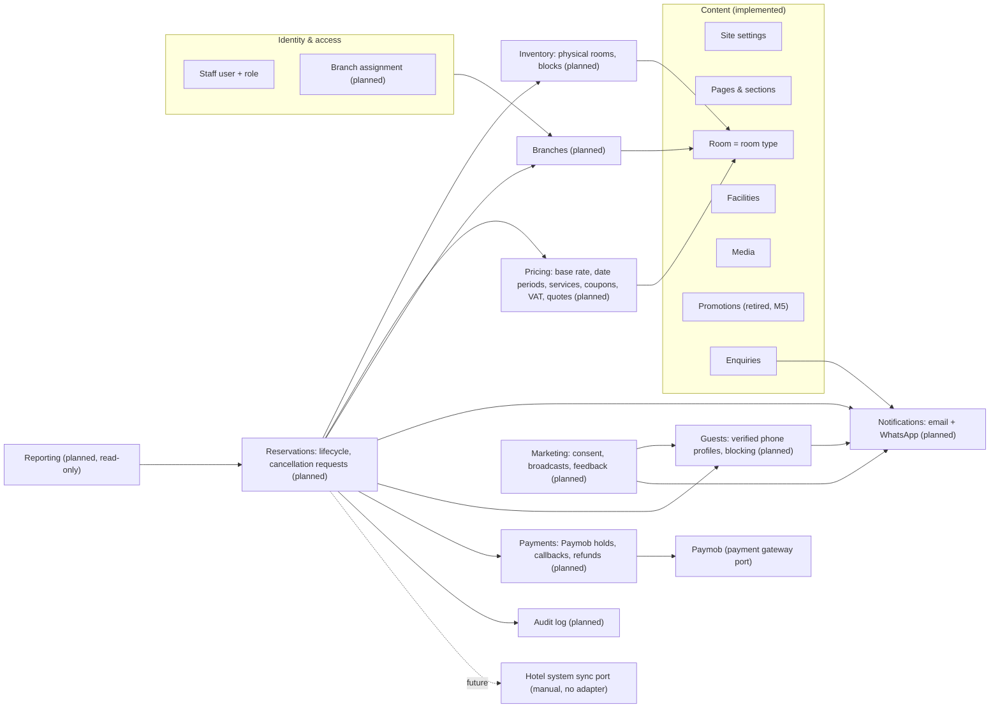

# Domain model

Rivana's domain has two kinds of concepts that work together. **Content** is how each branch presents itself: brand settings, pages, accommodation listings, facilities, media, and enquiries. **Operations** is how it sells and runs stays: branches, physical units, prices, services, coupons, VAT, reservations, payments, and guest messaging. A `Room` belongs to both. It is the marketing page for a listing (a room type or an apartment type) *and* the listing that inventory, prices, and reservations refer to.

Status: content concepts are **implemented** (Phases 2–7) in single-site form; branch ownership and the accommodation type are planned (M4–M5). The promotion popup is implemented and retired (Q-47, removal M5). Branches, inventory, pricing, services, coupons, VAT, reservations, payments, cancellation requests, messaging, and audit are **planned** (M4–M13), revised by the client decisions of 2026-11-06.

## Bounded contexts



Operations modules read only the listing facts they need (`id`, `branchId`, `accommodationType`, `name`, `slug`, `status`, `maxAdults`, `maxChildren`) through a narrow port. They never edit marketing content.

## Content

### Site settings

The singleton site identity: residence name, legal/footer copy, logos, phone, email, physical address, IANA timezone, map configuration, default metadata, and display preferences. Social links are ordered child records.

Invariants:

- exactly one default settings record;
- contact email and URLs must be valid;
- timezone must be a valid configured IANA identifier and server timestamps remain stored in UTC;
- required brand media must be `READY` media assets;
- booking content may contain CTA wording but no invented rates or availability.

### Page

A managed singleton for `HOME`, `ABOUT`, or `CONTACT`, containing route metadata and a controlled ordered set of `PageSection` records.

Invariants:

- one page per page key;
- section types must be allowed for that page key;
- section payload must pass its type-specific Zod schema;
- section positions are unique inside a page;
- a published page cannot reference pending/deleted media.

### Room

Marketing information for an accommodation listing: name, slug, summaries, description, size, adult/child occupancy, bed/view text, features, media, ordering, featured state, and publication state. Planned (M4): owning `branchId`, `accommodationType` (`ROOM` or `APARTMENT`), optional `bedroomCount` and `bathroomCount`. The same record is the bookable listing that inventory, pricing, and reservations reference.

Invariants:

- slug is globally unique among rooms and URL-safe;
- adult occupancy is at least one; child occupancy and size are non-negative;
- title, summary, and hero image are required before publication;
- media ordering is deterministic and one image is marked as hero;
- marketing fields only. Prices, physical units, and reservations live in their own tables and reference the listing by id. Each listing will belong to exactly one branch (planned, ADR 017, ADR 026).

### Room feature

An ordered marketing bullet owned by one room, such as “Private balcony” or “Kitchenette.” `iconKey` is selected from an application allowlist so editors cannot inject arbitrary SVG/HTML.

### Facility

Marketing information for an amenity such as Gym or Swimming Pool. Contains name, slug, summary, rich description, optional opening-hours text, media, ordering, featured state, and publication state.

Invariants mirror Room publication and media rules. Hours remain editorial text until a future scheduling requirement proves that structured weekly hours are necessary.

### Media asset

Metadata for an object stored outside PostgreSQL: storage key, MIME type, byte size, dimensions, alt text, focal point, caption/credit, checksum, status, and ownership timestamps.

Invariants:

- only allowed image formats and configured size/dimension limits;
- storage key and checksum are unique where appropriate;
- alt text is required when used as meaningful content; decorative usage is marked explicitly by the association;
- an asset cannot be hard-deleted while referenced;
- replacement creates/finalizes a new object before references are swapped.

### Contact enquiry

A visitor message with name, email, optional phone, subject/message, lifecycle state, and timestamps. It is not a guest profile or CRM.

Invariants:

- server-validated lengths and email;
- no HTML accepted in visitor fields;
- rate limiting and bot controls run before persistence/delivery;
- retention is finite; archived data is purged according to policy.

### Promotion

**Implemented; retired by Q-47 (removal in M5).** A managed marketing campaign that surfaces a code in a public popup. It contains an internal name, public headline/body, code, optional terms, publication state, start/end timestamps, priority, and popup visibility. It advertises a code only and never validates or prices it. Coupons (planned, below) replace it.

Invariants:

- code is trimmed, bounded, and limited to a conservative printable allowlist; it is displayed exactly as saved;
- `startsAt` must precede `endsAt` when both exist;
- only `PUBLISHED` promotions inside their active time window can be returned publicly;
- when multiple promotions are active, the highest priority wins, followed by the most recently published record as a deterministic tie-breaker;
- archived/expired promotions never appear publicly;
- materially changing public popup content increments its version so visitors who dismissed an older version may see the update;
- public dismissal is browser-local and contains no visitor identity or reservation data.

### Staff identity

Better Auth owns user, account, session, and verification records. Rivana adds a role: `EDITOR` and `ADMIN` today, plus `RECEPTIONIST` and `MANAGER` with branch assignments (planned, ADR 018). Public registration is disabled; accounts are provisioned by an Admin. Roles and capabilities: [../requirements/user-roles-and-permissions.md](../requirements/user-roles-and-permissions.md).

### Publication and deletion

- `DRAFT`, `PUBLISHED`, and `ARCHIVED` describe editorial visibility for rooms/facilities.
- Pages are required route singletons and use section visibility plus an overall published flag; they are not deleted through the CMS.
- Room/facility deletion is soft (`ARCHIVED`) by default. Hard deletion is an explicit administrator maintenance action after reference checks.
- Media deletion is blocked when usage count is non-zero and is otherwise a two-step database/object deletion operation.
- Contact enquiries can be archived and later purged; they do not participate in content publication.
- Promotions use `DRAFT`, `PUBLISHED`, and `ARCHIVED`; the active window controls display without changing the stored publication state.
- Reservations are never deleted through the application; their lifecycle is in [reservation-lifecycle.md](./reservation-lifecycle.md).

## Operations

### Commercial rules (planned, ADR 027)

- `ServiceOffering` (`branchId`, `kind` `BREAKFAST|AIRPORT_TRANSFER`, `priceUnit`, `priceMinor`, `childPriceMinor?`, `active`). Price unit configurable per offering (SV-1…4).
- `Coupon` (`code`, `kind` `PERCENT|FIXED`, value, validity, total and per-phone limits, branch scope, `active`) and `CouponRedemption` (coupon, reservation, phone). Rules CP-1…7.
- `CommercialSettings` (`vatRateBasisPoints`, never null, seeded at 1500). Rules TX-1…5.
- `QuoteCalculator` (pure): accommodation + services − discount = taxable; VAT half-up once; total.

### Payments and cancellation requests (planned, ADRs 024–025)

- `Payment` (reservation, provider `PAYMOB`, provider ids, amount, currency, status `INITIATED|SUCCEEDED|FAILED|REFUND_PENDING|REFUNDED|REFUND_FAILED`) and `PaymentEvent` (verified callbacks, unique per provider transaction). Rules PY-1…8.
- `CancellationRequest` (reservation, reason, status `OPEN|APPROVED|REJECTED|REFUND_PENDING|REFUND_FAILED|COMPLETED`, decided by and at, decision reason). Rules CX-1…7.

### Marketing (planned, ADR 028)

- Consent on `Guest`: `marketingOptInAt`, `marketingConsentVersion`, `marketingOptOutAt`.
- `Broadcast` (author, branches, template, variables, optional coupon, audience count, status); one outbox row per recipient.

### Value objects

**Implemented (M6-T1, accepted 2026-11-08):** `LocalDate`, `StayRange`, `StayPolicy`, `Occupancy`, and `Money` in `src/domain/shared/`, plus `localDateAt` in `zoned-time.ts`. The remaining value objects below are planned for later tasks and milestones. See [spec 0003](../specs/0003-m6-inventory-and-availability.md) and the [M6 evidence](../delivery/reports/m6-inventory-and-availability.md).

| Name | Rules |
| --- | --- |
| `LocalDate` | Strict `YYYY-MM-DD`, real Gregorian years 0001–9999; ordering, calendar-day addition, day difference, and canonical formatting without instant arithmetic |
| `StayRange` | Immutable `checkIn < checkOut`; exclusive checkout, lazy nights, symmetric overlap (AV-3). Structural ranges do not enforce public booking limits |
| `StayPolicy` | `validatePublicStay(stay, today, policy)` checks public dates separately: no past arrival, maximum 30 nights and arrival at most 540 days ahead by default (AV-5/6/7, Q-09). Same-day arrival has no cutoff |
| `Occupancy` | Safe integer `adults ≥ 1`, `children ≥ 0`; per-unit eligibility against that listing's `maxAdults` and `maxChildren`. No fixed shared-value limit of 20 |
| `Money` | Nonnegative safe integer USD cents; checked same-currency addition and integer multiplication; storage-specific rate bounds belong at persistence boundaries |
| `ReservationReference` | Format, normalization (uppercase, ambiguous characters mapped) |
| `PhoneNumber` | E.164 international format, normalized with a maintained library; equality on the normalized value |
| `GuestContact` | `fullName` (1–120), `email` (normalized), `phone` (`PhoneNumber`), optional `country`, optional `specialRequests` (≤ 1000, plain text) |
| `VerificationCode` | 6 digits from a secure random source; stored only as a hash |
| `IdempotencyKey` | 8–128 visible ASCII characters |

### Reservation (aggregate root)

```text
Reservation
  id, reference, branchId, source, status, version
  stay: StayRange
  guestId                              (guest profile, see Guest below)
  guest: GuestContact                  (contact as given for this stay)
  rooms: ReservationRoom[1..n]        (several units, same stay; Q-39)
    roomTypeId, occupancy, physicalRoomId?, nights: NightPrice[]
  services: ReservationService[0..2]   (kind, unit, adult and child quantities, amountMinor)
  coupon?: { couponId, code, kind, value }
  price: accommodation, services, subtotal, discount, taxable, vatRateBasisPoints, vat, total (Money)
  paymentMethod: PAY_AT_HOTEL | PAYMOB (Q-37)
  paymentStatus: NOT_REQUIRED | AWAITING | PAID | REFUND_PENDING | REFUNDED
  holdExpiresAt?                       (AWAITING_PAYMENT only)
  pmsEnteredAt?, pmsEnteredById?       (WEBSITE source; Q-40)
  externalReference?                   (required when source = EXTERNAL)
  internalNotes?                       (staff only)
  manageTokenHash, manageTokenExpiresAt
  idempotency: keyHash, requestFingerprint
```

Invariants:

- R-1: All lines use the reservation's branch, enforced by a composite FK.
- R-2: Line stays equal the reservation stay in v1.
- R-3: Occupancy per line fits the room type (OC-2).
- R-4: `accommodation = Σ nights over all lines`; there is one night price per night per line; `total = taxable + vat` per ADR 027.
- R-5: Status changes only through the transitions in [reservation-lifecycle.md](./reservation-lifecycle.md).
- R-6: `consumesInventory` on each line equals `status ∈ {AWAITING_PAYMENT, CONFIRMED, CHECKED_IN, CHECKED_OUT}`. It is maintained by the repository in the same transaction as every status change, including hold expiry.
- R-7: `EXTERNAL` requires an `externalReference` that is unique within the branch.
- R-8: Guest contact is never returned by a public endpoint without a valid manage token or a guest session for the same verified phone.
- R-9: A `WEBSITE` reservation has a guest profile whose phone was verified for this booking (GV-2), and the phone is not blocked at creation.
- R-10: A reservation is `CONFIRMED` only when its inventory is held in the same database state and, for `PAYMOB`, a verified success has been processed. Confirmation messages are written only in the transaction that sets `CONFIRMED`.

Domain services (pure M6-T2 rules accepted 2026-11-08; the reservation state machine and full quote remain planned):

- `AvailabilityCalculator`: given capacity and sold counts per night, checks every requested night and returns the earliest failure (implemented in `src/domain/inventory/`).
- `checkInventoryReduction`: checks block/assignment overlaps and sparse sold dates against projected capacity, with replacement and deactivation semantics (implemented in `src/domain/inventory/`). Callers must scope inputs and load current state under the listing lock; no persistence or locking is implemented by this calculation.
- `NightlyPriceResolver`: given base rate and active periods, produces immutable nightly prices and an exact accommodation total, or a null total for any unpriced night (implemented in `src/domain/pricing/`, PR-3).
- `ReservationStateMachine`: allowed transitions plus preconditions (pure, given "today" in the branch zone).
- `QuoteCalculator`: total composition (pure, ADR 027).
- `CancellationDeadline`: 24 hours before the branch check-in time on the arrival date (pure, CX-1).

### Inventory

- `PhysicalRoom` (`id`, `branchId`, `roomTypeId`, `label`, `active`, `notes`): one room or apartment unit. The label is unique per branch.
- `InventoryBlock` (`id`, `branchId`, `physicalRoomId`, range, `reason` `MAINTENANCE|OWNER_USE|OTHER`, `note`, `cancelledAt`). Active blocks on one room may not overlap.

### Pricing

- `RoomBaseRate` (`roomTypeId` unique, `amount`).
- `RatePeriod` (`id`, `roomTypeId`, range, `amount`, `label?`, `active`). Active periods of one listing may not overlap (PR-4). No kinds (Q-44).

### Guest (verified phone profile)

```text
Guest
  id, phone (PhoneNumber, unique)
  name, email                          (latest used)
  phoneVerifiedAt?                     (null for profiles created by staff entry)
  blockedAt?, blockedById?, blockReason?
PhoneVerification
  id, phone, purpose (BOOKING | GUEST_SESSION), codeHash, attempts, expiresAt, consumedAt?, verifiedAt?
```

Rules:

- GV-1: A code is valid for 10 minutes and 5 attempts. At most 3 codes per phone per 15 minutes and 10 per day, plus per-client limits.
- GV-2: A correct `BOOKING` code yields a verification token valid for 30 minutes and one reservation. A correct `GUEST_SESSION` code yields a 30-minute guest session for that phone.
- GV-3: A blocked phone gets no code or broadcast, and its open verifications are invalid. The message the guest sees does not reveal more than "please contact the hotel".
- GV-4: Blocking and unblocking need `guests:block` (Manager, Admin) and a reason. They apply to all branches and are audited. Existing reservations are not changed automatically.
- GV-5: Staff-created and external reservations link to the guest with the same normalized phone, or create an unverified profile. Staff entry never marks a phone verified.
- GV-6: Guest data is never deleted automatically (Q-13).

### Sync checkpoints

- `BranchSyncCheckpoint` (`branchId`, `kind` `COMPLETED|STARTED`, `recordedById`, `note`, `recordedAt`).
- A branch is **due** when `now ≥ last COMPLETED + interval`. Once a `STARTED` is recorded, the branch is due again at `STARTED + follow-up delay` until a `COMPLETED` arrives. Interval and delay are branch settings ([branch-model.md](./branch-model.md#sync-reminders)).

### Branch and staff

See [branch-model.md](./branch-model.md) and ADR 018. `StaffPrincipal` gains `branchIds`.

### Audit

`AuditEvent` is append-only: actor (staff, guest token, payment provider, or system), action (`reservation.confirmed`, `cancellation-request.approved`, `refund.succeeded`, `coupon.updated`, `rate-period.updated`, …), entity type and id, `branchId`, `changes` (JSON with personal data redacted), `reason`, `occurredAt`. It covers reservation, payment, refund, cancellation-request, inventory, pricing, service, coupon, VAT, branch, guest-block, consent, broadcast, sync-checkpoint, PMS-entry, and staff-assignment actions. Retrofitting CMS content edits is Q-15.

## Application ports

Repositories speak domain/application DTOs, never Prisma payload types. Provider ports isolate vendor SDKs.

```text
Content (implemented)
  PageRepository, RoomRepository, FacilityRepository, SettingsRepository,
  MediaRepository, EnquiryRepository, PromotionRepository (retired in M5), AdminOverviewReader
  (all take a branch from M4–M5, except settings and media)
  MediaStorage, ImageProcessor, ContactDelivery, CacheInvalidator
  BookingProvider            Book Now launch descriptor (disabled today; internal booking mode planned)
Identity (implemented)
  CredentialAuthenticator, StaffDirectory, LoginThrottleStore, ThrottleKeyDeriver
Shared (implemented)
  Clock, IdGenerator, Hasher
Operations (planned)
  ReservationUnitOfWork      transaction(work) → binds the repositories below to one DB transaction
    InventoryLock            lockRoomTypes(branchId, roomTypeIds)          (ADR 016)
    InventoryReader          capacityByNight / soldByNight (branchId, roomTypeId, stay)
    ReservationRepository    insert, findForUpdate, save, findByIdempotencyKey, findByReference
    BlockRepository          insert, cancel, listOverlapping
    AuditLog                 append(event)
    NotificationOutbox       enqueue(message)
  RoomTypeCatalog            bookable room types for a branch (reads Room, read-only)
  RateRepository             base rate + periods for a listing and range
  ServiceRepository          branch service offerings
  CouponRepository           findByCode, lockForRedemption, countRedemptions, save
  CommercialSettingsRepository  VAT rate
  PaymentRepository          payments, events (unique per provider transaction)
  CancellationRequestRepository  open, decide, refund state
  PaymentGateway             createCheckout, verifyCallback, getTransaction, refund (Paymob adapter; ADR 025)
  BroadcastRepository        broadcasts and audience query (ADR 028)
  BranchRepository           findActiveBySlug, findById, list, save
  StaffBranchAccess          branchIds for a user; assign/unassign
  ReservationReadModel       staff lists, filters, availability grid, reports (read-only)
  SecureTokenGenerator       random tokens and references
  GuestRepository            findByPhone, upsertFromBooking, block, unblock, search
  PhoneVerificationRepository create, findActive, recordAttempt, consume
  SyncCheckpointRepository   record, latest(branchId), history
  EmailSender                outbox dispatcher (reuses the SMTP setup of ContactDelivery)
  WhatsAppSender             authentication, transactional, feedback, and marketing templates (provider adapter; ADR 028)
  HotelSystemSync            future PMS integration; no adapter (manual)
```

## Use cases

**Content (implemented).**

- Queries: published navigation and settings; page by key; published rooms and facilities; room or facility by slug; admin content and media usage; current promotion; admin promotions; dashboard counts.
- Commands: update settings and social links; edit, reorder, or toggle page sections; create, update, publish, archive, or delete rooms and facilities; upload, finalize, replace, or delete media; create, schedule, publish, or archive promotions; submit or archive enquiries; sign in, sign out, revoke sessions; resolve the Book Now launch.

**Operations (planned).**

- Public: `ListBranches`, `ListBookableRoomTypes`, `SearchAvailability`, `QuoteBooking`, `RequestPhoneVerification`, `ConfirmPhoneVerification`, `CreateWebsiteReservation`, `ProcessPaymentCallback`, `ListGuestReservations`, `GetGuestReservation`, `RequestCancellation`.
- Staff: `ListReservations`, `GetReservation`, `CreateStaffReservation`, `RecordExternalReservation`, `MarkEnteredInHotelSystem`, `CancelReservation`, `ListCancellationRequests`, `DecideCancellationRequest`, `RetryRefund`, `ManageServices`, `ManageCoupons`, `ManageCommercialSettings`, `PreviewBroadcastAudience`, `SendBroadcast`, `ModifyReservationStay`, `UpdateReservationGuest`, `AssignPhysicalRoom`, `CheckIn`, `CheckOut`, `MarkNoShow`, `ResendManageLink`, `GetAvailabilityGrid`, `CreateBlock`, `CancelBlock`, `ManagePhysicalRooms`, `ManageRates`, `GetSyncStatus`, `RecordSyncCheckpoint`, `SearchGuests`, `GetGuest`, `BlockGuestPhone`, `UnblockGuestPhone`, `GetReports`, `ListAuditEvents`, `ManageBranches`, `AssignStaffBranches`.

Every command and sensitive query authorizes itself, with branch scope for operations data, not only in menus or route layouts.

## Sequence: website booking

Pay at hotel (immediate confirmation, ADR 024). The Paymob path creates `AWAITING_PAYMENT` instead and confirms in `ProcessPaymentCallback` ([reservation-lifecycle.md](./reservation-lifecycle.md#payments-adr-025), ADR 025).

```mermaid
sequenceDiagram
  autonumber
  participant B as Browser (booking form)
  participant H as POST /api/v1/reservations
  participant U as CreateWebsiteReservation
  participant DB as PostgreSQL
  participant O as Outbox dispatcher
  B->>H: JSON + Idempotency-Key
  H->>H: size/content-type/Zod validation, rate limit
  Note over B,H: earlier: POST /phone-verifications → WhatsApp code → confirm → verification token; POST /quotes
  H->>U: command (branchSlug, lines[], services[], couponCode?, guest, verificationToken, paymentMethod, expectedTotal, marketingOptIn)
  U->>DB: BEGIN
  U->>DB: idempotency lookup (replay → return original)
  U->>DB: consume verification token; guest not blocked; per-phone cap
  U->>DB: expire overdue holds of these listings; SELECT Room … ORDER BY id FOR NO KEY UPDATE
  U->>DB: capacity & sold per night per listing; rates; services; SELECT Coupon … FOR UPDATE; VAT rate
  U->>U: AvailabilityCalculator + NightlyPriceResolver + CouponPolicy + QuoteCalculator (domain)
  alt unavailable, coupon refused, or total changed
    U->>DB: ROLLBACK
    U-->>H: INVENTORY_UNAVAILABLE / COUPON_INVALID / PRICE_CHANGED
    H-->>B: 409 or 422 problem+json (nothing created, nothing sent)
  else ok (pay at hotel)
    U->>DB: upsert guest; INSERT reservation CONFIRMED, lines, nights, services, redemption, audit, outbox (email + WhatsApp confirmation, staff alert)
    U->>DB: COMMIT
    U-->>H: reference, status CONFIRMED, manage token
    H-->>B: 201 {reference, status: "CONFIRMED", manageUrl}
    O->>DB: claim outbox rows (after commit)
    O->>O: send "booking confirmed" by email and WhatsApp
  end
```
