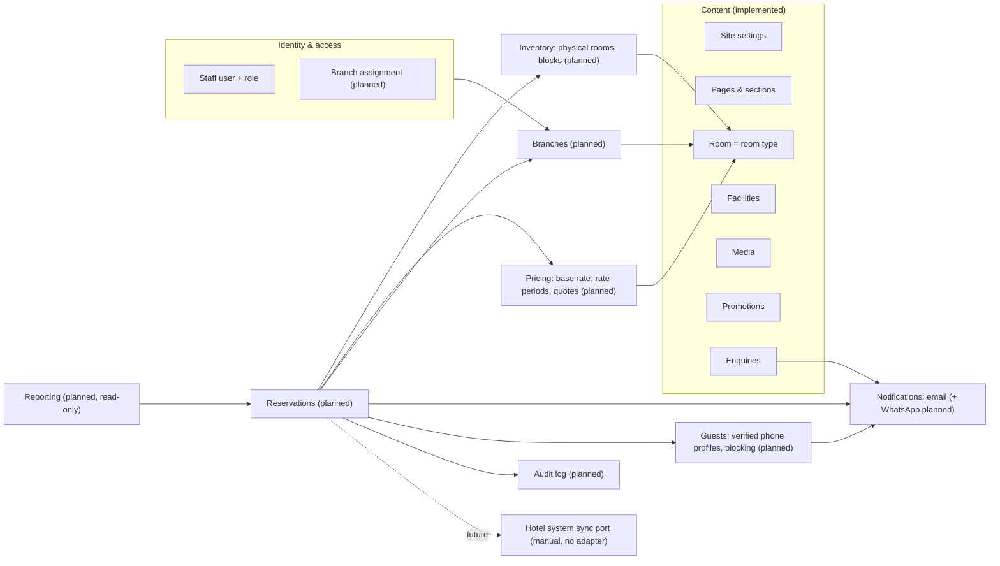

# Domain model

Rivana's domain has two kinds of concepts that work together. **Content** is how the residence presents itself: settings, pages, rooms, facilities, media, promotions, and enquiries. **Operations** is how it sells and runs stays: branches, physical rooms, prices, and reservations. A `Room` belongs to both. It is the marketing page for a room type *and* the room type that inventory, prices, and reservations refer to.

Status: content concepts are **implemented** (Phases 2–7). Branches, inventory, pricing, reservations, and audit are **planned** (milestones M4–M7).

## Bounded contexts



Operations modules read only the room-type facts they need (`id`, `branchId`, `name`, `slug`, `status`, `maxAdults`, `maxChildren`) through a narrow port. They never edit marketing content.

## Content

### Site settings

The singleton site identity: residence name, legal/footer copy, logos, phone, email, physical address, IANA timezone, map configuration, default metadata, and display preferences. Social links are ordered child records.

Invariants:

- exactly one default settings record;
- contact email and URLs must be valid;
- timezone must be a valid configured IANA identifier and server timestamps remain stored in UTC;
- required brand media must be `READY` media assets;
- booking content may contain CTA wording but no invented rates or availability.

### Page

A managed singleton for `HOME`, `ABOUT`, or `CONTACT`, containing route metadata and a controlled ordered set of `PageSection` records.

Invariants:

- one page per page key;
- section types must be allowed for that page key;
- section payload must pass its type-specific Zod schema;
- section positions are unique inside a page;
- a published page cannot reference pending/deleted media.

### Room

Marketing information for a room type: name, slug, summaries, description, size, adult/child occupancy, bed/view text, features, media, ordering, featured state, and publication state. The same record is the bookable room type that inventory, pricing, and reservations reference.

Invariants:

- slug is globally unique among rooms and URL-safe;
- adult occupancy is at least one; child occupancy and size are non-negative;
- title, summary, and hero image are required before publication;
- media ordering is deterministic and one image is marked as hero;
- marketing fields only. Prices, physical rooms, and reservations live in their own tables and reference the room by id. Each room will belong to exactly one branch (planned, ADR 017).

### Room feature

An ordered marketing bullet owned by one room, such as “Private balcony” or “Kitchenette.” `iconKey` is selected from an application allowlist so editors cannot inject arbitrary SVG/HTML.

### Facility

Marketing information for an amenity such as Gym or Swimming Pool. Contains name, slug, summary, rich description, optional opening-hours text, media, ordering, featured state, and publication state.

Invariants mirror Room publication and media rules. Hours remain editorial text until a future scheduling requirement proves that structured weekly hours are necessary.

### Media asset

Metadata for an object stored outside PostgreSQL: storage key, MIME type, byte size, dimensions, alt text, focal point, caption/credit, checksum, status, and ownership timestamps.

Invariants:

- only allowed image formats and configured size/dimension limits;
- storage key and checksum are unique where appropriate;
- alt text is required when used as meaningful content; decorative usage is marked explicitly by the association;
- an asset cannot be hard-deleted while referenced;
- replacement creates/finalizes a new object before references are swapped.

### Contact enquiry

A visitor message with name, email, optional phone, subject/message, lifecycle state, and timestamps. It is not a guest profile or CRM.

Invariants:

- server-validated lengths and email;
- no HTML accepted in visitor fields;
- rate limiting and bot controls run before persistence/delivery;
- retention is finite; archived data is purged according to policy.

### Promotion

A managed marketing campaign that can surface a code in a public popup. It contains an internal name, public headline/body, code, optional terms, publication state, start/end timestamps, priority, and popup visibility. A promotion advertises a code only. Rivana never validates, redeems, or prices a code; offers that change prices are rate periods (PR-2).

Invariants:

- code is trimmed, bounded, and limited to a conservative printable allowlist; it is displayed exactly as saved;
- `startsAt` must precede `endsAt` when both exist;
- only `PUBLISHED` promotions inside their active time window can be returned publicly;
- when multiple promotions are active, the highest priority wins, followed by the most recently published record as a deterministic tie-breaker;
- archived/expired promotions never appear publicly;
- materially changing public popup content increments its version so visitors who dismissed an older version may see the update;
- public dismissal is browser-local and contains no visitor identity or reservation data.

### Staff identity

Better Auth owns user, account, session, and verification records. Rivana adds a role: `EDITOR` and `ADMIN` today, plus `RECEPTIONIST` and `MANAGER` with branch assignments (planned, ADR 018). Public registration is disabled; accounts are provisioned by an Admin. Roles and capabilities: [../requirements/user-roles-and-permissions.md](../requirements/user-roles-and-permissions.md).

### Publication and deletion

- `DRAFT`, `PUBLISHED`, and `ARCHIVED` describe editorial visibility for rooms/facilities.
- Pages are required route singletons and use section visibility plus an overall published flag; they are not deleted through the CMS.
- Room/facility deletion is soft (`ARCHIVED`) by default. Hard deletion is an explicit administrator maintenance action after reference checks.
- Media deletion is blocked when usage count is non-zero and is otherwise a two-step database/object deletion operation.
- Contact enquiries can be archived and later purged; they do not participate in content publication.
- Promotions use `DRAFT`, `PUBLISHED`, and `ARCHIVED`; the active window controls display without changing the stored publication state.
- Reservations are never deleted through the application; their lifecycle is in [reservation-lifecycle.md](./reservation-lifecycle.md).

## Operations

### Value objects

| Name | Rules |
| --- | --- |
| `LocalDate` | Valid ISO calendar date; ordering; add days; parse and format |
| `StayRange` | `checkIn < checkOut`; nights; overlap (AV-3); length limits (AV-6/7) |
| `Occupancy` | `adults ≥ 1`, `children ≥ 0`, bounded (≤ 20 each, matching the CMS) |
| `Money` | Integer minor units + `currency`; addition only; same currency |
| `ReservationReference` | Format, normalization (uppercase, ambiguous characters mapped) |
| `PhoneNumber` | E.164 international format, normalized with a maintained library; equality on the normalized value |
| `GuestContact` | `fullName` (1–120), `email` (normalized), `phone` (`PhoneNumber`), optional `country`, optional `specialRequests` (≤ 1000, plain text) |
| `VerificationCode` | 6 digits from a secure random source; stored only as a hash |
| `IdempotencyKey` | 8–128 visible ASCII characters |

### Reservation (aggregate root)

```text
Reservation
  id, reference, branchId, source, status, version
  stay: StayRange
  guestId                              (guest profile, see Guest below)
  guest: GuestContact                  (contact as given for this stay)
  rooms: ReservationRoom[1..n]        (v1: exactly 1)
    roomTypeId, occupancy, physicalRoomId?, nights: NightPrice[]
  total: Money (sum of nights)
  paymentMethod: PAY_AT_HOTEL          (Q-08)
  externalReference?                   (required when source = EXTERNAL)
  internalNotes?                       (staff only)
  manageTokenHash, manageTokenExpiresAt
  idempotency: keyHash, requestFingerprint
```

Invariants:

- R-1: All lines use the reservation's branch, enforced by a composite FK.
- R-2: Line stays equal the reservation stay in v1.
- R-3: Occupancy per line fits the room type (OC-2).
- R-4: `total = Σ nights`; there is one night price per night per line.
- R-5: Status changes only through the transitions in [reservation-lifecycle.md](./reservation-lifecycle.md).
- R-6: `consumesInventory` on each line equals `status ∈ {PENDING, CONFIRMED, CHECKED_IN, CHECKED_OUT}`. It is maintained by the repository in the same transaction as every status change.
- R-7: `EXTERNAL` requires an `externalReference` that is unique within the branch.
- R-8: Guest contact is never returned by a public endpoint without a valid manage token or a guest session for the same verified phone.
- R-9: A `WEBSITE` reservation has a guest profile whose phone was verified for this booking (GV-2), and the phone is not blocked at creation.

Domain services:

- `AvailabilityCalculator`: given capacity and sold counts per night, decides availability (pure).
- `PriceResolver`: given base rate and periods, produces night prices (pure, PR-3).
- `ReservationStateMachine`: allowed transitions plus preconditions (pure, given "today" in the branch zone).

### Inventory

- `PhysicalRoom` (`id`, `branchId`, `roomTypeId`, `label`, `active`, `notes`). The label is unique per branch.
- `InventoryBlock` (`id`, `branchId`, `physicalRoomId`, range, `reason` `MAINTENANCE|OWNER_USE|OTHER`, `note`, `cancelledAt`). Active blocks on one room may not overlap.

### Pricing

- `RoomBaseRate` (`roomTypeId` unique, `amount`).
- `RatePeriod` (`id`, `roomTypeId`, range, `kind`, `amount`, `label?`, `active`). Same-kind periods may not overlap (PR-4).

### Guest (verified phone profile)

```text
Guest
  id, phone (PhoneNumber, unique)
  name, email                          (latest used)
  phoneVerifiedAt?                     (null for profiles created by staff entry)
  blockedAt?, blockedById?, blockReason?
PhoneVerification
  id, phone, purpose (BOOKING | GUEST_SESSION), codeHash, attempts, expiresAt, consumedAt?, verifiedAt?
```

Rules:

- GV-1: A code is valid for 10 minutes and 5 attempts. At most 3 codes per phone per 15 minutes and 10 per day, plus per-client limits.
- GV-2: A correct `BOOKING` code yields a verification token valid for 30 minutes and one reservation. A correct `GUEST_SESSION` code yields a 30-minute guest session for that phone.
- GV-3: A blocked phone gets no code, and its open verifications are invalid. The message the guest sees does not reveal more than "please contact the hotel".
- GV-4: Blocking and unblocking need `guests:block` (Manager, Admin) and a reason. They apply to all branches and are audited. Existing reservations are not changed automatically.
- GV-5: Staff-created and external reservations link to the guest with the same normalized phone, or create an unverified profile. Staff entry never marks a phone verified.
- GV-6: Guest data is never deleted automatically (Q-13).

### Sync checkpoints

- `BranchSyncCheckpoint` (`branchId`, `kind` `COMPLETED|STARTED`, `recordedById`, `note`, `recordedAt`).
- A branch is **due** when `now ≥ last COMPLETED + interval`. Once a `STARTED` is recorded, the branch is due again at `STARTED + follow-up delay` until a `COMPLETED` arrives. Interval and delay are branch settings ([branch-model.md](./branch-model.md#sync-reminders)).

### Branch and staff

See [branch-model.md](./branch-model.md) and ADR 018. `StaffPrincipal` gains `branchIds`.

### Audit

`AuditEvent` is append-only: actor (staff, guest token, or system), action (`reservation.confirmed`, `rate-period.updated`, …), entity type and id, `branchId`, `changes` (JSON with personal data redacted), `reason`, `occurredAt`. It covers reservation, inventory, pricing, branch, guest-block, sync-checkpoint, and staff-assignment actions. Retrofitting CMS content edits is Q-15.

## Application ports

Repositories speak domain/application DTOs, never Prisma payload types. Provider ports isolate vendor SDKs.

```text
Content (implemented)
  PageRepository, RoomRepository, FacilityRepository, SettingsRepository,
  MediaRepository, EnquiryRepository, PromotionRepository, AdminOverviewReader
  MediaStorage, ImageProcessor, ContactDelivery, CacheInvalidator
  BookingProvider            Book Now launch descriptor (disabled today; internal booking mode planned)
Identity (implemented)
  CredentialAuthenticator, StaffDirectory, LoginThrottleStore, ThrottleKeyDeriver
Shared (implemented)
  Clock, IdGenerator, Hasher
Operations (planned)
  ReservationUnitOfWork      transaction(work) → binds the repositories below to one DB transaction
    InventoryLock            lockRoomTypes(branchId, roomTypeIds)          (ADR 016)
    InventoryReader          capacityByNight / soldByNight (branchId, roomTypeId, stay)
    ReservationRepository    insert, findForUpdate, save, findByIdempotencyKey, findByReference
    BlockRepository          insert, cancel, listOverlapping
    AuditLog                 append(event)
    NotificationOutbox       enqueue(message)
  RoomTypeCatalog            bookable room types for a branch (reads Room, read-only)
  RateRepository             base rate + periods for a room type and range
  BranchRepository           findActiveBySlug, findById, list, save
  StaffBranchAccess          branchIds for a user; assign/unassign
  ReservationReadModel       staff lists, filters, availability grid, reports (read-only)
  SecureTokenGenerator       random tokens and references
  GuestRepository            findByPhone, upsertFromBooking, block, unblock, search
  PhoneVerificationRepository create, findActive, recordAttempt, consume
  SyncCheckpointRepository   record, latest(branchId), history
  EmailSender                outbox dispatcher (reuses the SMTP setup of ContactDelivery)
  WhatsAppSender             verification codes and booking messages via approved templates (provider adapter)
  HotelSystemSync            future PMS integration; no adapter (manual)
```

## Use cases

**Content (implemented).**

- Queries: published navigation and settings; page by key; published rooms and facilities; room or facility by slug; admin content and media usage; current promotion; admin promotions; dashboard counts.
- Commands: update settings and social links; edit, reorder, or toggle page sections; create, update, publish, archive, or delete rooms and facilities; upload, finalize, replace, or delete media; create, schedule, publish, or archive promotions; submit or archive enquiries; sign in, sign out, revoke sessions; resolve the Book Now launch.

**Operations (planned).**

- Public: `ListBranches`, `ListBookableRoomTypes`, `SearchAvailability`, `QuoteStay`, `RequestPhoneVerification`, `ConfirmPhoneVerification`, `CreateWebsiteReservation`, `ListGuestReservations`, `GetGuestReservation`, `CancelGuestReservation`.
- Staff: `ListReservations`, `GetReservation`, `CreateStaffReservation`, `RecordExternalReservation`, `ConfirmReservation`, `DeclineReservation`, `CancelReservation`, `ModifyReservationStay`, `UpdateReservationGuest`, `AssignPhysicalRoom`, `CheckIn`, `CheckOut`, `MarkNoShow`, `ResendManageLink`, `GetAvailabilityGrid`, `CreateBlock`, `CancelBlock`, `ManagePhysicalRooms`, `ManageRates`, `GetSyncStatus`, `RecordSyncCheckpoint`, `SearchGuests`, `GetGuest`, `BlockGuestPhone`, `UnblockGuestPhone`, `GetReports`, `ListAuditEvents`, `ManageBranches`, `AssignStaffBranches`.

Every command and sensitive query authorizes itself, with branch scope for operations data, not only in menus or route layouts.

## Sequence: website booking

```mermaid
sequenceDiagram
  autonumber
  participant B as Browser (booking form)
  participant H as POST /api/v1/reservations
  participant U as CreateWebsiteReservation
  participant DB as PostgreSQL
  participant O as Outbox dispatcher
  B->>H: JSON + Idempotency-Key
  H->>H: size/content-type/Zod validation, rate limit
  Note over B,H: earlier: POST /phone-verifications → WhatsApp code → confirm → verification token
  H->>U: command (branchSlug, roomSlug, stay, occupancy, guest, verificationToken, expectedTotal)
  U->>DB: BEGIN
  U->>DB: idempotency lookup (replay → return original)
  U->>DB: consume verification token; guest not blocked
  U->>DB: SELECT Room … FOR NO KEY UPDATE (lock room type)
  U->>DB: capacity & sold per night; rates
  U->>U: AvailabilityCalculator + PriceResolver (domain)
  alt unavailable or price changed
    U->>DB: ROLLBACK
    U-->>H: INVENTORY_UNAVAILABLE / PRICE_CHANGED
    H-->>B: 409 problem+json
  else ok
    U->>DB: upsert guest profile; INSERT reservation, line, nights, audit, outbox (email + WhatsApp)
    U->>DB: COMMIT
    U-->>H: reference, status PENDING, manage token
    H-->>B: 201 {reference, status, manageUrl}
    O->>DB: claim outbox rows (after commit)
    O->>O: send "request received" by email and WhatsApp
  end
```
