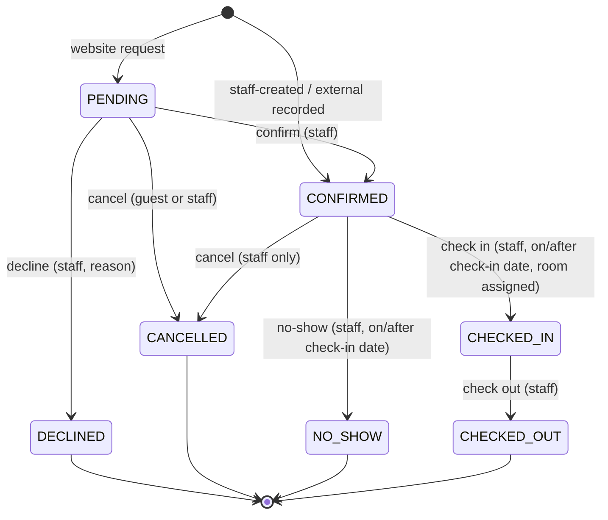

# Reservation lifecycle

Status: **Planned**, design accepted 2026-10-24. Request to book (Q-02) and pending-only guest cancellation (Q-07) were decided on 2026-10-24.

## States

| State | Meaning | Consumes inventory |
| --- | --- | --- |
| `PENDING` | Website request received; inventory held; staff have not yet checked it against the hotel system | Yes |
| `CONFIRMED` | Accepted by staff, or created or recorded by staff | Yes |
| `DECLINED` | Staff refused a pending request (reason required) | No |
| `CANCELLED` | Cancelled by the guest or by staff (reason required for staff) | No |
| `CHECKED_IN` | Guest has arrived; a physical room is assigned | Yes |
| `CHECKED_OUT` | Stay completed; an early departure shortens the stay | Yes (historical nights only) |
| `NO_SHOW` | Guest did not arrive | No |

There are no temporary holds or expiring carts. Inventory is taken only when a reservation is created. Q-11 asks whether unactioned `PENDING` requests should expire; the recommendation is no automatic expiry in v1, with an age indicator and manager alert instead.

## State machine

## Transitions

| Transition | Who (capability) | Preconditions | Effects |
| --- | --- | --- | --- |
| create (website) → `PENDING` | Public, rate-limited | Valid phone verification token (GV-2) for a non-blocked phone; branch active with online booking; room type bookable; valid stay and occupancy; price matches `expectedTotalMinor`; inventory free under lock; idempotency key | Guest profile upserted; reference, manage token, price snapshot, audit; "request received" by email and WhatsApp; staff alert |
| create (staff) → `CONFIRMED` | `reservations:create` + branch | As above, minus public-only rules; manual price needs `pricing:override` | Audit; confirmation by email and WhatsApp if staff tick "send" |
| record external → `CONFIRMED` | `reservations:record-external` + branch | `externalReference` required and unique per branch; inventory free under lock, otherwise a conflict is reported | Audit, flagged source `EXTERNAL` |
| confirm `PENDING → CONFIRMED` | `reservations:decide` | Staff attest they checked the hotel system; checkbox stored in the audit entry | Confirmation by email and WhatsApp; audit |
| decline `PENDING → DECLINED` | `reservations:decide` | Reason (required, from a list plus free text) | Inventory released; decline message by email and WhatsApp; audit |
| cancel | Guest link or guest session (`PENDING` only, Q-07) or `reservations:cancel` (`PENDING` or `CONFIRMED`) | Not in a terminal state; not `CHECKED_IN` | Inventory released; message by email and WhatsApp; audit. No fee is calculated |
| modify stay | `reservations:modify` | `PENDING` or `CONFIRMED`; new dates or type pass inventory under locks for old and new type; re-quote (PR-11) | New snapshot for changed nights; version bump; audit with before and after values |
| edit guest details/notes | `reservations:modify` | Not terminal | Audit (personal fields redacted to "changed") |
| assign room | `reservations:front-desk` | Room of the same type and branch, active, unblocked, not assigned to an overlapping stay | Exclusion constraint is the final guard; audit |
| check in | `reservations:front-desk` | `CONFIRMED`; branch today ≥ check-in; room assigned | Audit |
| no-show | `reservations:front-desk` | `CONFIRMED`; branch today ≥ check-in | Inventory released; audit |
| check out | `reservations:front-desk` | `CHECKED_IN` | If branch today < check-out, the stay is shortened to today (IN-3); audit |

Every transition:

- runs in one transaction that re-reads the reservation `FOR UPDATE` and checks the expected `version` (optimistic concurrency, `412` on mismatch);
- appends an `AuditEvent` in the same transaction;
- writes any email or WhatsApp message as an outbox row in the same transaction, sent after commit.

## Reversals

Undoing a terminal state is **not** in v1 (Q-18). Reinstating a cancelled reservation is done by creating a new one, which re-checks inventory and price. Undoing a mistaken check-in requires an Admin data correction, which is audited.

## Reservation sources

| Source | Created by | Initial state | Notes |
| --- | --- | --- | --- |
| `WEBSITE` | Guest | `PENDING` | Must be entered into the PMS by staff on confirmation |
| `STAFF` | Receptionist and up | `CONFIRMED` | Phone, walk-in, or email request; staff also enter it in the PMS |
| `EXTERNAL` | Receptionist and up | `CONFIRMED` | Already in the PMS; `externalReference` required; recorded here to consume inventory |

Blocks are not reservations and have their own lifecycle: active, then cancelled. A block's end date can be shortened, but extending it re-checks inventory.

## Reference generation

- Format: `RR-` plus 8 characters of Crockford base32 (no `I`, `L`, `O`, `U`), generated from a cryptographically secure random source: about 1.1 × 10¹² values.
- There is a unique database constraint. On a collision the server regenerates, up to 3 attempts, inside the same transaction.
- References are not sequential, so they leak neither volume nor order. They are not secrets (ADR 019).

## Idempotency

- `POST` create endpoints require an `Idempotency-Key` header (8–128 visible ASCII characters). Without it the request is rejected with `400`.
- The key's scope is the source plus actor: the public client, or the staff user id. The server stores the key's hash and a SHA-256 fingerprint of the normalized request body on the reservation row, under a unique constraint.
- The same key with the same body returns `200` with the original reservation's reference and status. It does not return the manage token again; the response notes that the link was sent by email and WhatsApp.
- The same key with a different body returns `422 IDEMPOTENCY_KEY_REUSED`.
- Two concurrent requests with the same key: the unique constraint lets one insert win. The other returns the winner's result after commit, or `409 IDEMPOTENCY_IN_PROGRESS` if it still cannot see the row.
- Retention: the key stays with the reservation (permanent). Failed attempts store nothing.
