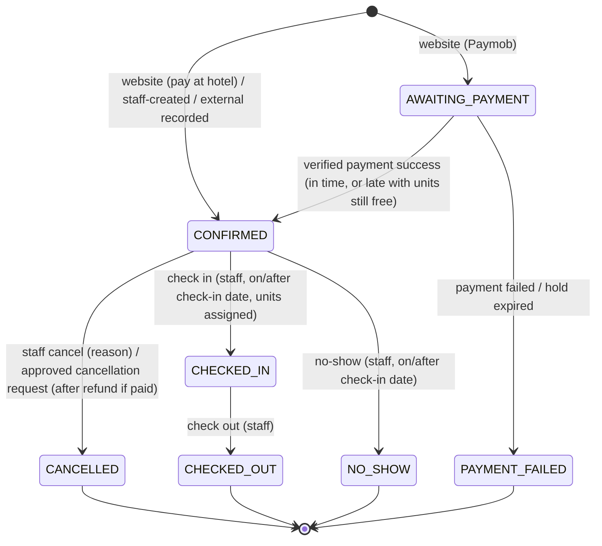

# Reservation lifecycle

Status: **Planned.** Design accepted 2026-10-24 and revised on 2026-11-06 by the client decisions Q-36 (immediate confirmation), Q-37 (Paymob or pay at hotel), Q-38 (cancellation requests), and Q-39 (several units per booking); see ADRs [024](../adr/024-immediate-confirmation.md) and [025](../adr/025-paymob-online-payment.md). The earlier request-to-book design (`PENDING`, `DECLINED`, confirm and decline by staff, guest cancellation of pending requests) is superseded and kept only in the accepted M1–M3 history and ADRs 013 and 019.

## States

| State | Meaning | Consumes inventory |
| --- | --- | --- |
| `AWAITING_PAYMENT` | Website booking with online payment chosen; units held for about 15 minutes while the guest pays on Paymob. Never shown or messaged as confirmed | Yes (until `holdExpiresAt`) |
| `CONFIRMED` | Rivana's database holds the inventory: a pay-at-hotel website booking at submission, an online booking after a verified Paymob success, or a staff or external booking | Yes |
| `PAYMENT_FAILED` | Online payment failed, was abandoned, or the hold expired before a success; nothing was confirmed | No |
| `CANCELLED` | Cancelled by staff (reason required) or by an approved guest cancellation request; refunded first when paid | No |
| `CHECKED_IN` | Guest has arrived; a physical unit is assigned to each line | Yes |
| `CHECKED_OUT` | Stay completed; an early departure shortens the stay | Yes (historical nights only) |
| `NO_SHOW` | Guest did not arrive | No |

`PENDING` and `DECLINED` do not exist (ADR 024). Holds exist only for online payment and always expire. Inventory is otherwise taken only when a reservation is created.

A **cancellation request** is not a status: it is a separate record attached to a `CONFIRMED` reservation (below).

## State machine

## Transitions

| Transition | Who (capability) | Preconditions | Effects |
| --- | --- | --- | --- |
| create website, pay at hotel → `CONFIRMED` | Public, rate-limited | Valid phone verification token (GV-2) for a non-blocked phone; per-phone cap (Q-60); branch active with online booking enabled; every listing bookable; valid stay and occupancy per unit; coupon valid (CP-1…3); total equals `expectedTotalMinor`; inventory free for every unit under lock; idempotency key | Guest profile upserted (marketing opt-in recorded if ticked); reference, manage token, price snapshot, coupon redemption, audit; confirmation by email and WhatsApp queued in the same transaction (sent after commit); staff alert; flagged "not yet in hotel system" |
| create website, Paymob → `AWAITING_PAYMENT` | Public, rate-limited | As above, plus at most one open hold per phone (Q-60) | Same writes except confirmations; `holdExpiresAt = now + 15 min`; after commit a Paymob checkout session is created (ADR 025) |
| payment success `AWAITING_PAYMENT → CONFIRMED` | Paymob callback (HMAC-verified) | Amount and currency equal the payment; reservation still `AWAITING_PAYMENT`, or `PAYMENT_FAILED` by expiry with every unit still free under lock (PY-5) | Payment `SUCCEEDED`; confirmation by email and WhatsApp queued; staff alert; audit |
| payment failure or expiry → `PAYMENT_FAILED` | Paymob callback, or the hold-expiry job, or a booking transaction for the same listings | Not yet confirmed | Inventory and coupon redemption released; "payment not completed" message; audit |
| create (staff) → `CONFIRMED` | `reservations:create` + branch | As website, minus public-only rules; pay at hotel; manual price needs `pricing:override` | Audit; confirmation by email and WhatsApp if staff tick "send" |
| record external → `CONFIRMED` | `reservations:record-external` + branch | `externalReference` required and unique per branch; inventory free under lock, otherwise a conflict is reported | Audit, flagged source `EXTERNAL`; already in the PMS, so no PMS-entry flag |
| mark entered in hotel system | `reservations:pms-entry` + branch | `WEBSITE` source; `pmsEnteredAt` not set | Sets `pmsEnteredAt` and `pmsEnteredById`; audit |
| cancel (staff), unpaid | `reservations:cancel` + branch | `CONFIRMED`; not paid online | Inventory and coupon redemption released (Q-57); optional guest message; audit |
| cancel (staff), paid | `reservations:cancel-paid` (Manager, Admin) + branch | `CONFIRMED`; payment `SUCCEEDED` | Refund requested through Paymob; `CANCELLED` when Paymob confirms; then release and messages; audit (Q-62) |
| modify stay | `reservations:modify` | `CONFIRMED`; new dates or units pass inventory under locks for old and new listings; re-quote with VAT (PR-11); prepaid differences per Q-66 | New snapshot for changed nights; version bump; audit with before and after values |
| edit guest details/notes | `reservations:modify` | Not terminal | Audit (personal fields redacted to "changed") |
| assign unit | `reservations:front-desk` | Unit of the same listing and branch, active, unblocked, not assigned to an overlapping stay | Exclusion constraint is the final guard; audit |
| check in | `reservations:front-desk` | `CONFIRMED`; branch today ≥ check-in; every line assigned | Audit |
| no-show | `reservations:front-desk` | `CONFIRMED`; branch today ≥ check-in | Inventory released; no automatic refund (Q-65); audit |
| check out | `reservations:front-desk` | `CHECKED_IN` | If branch today < check-out, the stay is shortened to today (IN-3); feedback request queued (M13, ADR 028); audit |

Every transition:

- runs in one transaction that re-reads the reservation `FOR UPDATE` and checks the expected `version` (optimistic concurrency, `412` on mismatch) where staff act;
- appends an `AuditEvent` in the same transaction;
- writes any email or WhatsApp message as an outbox row in the same transaction, sent after commit, so a message never describes a state that was rolled back.

## Cancellation requests (Q-38)

| Rule | Definition |
| --- | --- |
| CX-1 | A guest may request cancellation until the **deadline**: 24 hours before the branch's `checkInTime` on the arrival date, in the branch time zone. A branch without a check-in time offers no online requests. |
| CX-2 | Only `CONFIRMED` reservations can have a request; at most one `OPEN` request per reservation. Requests come from the manage link or a guest session for the reservation's phone. |
| CX-3 | While the request is open the reservation stays `CONFIRMED` and keeps its inventory. |
| CX-4 | A Manager of the branch or an Admin (`cancellations:decide`) approves or rejects. Rejection needs a reason, which is sent to the guest. |
| CX-5 | Approval of an unpaid booking sets `CANCELLED` and releases inventory at once. Approval of a paid booking requests a Paymob refund of the captured amount; the reservation becomes `CANCELLED` when Paymob confirms. A refund failure leaves it `CONFIRMED` with the request `REFUND_FAILED` and a retry action. |
| CX-6 | After the deadline, the guest sees the branch's contact details; staff may still cancel under the transitions above. A booking made inside the 24-hour window can never be requested online (Q-64). |
| CX-7 | Request, decision, refund attempt, and result are each audited and messaged (email and WhatsApp). |

Request states: `OPEN → APPROVED → (REFUND_PENDING → COMPLETED | REFUND_FAILED → retry)`, `OPEN → REJECTED`. For unpaid bookings `APPROVED` goes straight to `COMPLETED`.

## Payments (ADR 025)

| Rule | Definition |
| --- | --- |
| PY-1 | Website guests choose `PAYMOB` (full prepayment) or `PAY_AT_HOTEL`. Staff and external reservations are `PAY_AT_HOTEL` or unpriced. |
| PY-2 | A Paymob booking is created `AWAITING_PAYMENT` with a hold of about 15 minutes; the Paymob session expires no later than the hold. |
| PY-3 | Only an HMAC-verified callback with the expected amount and currency changes payment state. Browser returns are display only. |
| PY-4 | Each provider transaction is processed once (unique event id); repeats are acknowledged and ignored. |
| PY-5 | A success after the hold expired is confirmed if every unit is still free under the room-type lock; otherwise it is refunded automatically, and the guest and staff are told (Q-63). |
| PY-6 | Holds past `holdExpiresAt` are expired by a job every minute, and by any booking transaction that locks the same listing. |
| PY-7 | Refunds are full refunds of the captured amount through Paymob's API; Rivana does not calculate fees. Partial refunds are not offered (Q-66). |
| PY-8 | No card data is received or stored; secrets are server-only. |

## Reversals

Undoing a terminal state is **not** in v1 (Q-18). Reinstating a cancelled reservation is done by creating a new one, which re-checks inventory and price. Undoing a mistaken check-in requires an Admin data correction, which is audited.

## Reservation sources

| Source | Created by | Initial state | Notes |
| --- | --- | --- | --- |
| `WEBSITE` | Guest | `CONFIRMED` (pay at hotel) or `AWAITING_PAYMENT` (Paymob) | Staff enter it in the PMS and mark it entered (Q-40) |
| `STAFF` | Receptionist and up | `CONFIRMED` | Phone, walk-in, or email request; pay at hotel; staff also enter it in the PMS |
| `EXTERNAL` | Receptionist and up | `CONFIRMED` | Already in the PMS; `externalReference` required; recorded here to consume inventory |

Blocks are not reservations and have their own lifecycle: active, then cancelled. A block's end date can be shortened, but extending it re-checks inventory.

## Reference generation

- Format: `RR-` plus 8 characters of Crockford base32 (no `I`, `L`, `O`, `U`), generated from a cryptographically secure random source: about 1.1 × 10¹² values.
- There is a unique database constraint. On a collision the server regenerates, up to 3 attempts, inside the same transaction.
- References are not sequential, so they leak neither volume nor order. They are not secrets (ADR 019).

## Idempotency

- `POST` create endpoints require an `Idempotency-Key` header (8–128 visible ASCII characters). Without it the request is rejected with `400`.
- The key's scope is the source plus actor: the public client, or the staff user id. The server stores the key's hash and a SHA-256 fingerprint of the normalized request body on the reservation row, under a unique constraint.
- The same key with the same body returns `200` with the original reservation's reference and current status (and, for an `AWAITING_PAYMENT` booking still inside its hold, its checkout URL). It does not return the manage token again.
- The same key with a different body returns `422 IDEMPOTENCY_KEY_REUSED`.
- Two concurrent requests with the same key: the unique constraint lets one insert win. The other returns the winner's result after commit, or `409 IDEMPOTENCY_IN_PROGRESS` if it still cannot see the row.
- Retention: the key stays with the reservation (permanent). Failed attempts store nothing.
- Paymob callbacks have their own idempotency (PY-4).
