# Booking and operations UI

The booking journey and the staff reservation screens: journey, state, components, accessibility. Status: **Planned**, design accepted 2026-10-24 and revised 2026-11-06 (immediate confirmation, several units, services, coupon, VAT review, online payment, cancellation requests; built in M10–M13). **Implemented:** search and results (M10-T2) and the selection basket (M10-T3) at `/{branch}/book`, guest details with verification (M10-T4), extras with a coupon (M10-T5), and payment choice, review and submit (M10-T6) at `/{branch}/book/details`, and the confirmation at `/{branch}/book/confirmed` (M10-T6), in `src/presentation/features/booking/`. Routes are listed in [route-map.md](./route-map.md). It reuses the design system ([../design-system.md](./design-system.md), [../component-architecture.md](./component-architecture.md)), the Tailwind tokens in `src/app/globals.css`, and the class helpers in `src/presentation/site/classes.ts` and `src/presentation/admin/ui/`.

## Customer journey

```mermaid
flowchart LR
  A["Branch site: Book Now"] --> C["/{branch}/book: dates + guests → available rooms & apartments (prices before VAT)"]
  C --> S["Select one or more units"]
  S --> D["/{branch}/book/details: guest details"]
  D --> V["Verify phone: WhatsApp code"]
  V -->|blocked number| X["Please contact the hotel"]
  V --> E["Extras (breakfast, transfer) + coupon"]
  E --> P["Payment choice: online payment or pay at hotel"]
  P --> R["Review: lines, extras, discount, subtotal, VAT, total, cancellation terms, optional cross-sell"]
  R -->|pay at hotel, 201 CONFIRMED| F["/{branch}/book/confirmed: reference"]
  R -->|online payment, 201 AWAITING_PAYMENT| K["hosted checkout"]
  K --> Q["/{branch}/book/payment: server status"]
  Q -->|CONFIRMED| F
  Q -->|PAYMENT_FAILED| N["Payment not completed; units released"]
  R -->|409 unavailable| C
  R -->|409 price changed| R
  F --> G["Email + WhatsApp confirmation: manage link"] --> H["/reservations/manage: view, request cancellation"]
  M["/reservations/find: phone + code"] --> L["My reservations"] --> H
```

State strategy:

- **Search state** lives in the URL (query parameters), so pages are server-rendered from it. There is no global store.
- **Form state** is local component state (`useState`), because the form submits to the REST API rather than to a Server Action. React Hook Form stays reserved for complex admin forms, per the existing convention.
- **Server state**: Server Components fetch through use cases. Client components call the typed API client (`src/presentation/api-client`, **implemented M10-T1**). The basket uses the client to request P6 quotes. Amounts are shown with `formatMoney` from `src/presentation/format/money.ts`. The server is authoritative for availability and price, and the client never computes totals.
- **Server state for prices**: every change to units, extras, or coupon re-quotes through API-P6; the review shows exactly the server quote, and `expectedTotal` is the quote's total.
- **Confirmation and payment return** (implemented in M10-T6 and M10-T7). Both screens read API-G1 using the manage token saved with the branch and reference in the checkout tab. Both show "Confirmed" only for a matching `CONFIRMED` booking. The return page checks for an online payment and ignores the return URL's query string.
- **Payment status checks** (implemented in M10-T7). The return page checks immediately, every two seconds for the first 20 seconds, and every five seconds after that, for up to two minutes. If the booking is still pending, "Check again" starts a fresh check. A temporary API error pauses checks and honors any retry delay from the server. A confirmed payment shows the shared receipt. A failed or expired payment shows "Payment not completed" and links to branch search. Without usable access, the page points guests to their booking message and branch contact details. The My reservations recovery link is planned for M10-T8.
- **Double-submit protection** (implemented M10-T6): one `Idempotency-Key` per submission content (`crypto.randomUUID()`), kept across retries; the button is disabled while in flight; the key is regenerated when the request content changes or a new total is accepted. While a booking is being sent or its result is unknown, choices are locked and the browser asks before the page is left (limits in [spec 0007](../specs/0007-m10-guest-booking-journey.md#settled-during-m10-t6-2026-11-27)).
- **States handled per screen**: loading (skeleton or "Checking availability…" live region), empty ("no rooms or apartments for these guests"), error (problem `title` plus retry), conflict (`INVENTORY_UNAVAILABLE` with a link back to results; `PRICE_CHANGED` with the new breakdown and an explicit "Accept new total"), coupon refused (reason in plain words), payment waiting, payment not completed, cancellation window closed, and success. "Confirmed" appears only for a committed `CONFIRMED` status.

## Components (new)

| Component | Kind | Notes |
| --- | --- | --- |
| `BranchCard` | Server | Reuses card patterns from `site/cards.tsx` |
| `StaySearchForm` | Server form (GET) | **Implemented (M10-T2)** with no client script. Native `<input type="date">` (accessible, no picker dependency) and labelled `<input type="number">` guest counts; errors beside each field and a focused error heading |
| `BookingSearchFrame`, `BookingContact` | Server | **Implemented (M10-T2).** The branch photo header, and the hotel contact panel shown when online booking is unavailable |
| `AvailabilityResults` | Server | **Implemented (M10-T2).** Available listings as cards (badge, price per night or "Nightly rates vary", stay total for one unit **before VAT**, nightly prices in `
`), then unavailable listings with a plain reason |
| `AddBookingUnit`, `BookingSelection` | Client | **Implemented (M10-T3).** Available cards show the selected count and link to the basket. Each new unit starts with the search party and can be edited or removed. The basket shows the P6 accommodation subtotal before VAT. **M10-T4:** Continue opens the details page, and the basket is rebuilt from the `u` value when the guest comes back. |
| `BranchChooser`, `BranchSwitcher` | Server + small client disclosure | Chooser cards at `/`; header switcher that keeps the page type (M5) |
| `ServicesPicker` | Client | **Implemented (M10-T5).** The branch's active extras with prices before VAT worded by unit (per booking, per night, per car, per adult, or per adult per night, with the child price or "children are not charged"); nothing preselected. The airport transfer asks for 1 to the branch's maximum cars and one optional flight number and arrival time field |
| `CouponField` | Client | **Implemented (M10-T5).** One code; apply re-quotes; the refusal reason is tied to the field and announced; an earlier accepted code stays; a refused code is not sent again until the field is edited |
| `BookingCheckout` | Client, loaded on demand | **Implemented (M10-T6).** Steps 4 and 5. Payment methods come from the quote: none preselected when there are two, a single one selected with the reason, online only after email verification. Moving to review asks API-P6 again. Handles every API-P7 refusal, a changed total (old and new, accept or change choices, focus moved), unknown results and retries |
| `PriceSummary` | Client | **Implemented (M10-T5, T6)** from the extras step: units, extras, subtotal, discount, VAT with its rate, and total in a `<table>` with a caption, shown as the server sent them and hidden while they do not answer the current choices. On the review it adds each unit's nights with their rate labels, and it hides "Change selection" while a submission is locked |
| `BookingConfirmation` | Client | **Implemented (M10-T6).** Reference, dates, payment method, units and the full server price from API-G1; any other status is shown as it is. A missing or refused token points to the booking message; a failed read can be checked again |
| `PaymentReturnStatus` | Client | Polls API-G1; waiting, confirmed, not completed |
| `CancellationRequestForm` | Client | Before the deadline: reason and confirm; after: branch contact details |
| `PriceBreakdown` | Server or client | Table of nights, with a caption |
| `GuestDetailsForm` | Client | **Implemented (M10-T4).** Name, email, phone with a country selector, optional requests. Errors beside each field and a focused error summary; the browser sends nothing at this step and the server's phone or email errors from API-P9 return here. The phone library loads only when used |
| `PhoneVerificationStep` | Client | **Implemented (M10-T4).** Ready channels only (email only when the quote can be paid online), code by API-P9 and P10 with `autocomplete="one-time-code"` and `inputmode="numeric"`, attempts left, resend and rate limit waits, expiry, and the hotel contact when a code cannot be sent. A blocked number gets a neutral message. The token stays in memory |
| `BookingJourney`, `SelectionSummary`, `HotelContact` | Client, server, shared | **Implemented (M10-T4).** The journey holds the draft (`sessionStorage`, five typed fields) and the verification; the summary shows the server quote beside it. Without JavaScript the journey shows the hotel contact. **M10-T5:** it also holds the extras, coupon, flight text and last price in memory, so they survive moving between steps, and swaps the summary for the live price panel from the extras step |
| `ExtrasStep` | Client, loaded on demand | **Implemented (M10-T5).** Step 3. Each choice that changes the price waits 250 ms, cancels the earlier request and asks API-P6 again (`useDebouncedQuote`, shared with the basket); Continue waits for the answer to the current choices. Handles refused coupons and services, the car limit, rate limits, connection failures, a sold out selection, closed booking, and an email verified booking that cannot be paid online |
| `MyReservations` | Client | Phone plus code, then the list of that number's reservations (API-G3, G4) |
| `BookingReview` | Client | **Implemented (M10-T6).** Stay and payment, guest, skipped extras (added only on request, back at the extras step), the cancellation deadline in branch time, placeholder policies, required privacy consent, and marketing opt-in (unticked, absent after email verification). The total sits beside the submit button |
| `ReservationStatusBadge` | Shared | Uses `admin/ui/badge.tsx` tokens; the text label is always present, never colour alone |
| Staff `ReservationTable`, `ReservationFilters` | Server + client | Reuse `admin/ui/data-table.tsx`, `list-controls.tsx` |
| Staff `ReservationActions` | Client | Each action in a confirm dialog (`admin/ui/confirm-dialog.tsx`); sends `If-Match`; includes "Mark entered in hotel system" and paid-cancellation refund notice |
| Staff `CancellationQueue`, `CancellationDecision` | Server + client | Manager and Admin: open requests, approve (refund notice) or reject (reason), refund status and retry |
| Staff `PmsEntryList` | Server | Website bookings not yet entered in the hotel system, with age highlight |
| Admin `ServicesForm`, `CouponForm`, `VatSetting`, `BroadcastComposer` | Client | M12–M13 commercial and marketing screens |
| `AvailabilityGrid` | Client (scrollable table) | A real `<table>` with row and column headers, sticky first column, accessible cell text "3 of 5 free" |
| `BlockForm`, `RatePeriodForm` | Client | Inline validation mirrors the server's (errors still come from the server) |
| Staff `SyncReminder` | Client, mounted in the admin shell | Polls API-S29 every 60 seconds and on focus. When the branch is due, it plays a short chime (a static file served by the app) and opens a native modal `<dialog>` (`role="alertdialog"`) that ignores Escape and outside clicks. Its two buttons are "I have synced" (with an optional note) and "I'm syncing now" (API-S28). It also shows how many website bookings are not yet entered in the hotel system. If sound is blocked, it flashes the tab title instead. A `BroadcastChannel` keeps several tabs to one chime and one answer |
| Staff `GuestProfile`, `GuestSearch` | Server + client | Phone or name search, reservation history, block or unblock with a required reason (Manager and Admin only) |
| Admin `BranchSyncSettings` | Client form | Interval (10–240 minutes, default 30) and follow-up delay (5–60, default 10) per branch |

Feature code lives in `src/presentation/features/booking/` and `src/presentation/features/branches/` (public) and `src/presentation/admin/{reservations,cancellations,inventory,pricing,services,coupons,reports,guests,sync,broadcasts}/` (staff). Route files only compose them.

## Accessibility and motion

- WCAG 2.2 AA. One `h1` per page. Steps announced ("Step 2 of 2: Review"). Every error linked to its field. The only time limits are the 10-minute verification code and the 15-minute payment hold, both explained before they start; entered details are kept and a new code can be requested. The sync reminder dialog moves focus to its first button and announces its message. Focus moves to the result heading after submit.
- Dates are shown with weekday and month names (for example "Sat 14 Nov 2026") in the branch time zone; prices use `Intl.NumberFormat("en-US", { style: "currency", currency: "USD" })`.
- Motion uses the existing `motion` (Framer Motion successor, ADR 012) reveal components only, and respects `prefers-reduced-motion` through the existing `MotionProvider`. GSAP is not needed.
- Tailwind only, no inline `style` props, following the existing rule. The availability grid's sticky columns use Tailwind `sticky` utilities.
- Touch targets ≥ 44 px on the booking journey (the existing phone touch-target test covers new pages).

## CSP impact

None. All requests are same-origin (`connect-src 'self'`), the reminder chime is a same-origin file, and there are no third-party scripts. WhatsApp and the payment gateway APIs are called only from the server. The gateway's hosted checkout is a top-level navigation to the gateway's domain, not a frame or script, so `frame-src` stays `https://www.google.com` (maps only) and `form-action` is unaffected because the redirect is a link, not a form post.
