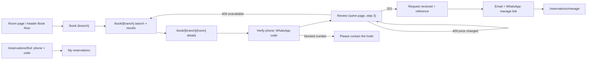

# Booking and operations UI

The booking journey and the staff reservation screens: journey, state, components, accessibility. Status: **Planned**, design accepted 2026-10-24 (built in M8–M10). Routes are listed in [route-map.md](./route-map.md). It reuses the design system ([../design-system.md](./design-system.md), [../component-architecture.md](./component-architecture.md)), the Tailwind tokens in `src/app/globals.css`, and the class helpers in `src/presentation/site/classes.ts` and `src/presentation/admin/ui/`.

## Customer journey

State strategy:

- **Search state** lives in the URL (query parameters), so pages are server-rendered from it. There is no global store.
- **Form state** is local component state (`useState`), because the form submits to the REST API rather than to a Server Action. React Hook Form stays reserved for complex admin forms, per the existing convention.
- **Server state**: Server Components fetch through use cases. Client components call the typed API client (`src/presentation/api-client`). The server is authoritative for availability and price, and the client never computes totals.
- **Double-submit protection**: one `Idempotency-Key` per review step (`crypto.randomUUID()`), kept across retries of the same submission; the button is disabled while in flight; the key is regenerated only when the request content changes.
- **States handled per screen**: loading (skeleton or "Checking availability…" live region), empty ("no room types for these guests"), error (problem `title` plus retry), conflict (`INVENTORY_UNAVAILABLE` with a link back to results; `PRICE_CHANGED` with the new breakdown and an explicit "Accept new total"), and success.

## Components (new)

| Component | Kind | Notes |
| --- | --- | --- |
| `BranchCard` | Server | Reuses card patterns from `site/cards.tsx` |
| `StaySearchForm` | Server form (GET) + small client enhancer | Native `<input type="date">` (accessible, no picker dependency), number steppers as `<input type="number">` with labels |
| `AvailabilityResultCard` | Server | Room summary, availability, total, "see breakdown" `
` |
| `PriceBreakdown` | Server or client | Table of nights, with a caption |
| `GuestDetailsForm` | Client | Field-level errors from `fieldErrors`, `aria-describedby`, error summary with focus on submit failure. The phone field has a country selector and is stored in international format |
| `PhoneVerificationStep` | Client | "Send code by WhatsApp" (API-P9), a 6-digit code input with `autocomplete="one-time-code"` and `inputmode="numeric"`, attempts left, "Send again" after the resend time, and a neutral message for blocked numbers. Entered details are kept if the code expires |
| `MyReservations` | Client | Phone plus code, then the list of that number's reservations (API-G3, G4) |
| `BookingReview` | Client | Final confirmation; request-to-book wording |
| `ReservationStatusBadge` | Shared | Uses `admin/ui/badge.tsx` tokens; the text label is always present, never colour alone |
| Staff `ReservationTable`, `ReservationFilters` | Server + client | Reuse `admin/ui/data-table.tsx`, `list-controls.tsx` |
| Staff `ReservationActions` | Client | Each action in a confirm dialog (`admin/ui/confirm-dialog.tsx`); sends `If-Match` |
| `AvailabilityGrid` | Client (scrollable table) | A real `<table>` with row and column headers, sticky first column, accessible cell text "3 of 5 free" |
| `BlockForm`, `RatePeriodForm` | Client | Inline validation mirrors the server's (errors still come from the server) |
| Staff `SyncReminder` | Client, mounted in the admin shell | Polls API-S29 every 60 seconds and on focus. When the branch is due, it plays a short chime (a static file served by the app) and opens a native modal `<dialog>` (`role="alertdialog"`) that ignores Escape and outside clicks. Its two buttons are "I have synced" (with an optional note) and "I'm syncing now" (API-S28). If sound is blocked, it flashes the tab title instead. A `BroadcastChannel` keeps several tabs to one chime and one answer |
| Staff `GuestProfile`, `GuestSearch` | Server + client | Phone or name search, reservation history, block or unblock with a required reason (Manager and Admin only) |
| Admin `BranchSyncSettings` | Client form | Interval (10–240 minutes, default 30) and follow-up delay (5–60, default 10) per branch |

Feature code lives in `src/presentation/features/booking/` (public) and `src/presentation/admin/{reservations,inventory,pricing,reports,guests,sync}/` (staff). Route files only compose them.

## Accessibility and motion

- WCAG 2.2 AA. One `h1` per page. Steps announced ("Step 2 of 2: Review"). Every error linked to its field. The only time limit is the 10-minute verification code, which is a security measure; entered details are kept and a new code can be requested. The sync reminder dialog moves focus to its first button and announces its message. Focus moves to the result heading after submit.
- Dates are shown with weekday and month names (for example "Sat 14 Nov 2026") in the branch time zone; prices use `Intl.NumberFormat("en-US", { style: "currency", currency: "USD" })`.
- Motion uses the existing `motion` (Framer Motion successor, ADR 012) reveal components only, and respects `prefers-reduced-motion` through the existing `MotionProvider`. GSAP is not needed.
- Tailwind only, no inline `style` props, following the existing rule. The availability grid's sticky columns use Tailwind `sticky` utilities.
- Touch targets ≥ 44 px on the booking journey (the existing phone touch-target test covers new pages).

## CSP impact

None. All requests are same-origin (`connect-src 'self'`), the reminder chime is a same-origin file, and there are no third-party scripts. WhatsApp is called only from the server.
