# Booking and operations UI

The booking journey and the staff reservation screens: journey, state, components, accessibility. Status: **Planned**, design accepted 2026-10-24 and revised 2026-11-06 (immediate confirmation, several units, services, coupon, VAT review, Paymob, cancellation requests; built in M10–M13). Routes are listed in [route-map.md](./route-map.md). It reuses the design system ([../design-system.md](./design-system.md), [../component-architecture.md](./component-architecture.md)), the Tailwind tokens in `src/app/globals.css`, and the class helpers in `src/presentation/site/classes.ts` and `src/presentation/admin/ui/`.

## Customer journey

```mermaid
flowchart LR
  A["Branch site: Book Now"] --> C["/{branch}/book: dates + guests → available rooms & apartments (prices before VAT)"]
  C --> S["Select one or more units"]
  S --> D["/{branch}/book/details: guest details"]
  D --> V["Verify phone: WhatsApp code"]
  V -->|blocked number| X["Please contact the hotel"]
  V --> E["Extras (breakfast, transfer) + coupon"]
  E --> P["Payment choice: Paymob or pay at hotel"]
  P --> R["Review: lines, extras, discount, subtotal, VAT, total, cancellation terms, optional cross-sell"]
  R -->|pay at hotel, 201 CONFIRMED| F["/{branch}/book/confirmed: reference"]
  R -->|Paymob, 201 AWAITING_PAYMENT| K["Paymob hosted checkout"]
  K --> Q["/{branch}/book/payment: server status"]
  Q -->|CONFIRMED| F
  Q -->|PAYMENT_FAILED| N["Payment not completed; units released"]
  R -->|409 unavailable| C
  R -->|409 price changed| R
  F --> G["Email + WhatsApp confirmation: manage link"] --> H["/reservations/manage: view, request cancellation"]
  M["/reservations/find: phone + code"] --> L["My reservations"] --> H
```

State strategy:

- **Search state** lives in the URL (query parameters), so pages are server-rendered from it. There is no global store.
- **Form state** is local component state (`useState`), because the form submits to the REST API rather than to a Server Action. React Hook Form stays reserved for complex admin forms, per the existing convention.
- **Server state**: Server Components fetch through use cases. Client components call the typed API client (`src/presentation/api-client`). The server is authoritative for availability and price, and the client never computes totals.
- **Server state for prices**: every change to units, extras, or coupon re-quotes through API-P6; the review shows exactly the server quote, and `expectedTotal` is the quote's total.
- **Payment return**: the manage token from the `201` response is kept in `sessionStorage` for the return page, which polls API-G1 and shows "Confirmed" only for `CONFIRMED`. The return URL's query string is never trusted.
- **Double-submit protection**: one `Idempotency-Key` per review step (`crypto.randomUUID()`), kept across retries of the same submission; the button is disabled while in flight; the key is regenerated only when the request content changes.
- **States handled per screen**: loading (skeleton or "Checking availability…" live region), empty ("no rooms or apartments for these guests"), error (problem `title` plus retry), conflict (`INVENTORY_UNAVAILABLE` with a link back to results; `PRICE_CHANGED` with the new breakdown and an explicit "Accept new total"), coupon refused (reason in plain words), payment waiting, payment not completed, cancellation window closed, and success. "Confirmed" appears only for a committed `CONFIRMED` status.

## Components (new)

| Component | Kind | Notes |
| --- | --- | --- |
| `BranchCard` | Server | Reuses card patterns from `site/cards.tsx` |
| `StaySearchForm` | Server form (GET) + small client enhancer | Native `<input type="date">` (accessible, no picker dependency), number steppers as `<input type="number">` with labels |
| `AvailabilityResultCard` | Server | Listing summary with Room or Apartment badge, availability, price per night and stay total **before VAT**, units selector, "see breakdown" `
` |
| `BranchChooser`, `BranchSwitcher` | Server + small client disclosure | Chooser cards at `/`; header switcher that keeps the page type (M5) |
| `ServicesPicker` | Client | Breakfast and airport transfer priced by each service's unit (per booking, per night, per person, or per person per night, with child prices where set); nothing preselected |
| `CouponField` | Client | One code; apply re-quotes; refusal reason announced |
| `PaymentChoice` | Client | Paymob or pay at hotel; Paymob hidden when unavailable or the total is zero |
| `PriceSummary` | Server or client | Lines, services, discount, subtotal, VAT (rate shown), total; a `<table>` with caption |
| `CrossSellOffer` | Client | At review, offers skipped services; adds nothing until accepted |
| `PaymentReturnStatus` | Client | Polls API-G1; waiting, confirmed, not completed |
| `CancellationRequestForm` | Client | Before the deadline: reason and confirm; after: branch contact details |
| `PriceBreakdown` | Server or client | Table of nights, with a caption |
| `GuestDetailsForm` | Client | Field-level errors from `fieldErrors`, `aria-describedby`, error summary with focus on submit failure. The phone field has a country selector and is stored in international format |
| `PhoneVerificationStep` | Client | "Send code by WhatsApp" (API-P9), a 6-digit code input with `autocomplete="one-time-code"` and `inputmode="numeric"`, attempts left, "Send again" after the resend time, and a neutral message for blocked numbers. Entered details are kept if the code expires |
| `MyReservations` | Client | Phone plus code, then the list of that number's reservations (API-G3, G4) |
| `BookingReview` | Client | Final review before submit: price with VAT, payment choice, cancellation terms (requests until 24 hours before check-in time), marketing opt-in (unticked), privacy consent |
| `ReservationStatusBadge` | Shared | Uses `admin/ui/badge.tsx` tokens; the text label is always present, never colour alone |
| Staff `ReservationTable`, `ReservationFilters` | Server + client | Reuse `admin/ui/data-table.tsx`, `list-controls.tsx` |
| Staff `ReservationActions` | Client | Each action in a confirm dialog (`admin/ui/confirm-dialog.tsx`); sends `If-Match`; includes "Mark entered in hotel system" and paid-cancellation refund notice |
| Staff `CancellationQueue`, `CancellationDecision` | Server + client | Manager and Admin: open requests, approve (refund notice) or reject (reason), refund status and retry |
| Staff `PmsEntryList` | Server | Website bookings not yet entered in the hotel system, with age highlight |
| Admin `ServicesForm`, `CouponForm`, `VatSetting`, `BroadcastComposer` | Client | M12–M13 commercial and marketing screens |
| `AvailabilityGrid` | Client (scrollable table) | A real `<table>` with row and column headers, sticky first column, accessible cell text "3 of 5 free" |
| `BlockForm`, `RatePeriodForm` | Client | Inline validation mirrors the server's (errors still come from the server) |
| Staff `SyncReminder` | Client, mounted in the admin shell | Polls API-S29 every 60 seconds and on focus. When the branch is due, it plays a short chime (a static file served by the app) and opens a native modal `<dialog>` (`role="alertdialog"`) that ignores Escape and outside clicks. Its two buttons are "I have synced" (with an optional note) and "I'm syncing now" (API-S28). It also shows how many website bookings are not yet entered in the hotel system. If sound is blocked, it flashes the tab title instead. A `BroadcastChannel` keeps several tabs to one chime and one answer |
| Staff `GuestProfile`, `GuestSearch` | Server + client | Phone or name search, reservation history, block or unblock with a required reason (Manager and Admin only) |
| Admin `BranchSyncSettings` | Client form | Interval (10–240 minutes, default 30) and follow-up delay (5–60, default 10) per branch |

Feature code lives in `src/presentation/features/booking/` and `src/presentation/features/branches/` (public) and `src/presentation/admin/{reservations,cancellations,inventory,pricing,services,coupons,reports,guests,sync,broadcasts}/` (staff). Route files only compose them.

## Accessibility and motion

- WCAG 2.2 AA. One `h1` per page. Steps announced ("Step 2 of 2: Review"). Every error linked to its field. The only time limits are the 10-minute verification code and the 15-minute payment hold, both explained before they start; entered details are kept and a new code can be requested. The sync reminder dialog moves focus to its first button and announces its message. Focus moves to the result heading after submit.
- Dates are shown with weekday and month names (for example "Sat 14 Nov 2026") in the branch time zone; prices use `Intl.NumberFormat("en-US", { style: "currency", currency: "USD" })`.
- Motion uses the existing `motion` (Framer Motion successor, ADR 012) reveal components only, and respects `prefers-reduced-motion` through the existing `MotionProvider`. GSAP is not needed.
- Tailwind only, no inline `style` props, following the existing rule. The availability grid's sticky columns use Tailwind `sticky` utilities.
- Touch targets ≥ 44 px on the booking journey (the existing phone touch-target test covers new pages).

## CSP impact

None. All requests are same-origin (`connect-src 'self'`), the reminder chime is a same-origin file, and there are no third-party scripts. WhatsApp and Paymob APIs are called only from the server. Paymob's hosted checkout is a top-level navigation to Paymob's domain, not a frame or script, so `frame-src` stays `https://www.google.com` (maps only) and `form-action` is unaffected because the redirect is a link, not a form post.
