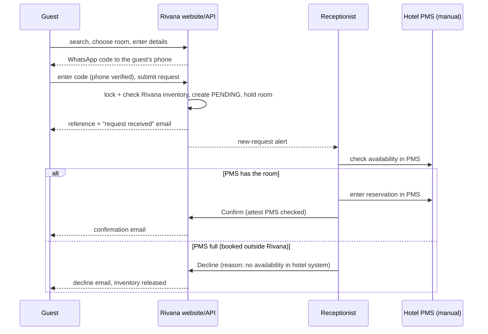

# Stakeholders and workflows

## Stakeholders

| Stakeholder | Interest | Touchpoints |
| --- | --- | --- |
| Hotel owner/client | Bookings, brand, control of prices and staff | Admin dashboard, reports, approvals of open questions |
| Guests | Easy, trustworthy booking; privacy | Website, emails, manage link |
| Receptionists | Fast daily operations; never double-book | Staff dashboard, PMS (outside Rivana) |
| Managers | Occupancy, revenue, staff compliance | Reports, pricing, audit |
| Content editors (if kept) | Website content | CMS |
| External PMS vendor | Not engaged; no API | None |
| Developers/operators | Maintainable code, safe deploys | Repo, docs, cPanel, database provider |

## Workflow 1 — Website request to confirmed booking

## Workflow 2 — Reservation taken in the PMS (phone, OTA, walk-in at another desk)

1. The booking exists in the PMS.
2. A receptionist records it in Rivana as **External** (`POST /staff/external-reservations`) with the PMS reference, within the agreed time.
3. If Rivana accepts it, inventory is consumed and the website will not sell that room-night.
4. If Rivana refuses it with `INVENTORY_UNAVAILABLE`, a **cross-system conflict** exists: Rivana already sold that room-night online. The receptionist follows the escalation procedure ([manual-synchronization-procedure.md](../operations/manual-synchronization-procedure.md)).

## Workflow 3 — Reservation taken by Rivana staff (phone or walk-in at Rivana's desk)

Create it in Rivana first, so it is protected by the lock. Then enter it in the PMS. The record is `CONFIRMED`.

## Workflow 4 — Changes and cancellations

Every change made in one system is mirrored in the other by the same person, in the same sitting. Rivana is updated first when the change frees inventory in Rivana's favor; otherwise both are updated immediately. The audit trail records who changed what in Rivana.

## Workflow 5 — Maintenance

A receptionist blocks the physical room in Rivana (and in the PMS if it tracks room status). Rivana refuses a block that would oversell. Staff then move the affected reservations first.

## Workflow 6 — Sync every 30 minutes

Every interval (default 30 minutes, set by Admin per branch), the dashboard plays a sound and opens a reminder for the signed-in receptionists of the branch. The receptionist compares the reservations created, changed, or cancelled since the last checkpoint in both systems (and, at opening, the next 14 days of arrivals), fixes differences, and answers **"I have synced"**, which records a **sync checkpoint** for the branch. If the sync takes longer, they answer **"I'm syncing now"** and are reminded again after the follow-up delay (Q-20). The manager reviews overdue checkpoints and pending-request ages weekly.

## Workflow 6a — Fake reservations

Online bookings come only from WhatsApp-verified numbers. When staff spot a fake or abusive booking, they decline or cancel it. A Manager or Admin then opens the guest profile and **blocks the number** with a reason. That number can no longer receive codes or book online at any branch (Q-29).

## Workflow 7 — Front desk

Assign rooms the day before or on arrival, check in, check out, and mark no-shows after the cut-off. The PMS is updated the same way per hotel practice.
